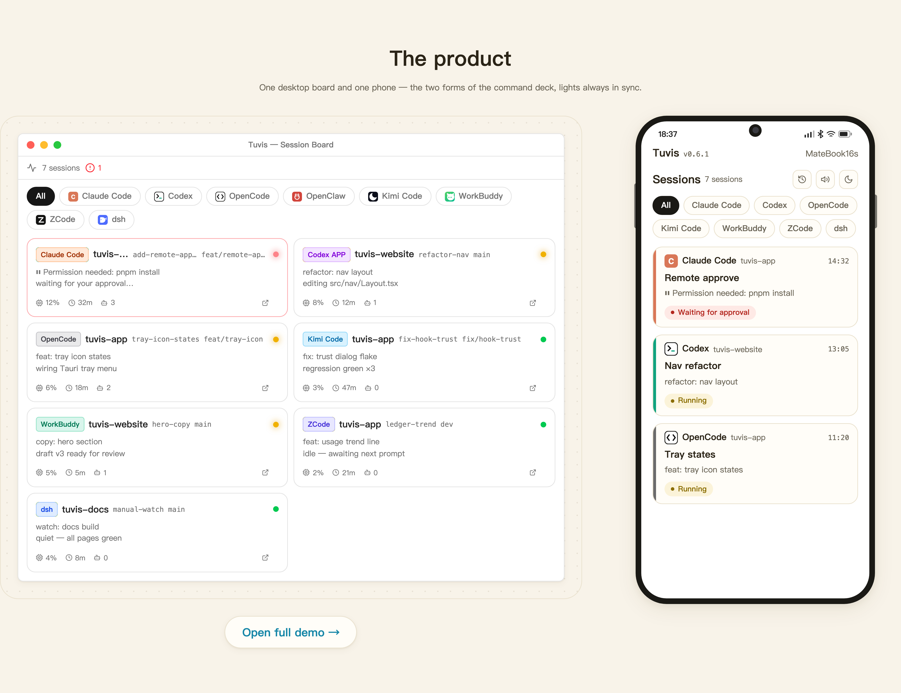
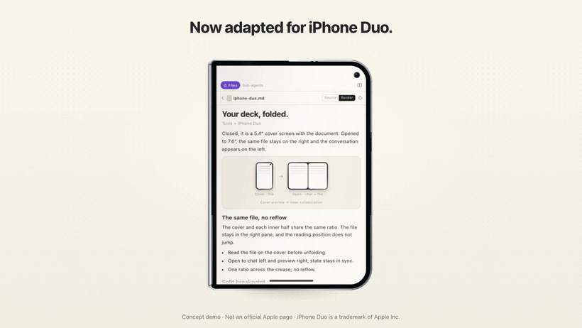
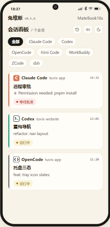

<div align="center">

# Tuvis

**Your desktop mission control for AI coding agents**

Monitor, jump to, and manage Claude Code / Codex CLI / OpenCode / OpenClaw / Kimi Code / WorkBuddy / ZCode / dsh sessions — from your desk or your phone.

[](../../releases/latest)
[](../../releases)
[](../../releases/latest)
[](LICENSE)
[](https://discord.gg/2PBUDYuD5)
[](https://qm.qq.com/q/mgDUzWheCs)

English · [中文](README.zh-CN.md)

[Features](#features) · [Capability Matrix](#capability-matrix) · [Quick Start](#quick-start) · [Roadmap](#roadmap) · [Community](#community)



<b>Now adapted for iPhone Duo.</b>



<i>Concept demo · Not an official Apple page · iPhone Duo is a trademark of Apple Inc.</i>

</div>

## Why Tuvis

- **One board for every agent** — real-time 🔴🟡🟢 traffic-light status for eight AI coding tools (CLI and desktop apps alike), aggregate tray icon, tool filter chips
- **Leave the desk, stay in the loop** — the same board in your phone's browser over four channels (LAN / quick tunnel / own domain / domain-free Tailscale Funnel), PIN-protected; status changes push to your phone in ~2 seconds
- **Act from your phone** (experimental) — send & queue messages, approve tool calls and plans, answer Q&A cards, switch permission modes, even create sessions; every injection is verified by a screen-read receipt — non-delivery is reported honestly, never faked
- **Resources managed once** — Skills / MCP servers / Plugins live in one repository and are mapped into every tool automatically (symlinks + config-format conversion); preset groups switch a whole stack in one click
- **A usage ledger that tells the truth** — token & API-equivalent cost accounting for seven tools in one ledger, with explicitly documented, honestly disclosed semantics
- Built with [Tauri v2](https://v2.tauri.app/) + [React 19](https://react.dev/) — local-first: your data stays in `~/.tuvis/` on your machine

## Features

Step-by-step documentation lives in the **[user manual](docs/product/manual/en/01-overview.md)** (13 chapters). The README is the porch; the manual is the house.

| Feature                              |                                                                                                                                                   | Manual                                                  |
| ------------------------------------ | ------------------------------------------------------------------------------------------------------------------------------------------------- | ------------------------------------------------------- |
| 🎛️ **Session monitoring dashboard**  | Real-time traffic-light board: status, project, branch, last message, CPU — click a card to jump straight to the session's terminal or app window | [Ch. 4](docs/product/manual/en/04-dashboard.md)            |
| 📶 **Remote access & mobile board**  | The same board on your phone, over four simultaneous channels with per-channel setup wizards and one permanent address option                     | [Ch. 8](docs/product/manual/en/08-mobile-remote.md)        |
| 📱 **Remote control** (experimental) | Send & queue messages, approve tool calls and plans, answer Q&A cards, switch permission modes, create sessions — all screen-read verified        | [Ch. 8](docs/product/manual/en/08-mobile-remote.md)        |
| 🕵️ **Sub-agent observatory**         | Live sub-agent chips, a dedicated sub-agent board and execution details in the session view (Claude Code)                                         | [Ch. 5](docs/product/manual/en/05-subagent-observatory.md) |
| 🐰 **Desktop pets**                  | tuvis-3D & Foxbell watch your sessions with status cards and voice alerts; open pet format for custom imports                                     | [Ch. 7](docs/product/manual/en/07-pet.md)                  |
| 🧮 **Token usage ledger**            | One ledger for seven tools: overview, trends, distribution, API-equivalent cost estimates, CSV export                                             | [Ch. 11](docs/product/manual/en/11-usage.md)               |
| ⚡ **Output speed (TPS)**            | Locally sampled streaming TPS + inclusive response throughput, four-range chart with hover readouts; zero speed-test requests                     | [Ch. 11](docs/product/manual/en/11-usage.md)               |
| 🖥️ **Four-tab desktop workspace**    | Main window tabs: Messages / Resources / Usage / Output Speed — each tab keeps its own state                                                      | [Ch. 11](docs/product/manual/en/11-usage.md)               |
| 🔔 **Notifications & sound**         | Change-based desktop notifications with deduplication + Web Audio chimes, clickable to jump to the terminal                                       | [Ch. 6](docs/product/manual/en/06-notifications.md)        |
| 🚀 **Launch at login**               | Shows the real OS-side state (no local cache); silent tray start when auto-launched                                                               | [Ch. 6](docs/product/manual/en/06-notifications.md)        |
| ⚡ **Quick terminal jump**           | Click a card, land in the right terminal tab — even with the same project open twice                                                              | [Ch. 4](docs/product/manual/en/04-dashboard.md)            |
| 🧩 **Extension resource management** | Skills / MCP servers / Plugins in one SSOT repository, auto-imported and format-converted per tool                                                | [Ch. 9](docs/product/manual/en/09-resources.md)            |
| 🎚️ **Preset groups**                 | Bundle skills + MCP + plugins into named presets, apply or revert in one click from the tray                                                      | [Ch. 10](docs/product/manual/en/10-presets.md)             |
| 👥 **Sub-agent resource allocation** | Allocate resource subsets to sub-agents; tool-level disable cascades down automatically                                                           | [Ch. 9](docs/product/manual/en/09-resources.md)            |
| ✅ **Tool toggle management**        | Decide which tools Tuvis monitors and manages; unchecking fully restores and hides the tool                                                       | [Ch. 9](docs/product/manual/en/09-resources.md)            |
| 🩺 **Signal health**                 | Hook trust-gate self-check per tool, with honest per-tool reasons instead of a bare "unregistered"                                                | [Ch. 12](docs/product/manual/en/12-troubleshooting.md)     |

## See it in action

<table>
  <tr>
    <td align="center"><br><sub><b>Mobile board</b> — the same traffic-light board in your phone's browser</sub></td>
    <td align="center"><br><sub><b>Session detail</b> — messages, files and sub-agents in one view</sub></td>
    <td align="center"><br><sub><b>Remote approvals</b> — approve tool calls &amp; plans from your phone</sub></td>
  </tr>
  <tr>
    <td align="center"><br><sub><b>Usage ledger</b> — tokens &amp; costs for seven tools, honestly accounted</sub></td>
    <td align="center"><br><sub><b>Desktop pets</b> — status cards &amp; voice alerts in the corner of your screen</sub></td>
    <td align="center"><br><sub><b>Remote access</b> — four channels, each with its own setup wizard</sub></td>
  </tr>
</table>

## Capability Matrix

13 capability rows × 8 terminal-class AI coding tools (✅ supported / ◐ partial / 🧪 experimental / ❌ not supported) — the master table, updated with every release. Structured source: [`docs/capabilities.json`](docs/capabilities.json), shared with the website.

| Capability                               | Claude Code | Codex CLI   | OpenCode | OpenClaw | Kimi Code    | WorkBuddy | ZCode           | dsh         |
| ---------------------------------------- | ----------- | ----------- | -------- | -------- | ------------ | --------- | --------------- | ----------- |
| Session monitoring                       | ✅          | ✅          | ✅       | ✅       | ✅           | ✅        | ✅              | ✅          |
| Desktop notifications                    | ✅          | ✅          | ✅       | ✅       | ✅           | ✅        | ✅              | ✅          |
| Skill management                         | ✅          | ✅          | ✅       | ✅       | ✅           | ✅        | ✅              | ◐ read-only |
| MCP management                           | ✅ JSON     | ✅ TOML     | ✅ JSONC | ✅ JSON  | ✅ JSON      | ✅ JSON   | ✅ JSON subtree | ❌          |
| Plugin management                        | ✅          | ✅          | ✅       | ✅       | ◐ file-based | ❌        | ❌              | ❌          |
| Status hooks                             | ✅          | ✅          | ❌       | ❌       | ✅           | ❌        | ❌              | ❌          |
| Mobile · message viewing                 | ✅          | ✅          | ✅       | ❌       | ✅           | ✅        | ✅              | ✅          |
| Mobile · file preview                    | ✅          | ✅          | ✅       | ❌       | ✅           | ✅        | ✅              | ✅          |
| Mobile · send messages (injection)       | 🧪          | 🧪          | 🧪       | ❌       | 🧪           | ❌        | ❌              | ❌          |
| Mobile · create sessions                 | 🧪          | 🧪          | 🧪       | ❌       | 🧪           | ❌        | ❌              | ❌          |
| Token usage collection                   | ✅          | ✅          | ✅       | ❌       | ✅           | ✅        | ✅              | ✅          |
| Output speed (TPS sampling)              | ◐ approx    | ◐ resp-only | ◐ plugin | ❌       | ✅           | ✅        | ✅              | ✅          |
| Mobile · sub-agent observatory           | ✅          | ❌          | ❌       | ❌       | ❌           | ❌        | ❌              | ❌          |
| Mobile · Codex APP control (Desktop IPC) | ❌          | 🧪          | ❌       | ❌       | ❌           | ❌        | ❌              | ❌          |

> **0.6.3 flagship: Codex Desktop adaptive control.** Per-operation contract evidence, grouped async answering, and a persistent queue-pause safety valve — no headless fallback and no guessed approvals. The matrix marks verified vs experimental; exact limits (Plan mode and permissions remain unsupported) are stated in [Ch. 8](docs/product/manual/en/08-mobile-remote.md).

## Quick Start

**Just want to use it?** Download the latest installer from [**Releases**](../../releases/latest) — Windows (NSIS installer) and macOS are available. First-run setup requires no command line.

<details>
<summary><strong>Build from source (developers)</strong></summary>

Prerequisites: [Node.js](https://nodejs.org/) ≥ 18 · [pnpm](https://pnpm.io/) ≥ 8 · [Rust](https://www.rust-lang.org/tools/install) ≥ 1.77 · [Tauri v2 CLI](https://v2.tauri.app/start/prerequisites/)

```bash
git clone https://github.com/jarvislee90s-dot/tuvis.git
cd tuvis
pnpm install
pnpm tauri:dev      # development mode (Rust + Vite HMR)
pnpm tauri:build    # release build (Windows NSIS installer)
pnpm check          # format:check + lint + build
```

- **macOS dev builds**: before the first "resume session" window focus, allow Tuvis to control Terminal / iTerm2 once under System Settings → Privacy & Security → Automation (TCC may not prompt automatically).
- **Helper binaries are feature-gated**: `pnpm tauri:dev` / `pnpm tauri:build` already include the required features; standalone builds need `--features hook-listener` (see [AGENTS.md](AGENTS.md)).

</details>

## Roadmap

- **Linux support**
- **Kitty & WezTerm terminal jump**
- **Remote control beyond experimental** — full tool coverage for injection & session creation

## Community

Two hangouts, same team behind both — feedback gathered there is triaged monthly into the public backlog.

| QQ group (中文)                                                                                                                                     | Discord (international)                                                                                                                   |
| --------------------------------------------------------------------------------------------------------------------------------------------------- | ----------------------------------------------------------------------------------------------------------------------------------------- |
| <br>Group **1131682176** · [join link](https://qm.qq.com/q/mgDUzWheCs) | <br>[discord.gg/2PBUDYuD5](https://discord.gg/2PBUDYuD5) |

Prefer staying on GitHub? **[Discussions](../../discussions)** is the public feedback pool (Ideas / Q&A / Announcements) and **[Issues](../../issues/new/choose)** is for bug reports. When reporting a problem, please include the app version, the in-app **error code** (every error carries one since v0.5.8, English & 中文), and steps or screenshots.

> The **only official distribution** of Tuvis is this repository's [GitHub Releases](../../releases) — downloads offered anywhere else are third-party redistributions. Brand usage guidelines: [TRADEMARK.md](TRADEMARK.md).

## Contributing

Pull requests are welcome! Please read [AGENTS.md](AGENTS.md) for the project architecture and development guidelines first, then fork → branch → PR.

## License & Legal

Released under the [MIT License](LICENSE). Forks and derivatives are welcome — keep the original copyright notice, and optionally note “based on Tuvis” with a link back so users can identify the upstream; brand-name and logo boundaries are described in [TRADEMARK.md](TRADEMARK.md).

Tuvis is an independent open-source project, not affiliated with or endorsed by Anthropic (Claude / Claude Code), OpenAI (Codex), OpenCode, OpenClaw, Moonshot AI (Kimi Code), WorkBuddy, ZCode, dsh, or any other product it monitors. All product names and trademarks belong to their respective owners and are used here solely to describe compatibility.
