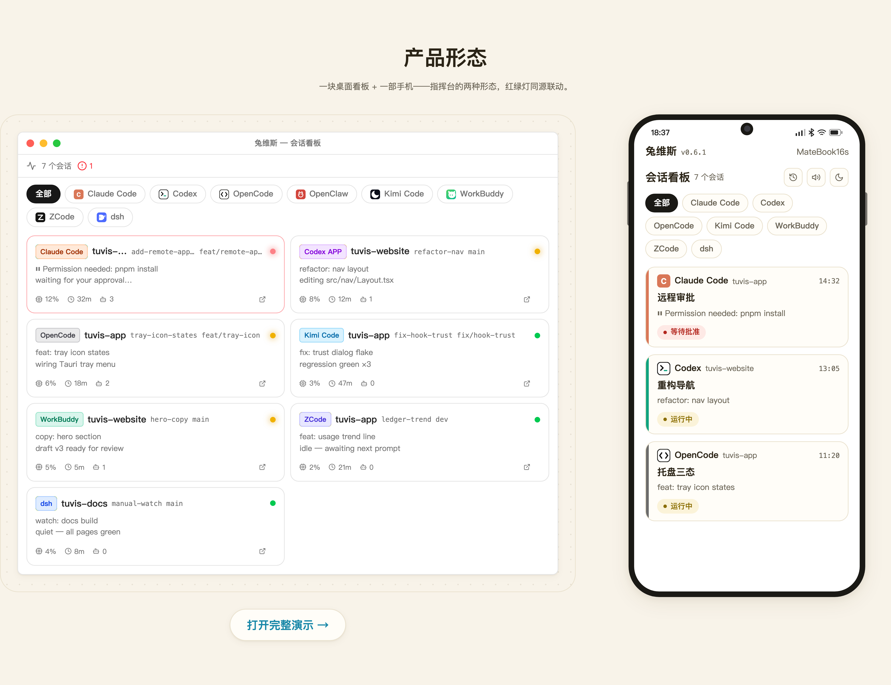

<div align="center">

# 兔维斯（Tuvis）

**你的桌面多 Agent 指挥台**

一站式监控、跳转、管理 Claude Code / Codex CLI / OpenCode / OpenClaw / Kimi Code / WorkBuddy / ZCode / dsh 会话——人可以离开桌面，Agent 不停工。

[](../../releases/latest)
[](../../releases)
[](../../releases/latest)
[](LICENSE)
[](https://discord.gg/2PBUDYuD5)
[](https://qm.qq.com/q/mgDUzWheCs)

[English](README.md) · 中文

[功能概览](#功能概览) · [能力矩阵](#能力矩阵) · [快速开始](#快速开始) · [路线图](#路线图) · [社区](#社区)



<b>现已适配 iPhone Duo.</b>


<i>概念演示 · 非 Apple 官方页面 · iPhone Duo 为 Apple Inc. 商标</i>

</div>

## 为什么是 Tuvis

- **一块看板管所有 Agent**——八个 AI 编程工具（CLI 与桌面 APP 一视同仁）的实时 🔴🟡🟢 红绿灯，托盘聚合状态、按工具筛选
- **人离开桌面，不掉线**——手机浏览器打开同源看板，四条通道任选（局域网 / 临时隧道 / 自有域名 / 免域名的 Tailscale Funnel），访问密码保护；状态变化约 2 秒推送到手机
- **手机上直接操作**（试验性）——发消息与排队、批准工具调用与计划、答问答卡、切权限模式、新建会话；每条注入都走屏读回执闭环，未送达如实告知，绝不谎报
- **资源只管一份**——Skill / MCP / 插件统一仓库，自动映射进每个工具（符号链接 + 配置格式转换）；预设组一键切换整套组合
- **一本说真话的用量账本**——七个工具的 token 与 API 等效费用统一记账，口径全部明文、如实披露
- 基于 [Tauri v2](https://v2.tauri.app/) + [React 19](https://react.dev/) 构建——本地优先：数据只留在你机器的 `~/.tuvis/`

## 功能概览

逐步操作说明都在**[用户手册](docs/product/manual/zh/01-overview.md)**（13 章）里。README 是门厅，手册才是家。

| 功能                       |                                                                                   | 手册                                                      |
| -------------------------- | --------------------------------------------------------------------------------- | --------------------------------------------------------- |
| 🎛️ **会话监控看板**        | 实时红绿灯看板：状态、项目、分支、最后消息、CPU——点卡片直达会话所在终端或应用窗口 | [第 4 章](docs/product/manual/zh/04-dashboard.md)            |
| 📶 **远程接入与移动看板**  | 手机打开同一块看板，四条通道可同时开启，各带配置向导，可选永久地址                | [第 8 章](docs/product/manual/zh/08-mobile-remote.md)        |
| 📱 **远程操控**（试验性）  | 发消息与排队、审批工具调用与计划、答问答卡、切权限模式、新建会话——全部屏读核验    | [第 8 章](docs/product/manual/zh/08-mobile-remote.md)        |
| 🕵️ **子 Agent 观察台**     | 会话视图内实时显示后台子 Agent：运行 chip、独立看板与执行过程详情（Claude Code）  | [第 5 章](docs/product/manual/zh/05-subagent-observatory.md) |
| 🐰 **内置桌宠**            | tuvis-3D 与 Foxbell 盯着所有会话：状态卡片 + 原声语音提醒；桌宠格式开放可导入     | [第 7 章](docs/product/manual/zh/07-pet.md)                  |
| 🧮 **Token 用量账本**      | 七个工具统一记账：总览、趋势、分布、API 等效费用估算、CSV 导出                    | [第 11 章](docs/product/manual/zh/11-usage.md)               |
| ⚡ **输出速度（TPS）**     | 本机采样的流式 TPS + 含等待响应吞吐双口径，四档区间图，悬停读数；零测速请求       | [第 11 章](docs/product/manual/zh/11-usage.md)               |
| 🖥️ **桌面四页同窗**        | 主窗口四页签：消息看板 / 工具资源 / 模型用量 / 输出速度，切页保留各自状态         | [第 11 章](docs/product/manual/zh/11-usage.md)               |
| 🔔 **通知与提示音**        | 状态变化触发桌面通知（带去重）+ Web Audio 提示音，点通知直达终端                  | [第 6 章](docs/product/manual/zh/06-notifications.md)        |
| 🚀 **开机自启动**          | 显示的是系统真实状态（不落本地缓存）；自启拉起时静默进托盘                        | [第 6 章](docs/product/manual/zh/06-notifications.md)        |
| ⚡ **快速跳转终端**        | 点卡片直达对应终端标签页——同项目双开也能锁定不弹窗                                | [第 4 章](docs/product/manual/zh/04-dashboard.md)            |
| 🧩 **扩展资源统一管理**    | Skill / MCP / 插件统一仓库，首次启动自动导入、按工具自动转换配置格式              | [第 9 章](docs/product/manual/zh/09-resources.md)            |
| 🎚️ **预设组一键切换**      | Skill + MCP + 插件打包为命名预设组，托盘菜单一键应用/还原                         | [第 10 章](docs/product/manual/zh/10-presets.md)             |
| 👥 **子 Agent 级资源分配** | 给子 Agent 分配资源子集；工具级禁用自动级联到全部子 Agent                         | [第 9 章](docs/product/manual/zh/09-resources.md)            |
| ✅ **工具勾选管理**        | 决定哪些工具纳入监控与管理；取消勾选彻底还原并隐藏                                | [第 9 章](docs/product/manual/zh/09-resources.md)            |
| 🩺 **信号健康度**          | 各工具 Hook 信任门自查，未就绪时给出如实原因而非干巴巴的「未注册」                | [第 12 章](docs/product/manual/zh/12-troubleshooting.md)     |

## 产品一览

<table>
  <tr>
    <td align="center"><br><sub><b>手机看板</b>——手机浏览器里同一块红绿灯看板</sub></td>
    <td align="center"><br><sub><b>会话详情</b>——消息、文件、子 Agent 一页看全</sub></td>
    <td align="center"><br><sub><b>远程审批</b>——手机上批准工具调用与计划</sub></td>
  </tr>
  <tr>
    <td align="center"><br><sub><b>用量账本</b>——七个工具的 Token 与费用，口径如实</sub></td>
    <td align="center"><br><sub><b>内置桌宠</b>——屏幕角落的状态卡片与原声语音</sub></td>
    <td align="center"><br><sub><b>远程接入</b>——四条通道，各带配置向导</sub></td>
  </tr>
</table>

## 能力矩阵

13 行能力 × 8 个终端类 AI 编程工具（✅ 支持 / ◐ 部分 / 🧪 试验性 / ❌ 不支持）——能力总表，随每次发版更新。结构化源：[`docs/capabilities.json`](docs/capabilities.json)，与官网同源。

| 能力                                     | Claude Code | Codex CLI | OpenCode | OpenClaw | Kimi Code | WorkBuddy | ZCode        | dsh    |
| ---------------------------------------- | ----------- | --------- | -------- | -------- | --------- | --------- | ------------ | ------ |
| 会话监控                                 | ✅          | ✅        | ✅       | ✅       | ✅        | ✅        | ✅           | ✅     |
| 桌面通知                                 | ✅          | ✅        | ✅       | ✅       | ✅        | ✅        | ✅           | ✅     |
| Skill 管理                               | ✅          | ✅        | ✅       | ✅       | ✅        | ✅        | ✅           | ◐ 只读 |
| MCP 管理                                 | ✅ JSON     | ✅ TOML   | ✅ JSONC | ✅ JSON  | ✅ JSON   | ✅ JSON   | ✅ JSON 子树 | ❌     |
| 插件管理                                 | ✅          | ✅        | ✅       | ✅       | ◐ 文件型  | ❌        | ❌           | ❌     |
| 状态 Hook                                | ✅          | ✅        | ❌       | ❌       | ✅        | ❌        | ❌           | ❌     |
| 手机 · 消息查看                          | ✅          | ✅        | ✅       | ❌       | ✅        | ✅        | ✅           | ✅     |
| 手机 · 文件预览                          | ✅          | ✅        | ✅       | ❌       | ✅        | ✅        | ✅           | ✅     |
| 手机 · 发消息（注入）                    | 🧪          | 🧪        | 🧪       | ❌       | 🧪        | ❌        | ❌           | ❌     |
| 手机 · 新建会话                          | 🧪          | 🧪        | 🧪       | ❌       | 🧪        | ❌        | ❌           | ❌     |
| Token 用量采集                           | ✅          | ✅        | ✅       | ❌       | ✅        | ✅        | ✅           | ✅     |
| 输出速度（TPS 采样）                     | ◐ 近似      | ◐ 仅响应  | ◐ 插件   | ❌       | ✅        | ✅        | ✅           | ✅     |
| 手机 · 子 Agent 观察台                   | ✅          | ❌        | ❌       | ❌       | ❌        | ❌        | ❌           | ❌     |
| 手机 · Codex APP 远程控制（Desktop IPC） | ❌          | 🧪        | ❌       | ❌       | ❌        | ❌        | ❌           | ❌     |

> **0.6.3 重磅：Codex 桌面端自适应控制。** 按操作契约证据放行、同组异步题一次提交、队列暂停保护；不做 headless 兜底、不猜审批。矩阵区分已验证与试验性；Plan 模式与权限切换仍不支持的边界，在手册[第 8 章](docs/product/manual/zh/08-mobile-remote.md)如实写明。

## 快速开始

**只想用？** 到 [**Releases**](../../releases/latest) 下载最新安装包——提供 Windows（NSIS 安装包）与 macOS，全程不需要命令行。

<details>
<summary><strong>从源码构建（开发者）</strong></summary>

环境要求：[Node.js](https://nodejs.org/) ≥ 18 · [pnpm](https://pnpm.io/) ≥ 8 · [Rust](https://www.rust-lang.org/tools/install) ≥ 1.77 · [Tauri v2 CLI](https://v2.tauri.app/start/prerequisites/)

```bash
git clone https://github.com/jarvislee90s-dot/tuvis.git
cd tuvis
pnpm install
pnpm tauri:dev      # 开发模式（Rust + Vite HMR）
pnpm tauri:build    # 构建发布版（Windows NSIS 安装包）
pnpm check          # 格式检查 + lint + 构建
```

- **macOS 开发版**：首次使用「一键恢复会话」开窗前，需在 系统设置 → 隐私与安全性 → 自动化 中手动允许兔维斯控制 Terminal / iTerm2 一次（TCC 不会自动弹窗）。
- **Helper 二进制挂 feature 门**：`pnpm tauri:dev` / `pnpm tauri:build` 已内置所需 feature；单独构建 helper 需显式 `--features hook-listener`（详见 [AGENTS.md](AGENTS.md)）。

</details>

## 路线图

- **Linux 支持**
- **Kitty & WezTerm 终端跳转**
- **远程操控走出试验性**——注入与新建会话覆盖全部可注入工具

## 社区

两个据点，同一拨人在维护——群里的反馈每月整理一次进公开 backlog。

| QQ 群（中文）                                                                                                                                | Discord（国际）                                                                                                                          |
| -------------------------------------------------------------------------------------------------------------------------------------------- | ---------------------------------------------------------------------------------------------------------------------------------------- |
| <br>群号 **1131682176** · [加群链接](https://qm.qq.com/q/mgDUzWheCs) | <br>[discord.gg/2PBUDYuD5](https://discord.gg/2PBUDYuD5) |

习惯留在 GitHub？**[Discussions](../../discussions)** 是公开反馈池（Ideas / Q&A / Announcements），bug 请走 **[Issues](../../issues/new/choose)**。反馈问题时请附：应用版本 + 应用内**错误码**（v0.5.8 起所有报错自带，中英文案齐备）+ 复现步骤或截图。

> 兔维斯 **唯一的官方发布渠道**是本仓库的 [GitHub Releases](../../releases)——任何其他网站或渠道提供的下载均为第三方分发。品牌使用规范见 [TRADEMARK.md](TRADEMARK.md)。

## 参与贡献

欢迎提交 Pull Request！请先阅读 [AGENTS.md](AGENTS.md) 了解项目架构与开发规范，然后 fork → 建分支 → 提 PR。

## 许可证与声明

本项目基于 [MIT 许可证](LICENSE)开源。欢迎 fork 与二次开发——分发时请保留原版权声明与许可证文本，并欢迎（非强制）注明「基于兔维斯（Tuvis）二次开发」回链本仓库；品牌名称与 Logo 的使用边界见 [TRADEMARK.md](TRADEMARK.md)。

兔维斯 是一个独立的开源项目，与 Anthropic（Claude / Claude Code）、OpenAI（Codex）、OpenCode、OpenClaw、月之暗面（Kimi Code）、WorkBuddy、ZCode、dsh 及其监控的其他任何产品均无关联、未获其背书。文中出现的名称与商标归其各自所有者所有，仅用于描述兼容性。
