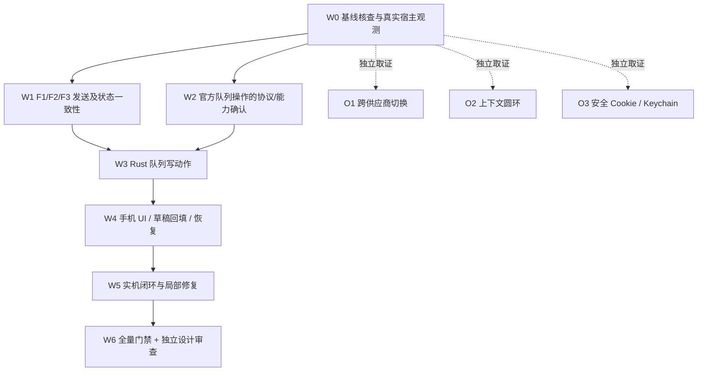

# ZCode 手机远控下一轮实施规格与工程施工单（v2）

> 日期：2026-10-31  
> 项目：`jarvislee90s-dot/tuvis` · PR [#190](https://github.com/jarvislee90s-dot/tuvis/pull/190) · `codex/zcode-unified-remote`  
> **冻结审查基线**：`f81f062e7d5493f947c6d3dbe0dc5729c95ffb77`（开始改动前必须重新检查 HEAD，本文行号以此版本为准）  
> 上位规范：`AGENTS.md`、`docs/MASTER-PLAN.md`（不得自行修改）、`docs/superpowers/specs/2026-10-24-zcode-unified-remote-design.md`、`docs/superpowers/specs/2026-10-28-zcode-capability-parity-spec.md`  
> 用户需求及上轮结论：`2026-10-31-zcode-next-round-review-and-change-proposals.md`；旧任务 `docs/superpowers/plans/2026-10-29-zcode-session-ui-repair.md`  
> 协议证据：`docs/superpowers/reviews/2026-10-29-zcode-r0-wire-evidence.md`，取自 ZCode `3.16.2.8769` 的**静态源码/安装包取证**，不代表当前实机写命令已经验证成功。  
> **性质**：详细设计 + 可执行施工单 + 建议代码骨架；本文件未修改产品源码、未编译或跑实机。示例不是可直接盲贴的完整补丁。所有未知宿主载荷先通过当前 build 验证。

---

## 0. 给执行 Agent 的总指令（开始施工先读）

**产品交付判据**：用户在手机 ZCode 会话中，能看到每个排队项目的 `序号 | 前20字… | 引导 | 修改 | 撤回`；能调整队列优先级；打断后如官方队列暂停，能明确点击“恢复运行”；新输入不会假成功、重复发送或无声卡在队列。上轮 F1～F5 修复一并纳入。跨供应商/上下文圆环/安全 Cookie 为三个独立可选任务，先做证据判定，**不能拖累主线**。

**本轮禁止**：重写 ZCode 官方桥、开第二连接、经自建网关传 API Key、硬编码权限全开、伪造队列、自动重复发送未知结果、把 `sendQueuedNow` 未经验证称作 `guide`、把累计 token 伪装为上下文占用；禁止为不弹 Keychain 授权而存明文、全应用开放凭据；不自动 push、merge、tag、发布。

**工程执行方式**：沿用 Superpowers 的 `brainstorming/spec → writing-plans → executing-plans/subagent-driven-development → code-review` **产物结构**，但每个任务改为 `阅读真实调用链 → 最小复现/脱敏观测 → 最小实现 → 定向验证 → 复盘/独立复审`。**不强制先写 RED 测试**；关键安全不变量、竞态和回归必须最终有自动化用例。每个小阶段提交之前至少做定向验证，完成全批后由新上下文 reviewer 复审。

### 0.1 工作区与起步命令

```bash
# 从 AGENTS.md 指定的工作区执行，勿覆盖用户现场；仅示意操作顺序
git status --short
git branch --show-current
git rev-parse HEAD
git log -1 --oneline
# 核对实际路径与函数；发现改名/改过形状先更新施工单，不强套旧行号
rg -n 'ControlAction|ActionReceipt|execute_send|classify_ack|applySessionView|QueueView|setAutoDrain' \
  src-tauri/src/services/zcode_control src/mobile src/lib/api/zcodeControl.ts
```

如当前 HEAD 已变，先 `git diff f81f062e..HEAD --` 针对本单涉及文件核查，不覆盖他人修改。使用用户已有工作区；依照 `AGENTS.md`，必要的 worktree 仅建在指定目录。**不要求修改 `AGENTS.md` 或 `MASTER-PLAN.md`。**

### 0.2 任务分组、依赖与停止门



W0 未确认的命令只能进入 debug evidence/probe，不得生产开闸。W1、W3、W4 是主线必做；引导命令若与用户语义不一致，可先交付**禁用并解释原因**，但**不能宣称三按钮全可用**。三个 O 类可独立停止，无需阻塞 W6。

---

## 1. 真实代码调用图（防止 Agent 只改 UI）

```text
官方 ZCode state.updated/snapshot
  → bridge.rs::BridgeManager::on_data_outcome
  → projection.rs::Projection::apply / parse_queue
  → types.rs::SessionView{queue, selection, capabilities, revision}
  → hub.rs::session / apply_relay_session → HTTP GET + SSE
  → useZcodeControl.ts::applySessionView / applyRead
  → ZcodeControlPanel.tsx
      └─ ZcodeQueuePanel.tsx  [当前仅只读，props={queue}]

手机点击动作
  → src/lib/api/zcodeControl.ts::postZcodeAction(actionId, action)
  → src-tauri/src/remote/zcode.rs [或实际注册的 actions handler；先定位]
  → hub.rs::ZcodeHub::execute
      → backend.existing_receipt / check_policy / bind_session
      → command.rs::CommandSender::execute_with_permits
      → command.rs::execute_{send,stop,selection,...}
      → CommandPort::call(官方 command envelope)
      → action.rs::ActionStore::record_result / audit
  → ActionReceipt → useZcodeControl / UI
```

**改一个 `ControlAction` 变体须同步以下位置**：

| 层 | 具体必改函数/数据结构 | 防漏理由 |
|---|---|---|
| Rust DTO | `types.rs::ControlAction`、`kind()`、`session_id()`、`generation()` | 否则反序列化/枚举 exhaustive match 失败 |
| 动作幂等 | `action.rs::action_params()`、`audit_summary()`、`ActionStore::reserve_with_kind/record_result` | 参数缺字段会导致重放同 actionId 判定失真；正文不得入日志 |
| 宿主派发 | `command.rs::CommandSender::execute_with_permits()`、`required_capabilities()`、新增 `execute_queue_*()` | 当前仅 6 类，队列类不在 match 中 |
| Hub 权限 | `hub.rs::ZcodeHub::execute()`、`check_policy()`、`confirmation_capabilities`、后端 `required_capabilities` | 双层能力闸，漏任一处会被拒/错误登记确认 |
| 当前状态读 | `bridge.rs::session()` + `projection.rs` + `types.rs::QueueView` | 必须从**新鲜官方状态**定位目标，不信任前端屏幕上的旧序号 |
| 手机协议 | `src/lib/api/zcodeControl.ts::{ControlAction,SessionView,QueueView,ActionReceipt}` | Rust/TS tagged union 一致 |
| 前端 | `ZcodeControlPanel.tsx`、`ZcodeQueuePanel.tsx`、`useZcodeControl.ts` | 可操作状态、pending、错误、草稿、回执、切会话 |
| 回归 | `tests/mobile/ZcodeQueuePanel.test.tsx`、`tests/mobile/ZcodeControlPanel.test.tsx`、Rust `wire_e2e.rs` 等 | 不得只新增 mock 的绿色按钮截图 |

### 1.1 当前已核实的精确缺口

- `types.rs:342–395` 的 `ControlAction` 没有队列动作；`types.rs:897–925` 的队列 DTO 只有 `input_id/text/position` 和 `known/paused/pause_reason/items`。
- `ZcodeQueuePanel.tsx:46` 仅接受 `{queue}`；队列文字在 `:90` 起完整呈现，且无点击操作。
- `projection.rs:313–363` 已正确透传官方 `queueItemId`，不能换成数组下标/正文哈希。
- `command.rs:627–668` 发送时只根据 activeWorks 判断是否带 `requestedDelivery="queue"`，未消费 `state.inputRouting`。
- `command.rs:344–352` `classify_ack` 只看 `status`；`dispatch_send:1468–1508` 丢弃 `result.type/delivery/inputId`。
- `useZcodeControl.ts:195–203` 对同代 `revision` 不比较，GET 可覆盖更新 SSE；`:490–494` 仅收到 `accepted` 就允许清草稿。
- `selection.rs:26–59,200–265` 只允许当前 provider；不能只增前端下拉实现跨供应商。
- `credential_store.rs:260–305` 使用 macOS Keychain (`com.jarvis.tuvis.zcode`/`dev`)，正式发布签名仍需核查。

---

## 2. W0：先确认真实协议和 bug 复现，不要凭想象写 Rust 命令

**只读观测点**（测试使用合成正文 `alpha/beta/gamma`；日志严禁 JWT、cookie、正文、附件路径）：

1. ZCode 运行 A 时向同会话发送 B、C，收集脱敏的 `state.queue`：`queueItemId`、`dispatch.state`、`kind`、`autoDrain`、`pauseReason`、`inputRouting.mode`、`availability` 允许值、`revision/toSeq`。
2. 打断 A，记录 B/C 是否仍在、`autoDrain=false` 是否出现；此时发送 D，记录**提交的信封意图和原样 ACK 结构类型/状态/原因**（只记录 `status`、`result.type`、`result.delivery`、原因码，不记录原文）。
3. 使用官方页面完成一次撤回/队列操作（由用户自愿在测试会话操作），观察官方发出的命令**名称、通道、payload 字段与实际状态变化**，优先验证：
   - `deleteQueueItem {queueItemId}`
   - `reorderQueueItem {queueItemId,beforeQueueItemId}`
   - `sendQueuedNow {queueItemId,...?}`
   - `setAutoDrain {autoDrain:true}`
   - `editQueueItem {queueItemId,newText}`（仅作为官方能力证据；**不是本次“修改”语义**）
4. 观察 `state.availability.queueEdit` / `sendQueuedNow` 是否有 `allowed`，以及操作被拒时的原因码。**`setAutoDrain` 是否也有 availability 字段尚未确认，不得捏造。**
5. 验证运行中 `sendQueuedNow` 是否真是“引导当前回合”还是“立即开启另一条”；记录对现有 A 的影响、原 B 是否仍在队列、是否重复消息。如两者不等价，不能把 `sendQueuedNow` 绑定到“引导”按钮。

**留证文件建议**：`docs/superpowers/reviews/2026-10-31-zcode-queue-debug-evidence.md`，只记录 build、字段形状、操作类型、官方状态迁移、脱敏 reasonCode、成功/失败。若无法在本环境实机操作，则明确标记 `NOT RUN`，用静态取证支持代码骨架但生产能力维持关闭。

**证据门**：任何安全/写入类动作先核实官方当前 build 的命令结构；绝不从 `CommandPort::call` 成功返回推断“官方效果已发生”。

---

## 3. W1：上轮 P1 的三项修复（应先于队列 UI）

### 3.1 F1：修复 GET/SSE 同代视图倒退

**要改**：`src/mobile/useZcodeControl.ts::applySessionView` 与 `applyRead`、SSE 事件入口；`src-tauri/src/services/zcode_control/hub.rs::session` 的写回 `inner.last_session`；必要时补投影的状态序列号。`SessionView.revision: number|null` 已存在，无须新造“更新时刻”。

**现状问题**：`view.generation < generationRef.current.session` 是唯一时序条件。即便 SSE `revision=12` 已生效，慢 GET 的 `revision=11` 仍可能覆盖，令队列“复活”/暂停按钮时有时无。**必须区分业务 revision 与连接安全降级**：`ready=false` 可以由确切的同步失败/断线触发，即使没有可比较 revision，也必须关写面；不能简单 `if (revision <= latest) return` 把降级和权威恢复一起屏蔽。

**建议代码骨架（React/TS，非整文件 patch）**：

```ts
// useZcodeControl.ts 顶层 hook 内；会话/代际变更时复位
const latestAppliedRef = useRef<{
  sessionId: string;
  generation: number;
  revision: number | null;
} | null>(null);

type SessionOrigin = "sse" | "get" | "safety-degrade";

const applySessionView = useCallback(
  (view: SessionView, origin: SessionOrigin): boolean => {
    if (view.sessionId !== sessionRef.current) return false;
    if (view.generation < generationRef.current.session) return false;

    const last = latestAppliedRef.current;
    const same = last?.sessionId === view.sessionId &&
      last.generation === view.generation;

    // 真正的安全降级单独走闸门；绝不能把一个迟到的普通 GET 误当降级事件。
    if (origin === "safety-degrade") {
      // 实际实现须保留既有恢复 GET / retry 预算，并清本代写能力；
      // 切勿在这里简单 setSession(view) 以致旧业务正文重写。
      // ... call existing degradation handler ...
    }

    if (same && last?.revision != null && view.revision != null &&
        view.revision < last.revision) return false;
    // 同 revision 但能力矩阵不同：允许权威 GET 恢复能力，
    // 但不能无条件覆盖新事件的 pending/queue；需合并来源/同序投影。
    // revision=null 的 ready=true 不可自动覆盖已有可靠数字 revision。

    latestAppliedRef.current = {
      sessionId: view.sessionId,
      generation: view.generation,
      revision: view.revision,
    };
    generationRef.current.session = view.generation;
    setSession(view);
    return true;
  }, []
);
```

以上只是**方向**：实际写法应优先抽出可测试的纯函数 `shouldApplySessionView(current, incoming, origin)`；接回现有 `staleRefreshRef/recoveryRefreshRef`。**不能用此骨架覆盖既有恢复逻辑。**`ready=false` 的真源（Hub SSE 失效、连接态降级）应使用独立“安全先行、内容不倒退”的降级通知；GET 相对旧时不能恢复旧业务内容。

**Rust 服务端**：在 `hub.rs::session` 对 `inner.last_session` 做同会话/同 generation 的 revision 比较；已发出的 `last_session` 更新则不要用异步 GET 的旧快照覆盖。若 GET 的 `ready=false` 代表实时故障，以独立降级广播/全关能力处理。**警惕**：`last_session` 可能属于另一会话；其比较条件必须带 `session_id`，不能全局简单大于。更稳妥的是为每会话维护 `last_seen_revision + connection_epoch` 而非只拿最后一份会话。

**定向用例**：`SSE(rev12) → GET(rev11)`、`GET(rev12) → SSE(rev12)`、`SSE(ready=false,revision=null) → GET恢复`、跨会话、换代、丢帧后恢复；特别断言 UI **不会显示旧队列项**，同时安全降级能禁用所有写操作。

### 3.2 F2：发送 ACK 必须校验 `result.type=inputAccepted`

**要改**：`command.rs::dispatch_send` 不能调用通用 `classify_ack()` 作为发送成功条件；新增 `classify_send_ack(ack, command_id)`；`useZcodeControl.ts::submit` 只在服务端**验证过**受理时清草稿。

**建议函数原型**：

```rust
// 建议加在 command.rs，沿用 ActionState/codes；示意骨架
#[derive(Debug, Clone, Copy, PartialEq, Eq)]
enum SendDelivery { StartNow, Queue, Guide }

fn classify_send_ack(ack: &serde_json::Value, sent_command_id: &str)
    -> (ActionState, Option<String>, Option<SendDelivery>)
{
    let status = ack.get("status").and_then(serde_json::Value::as_str);
    if matches!(status, Some("accepted" | "duplicate")) {
        let result = ack.get("result");
        let same_id = result.and_then(|v| v.get("inputId"))
            .and_then(serde_json::Value::as_str) == Some(sent_command_id);
        let correct_type = result.and_then(|v| v.get("type"))
            .and_then(serde_json::Value::as_str) == Some("inputAccepted");
        let delivery = result.and_then(|v| v.get("delivery"))
            .and_then(serde_json::Value::as_str);
        let mapped = match delivery {
            Some("startNow") => Some(SendDelivery::StartNow),
            Some("queue") => Some(SendDelivery::Queue),
            Some("guide") => Some(SendDelivery::Guide),
            _ => None,
        };
        if correct_type && same_id && mapped.is_some() {
            return (ActionState::Accepted, None, mapped);
        }
        // 绝不能把 status=accepted、但没有入队/受理对象的 ACK 清草稿。
        return (ActionState::Unknown, Some(codes::UNKNOWN.to_owned()), None);
    }
    let (state, reason) = classify_ack(ack);
    (state, reason, None)
}
```

**`dispatch_send()` 最小接口变化**：

```rust
let command_id = new_command_id();
let envelope = serde_json::json!({
    "commandId": command_id,
    "clientId": PROTOCOL_CLIENT_ID,
    "sessionId": target.session_id,
    "type": SEND_TEXT_TYPE,
    "payload": payload,
    "issuedAt": now_ms(),
});
// ... CommandPort::call 一次（不可自行套 timeout 导致桥 waiter 泄漏）...
// Ok(ack) => classify_send_ack(&ack, &command_id)
```

**发送结果展示的两档方案**：

- **本轮最小方案（推荐先修 bug）**：保持现有 `ActionReceipt {action_id,session_id,generation,state,reason_code}`，仅把通过校验的结果映射为 `Accepted`。UI 以新鲜 `queue.items` 呈现入队事实；没有最新队列时只说“宿主已受理，等待状态同步”，**不写“正在执行”**。优点是不用调整旧动作账本的 SQL/迁移。
- **增强方案（确实需要即时区分 3 个 delivery 时）**：`ActionReceipt.send_admission: Option<{delivery,input_id}>`，同步修改 `types.rs`、`src/lib/api/zcodeControl.ts`、`action.rs::ActionRow/SELECT_COLS/get_row/receipt/record_result`、`zcode_actions` 的**版本化迁移**与重放。不能只返回临时字段而在重试/重启时失去它；不在数据库记录消息正文或密钥。此项独立增量，不强求本轮实现。

**回归**：`status=accepted` 但无 result/错 type/错 inputId/错 delivery → `unknown`，草稿与附件保持；`accepted|duplicate` + 完整 `inputAccepted` → accepted；显式 rejected/failed/stale 不误认成功；ACK 超时既不清草稿也不自动重发；幂等 replay 返回的旧回执语义不变。

### 3.3 F3：`inputRouting.mode=choice` 下必须让用户选择是否保留旧队列

**要改**：`projection.rs` 增加从 snapshot/patch 读取 `inputRouting` 的**最小值域**（至少 `mode`, `reasonCode`）；`types.rs::SessionView`、`zcodeControl.ts` 增加相应 DTO；`ZcodeControlPanel.tsx::handleSend()` 当 `choice && items.length>0` 时弹轻量确认；`ControlAction::Send` / `command.rs::dispatch_send` 增两个只用于 choice 模式的字段。

**推荐协议 DTO（可选字段兼容旧动作）**：

```ts
// src/lib/api/zcodeControl.ts（示意）
type HeldQueueDisposition = "keepQueueAndSend" | "clearQueueAndSend";
type SendAction = {
  kind: "send";
  sessionId: string;
  generation: number;
  text: string;
  heldQueue?: {
    disposition: HeldQueueDisposition;
    expectedQueueItemIds: string[];
  };
};
```

```rust
// types.rs::ControlAction::Send 里追加；会改变原有匹配与测试结构体初始化，全面适配
Send {
    session_id: String,
    generation: u64,
    text: String,
    #[serde(default)]
    held_queue: Option<HeldQueueChoice>,
},

#[derive(Debug, Clone, PartialEq, Eq, serde::Serialize, serde::Deserialize)]
#[serde(rename_all="camelCase")]
pub struct HeldQueueChoice {
    pub disposition: HeldQueueDisposition,
    pub expected_queue_item_ids: Vec<String>,
}
```

**注意：** Rust 枚举/结构体定义必须与现有 `#[serde(tag="kind",rename_all="camelCase")]` 一致；上面的 `HeldQueueDisposition` 需补为严格 enum 或字符串白名单，**不接受任意字符串**。前端 `heldQueue` 是 Tuvis 自定义形状，真正发给宿主必须展平为：

```rust
if let Some(choice) = held_queue.as_ref() {
    payload["heldQueueDisposition"] = serde_json::to_value(choice.disposition)?;
    payload["expectedHeldQueueItemIds"] =
        serde_json::json!(choice.expected_queue_item_ids);
}
```

**写前验证**：只在官方实时 `inputRouting.mode=="choice" && !queue.items.is_empty()` 时需要用户明确选择；后端以新鲜队列重新核验 `expected_queue_item_ids` 的**完整官方 ID 列表和顺序**（CAS），不匹配返回 `stale`/明确冻结码，重新加载并要求用户再决定。`clearQueueAndSend` 属破坏性选择：不得自动默认；默认焦点 `保留原队列`。确认过程中草稿不能被别的 SSE 清空。传入 `held_queue` 必须进入 `action_params` 指纹；否则同 actionId 换成“清空”将被错误视为相同动作。

**状态机**：

```text
按发送 → 官方当前模式?
  choice + 非空队列 → [保留旧队列并发送] [清空旧队列并发送] [取消]
                      ↓同一次用户确认
                     新 actionId + expected ids → 官方 sendText 一帧
  enqueue/guide/startNow → 沿当前 U3 产品裁决：运行中倾向 queue，
                             但要如实反馈官方 admission/fallback
  reject → 不盲发，不静默丢草稿；展示官方原因
```

**严禁**：仅在 UI 中弹选择但没有把 `expectedHeldQueueItemIds` 送给宿主；选择后以两个 sendText 命令试错；默认清空队列；遇 stale 自动重试清队列。

---

## 4. W2 + W3：队列写动作——Rust 精确改造

### 4.1 先做最小 DTO（`types.rs`、`zcodeControl.ts`）

当前 `QueueItemView {input_id,text,position}`，建议增量改成如下（**字段是否被宿主真实宣告必须在 W0 验证**）：

```rust
#[derive(Debug, Clone, PartialEq, Eq, serde::Serialize, serde::Deserialize)]
#[serde(rename_all="camelCase")]
pub struct QueueItemView {
    pub input_id: String,      // 官方 queueItemId，永不重算
    pub text: String,          // 完整原文供手机展示/安全回填，审计绝不写入
    pub position: Option<u32>,
    #[serde(default)]
    pub kind: Option<String>,  // 如 sendText；不识别的 kind 不允许“修改”
    #[serde(default)]
    pub dispatch_state: Option<String>, // queued/reserved/promoting... 验证后白名单
    #[serde(default)]
    pub has_attachments: bool, // 只告知是否带附件，别下发秘密路径/附件原对象
}

#[derive(Debug, Clone, Default, PartialEq, Eq, serde::Serialize, serde::Deserialize)]
#[serde(rename_all="camelCase")]
pub struct QueueActionAvailability {
    pub known: bool,
    pub queue_edit_allowed: bool,
    pub send_queued_now_allowed: bool,
    // 不要虚构 `setAutoDrain` 的官方 availability 字段；
    // 恢复资格由官方接口证据+ready+paused+授权能力判断。
}
```

**`QueueView` 建议追加 `availability: QueueActionAvailability` 或 `SessionView.queue_availability`**，要统一前后端字段。`inputRouting.mode` 建议挂 `SessionView.input_routing: Option<InputRoutingView>` 而不是混入队列项。`queue.paused=None` 与 `known=false` 的旧兼容逻辑必须保留。`projection.rs::parse_queue` 的新增字段全部采取白名单/安全缺省，不改原有 `items` 解析、原始队列顺序和投影降级行为。

**能力来源**：官方 `state.availability.queueEdit/sendQueuedNow` 存在，并不表示 Tuvis 可以直接开放相应写能力。还需 `ready=true`、连接 paired、当前 build 命令证据、绑定会话授权、后端二次实时校验。建立专用 `QueueOperationFlags` 或在 `CapabilityView` 增字段，**默认 false**；不要挪用 `send`/`approval_reply` 作为写队列操作的授权。

**具体解析函数建议**：

```rust
// projection.rs 内新增纯函数，配合 apply_snapshot/apply_delta
fn parse_queue_availability(state: &serde_json::Value) -> QueueActionAvailability {
    let available = state.get("availability");
    let allow = |name: &str| {
        available.and_then(|v| v.get(name))
          .and_then(|v| v.get("allowed"))
          .and_then(serde_json::Value::as_bool) == Some(true)
    };
    QueueActionAvailability {
        known: available.is_some_and(serde_json::Value::is_object),
        queue_edit_allowed: allow("queueEdit"),
        send_queued_now_allowed: allow("sendQueuedNow"),
    }
}
```

**注意**：官方 snapshot 的 `availability` 所处层级须按 W0 真正帧形确认；上例函数的入参为**状态对象**而非裸 `availability`。增量 `state.updated.patch` 缺字段时保持旧值，快照缺字段时置未知/全关；`Projection::mark_unready/deactivate` 应清队列可写资格。

### 4.2 `ControlAction` 应新增哪些 variants

**建议 4 个最小队列动作**：

```rust
// types.rs::ControlAction 内；示意，遵循现有 serde tagged enum
#[serde(rename_all="camelCase")]
QueueDelete {
    session_id: String,
    generation: u64,
    queue_item_id: String,
},
#[serde(rename_all="camelCase")]
QueueReorder {
    session_id: String,
    generation: u64,
    queue_item_id: String,
    before_queue_item_id: Option<String>, // null=移末尾（先核官方语义）
},
#[serde(rename_all="camelCase")]
QueueNow {
    session_id: String,
    generation: u64,
    queue_item_id: String,
},
#[serde(rename_all="camelCase")]
QueueResume {
    session_id: String,
    generation: u64,
},
```

TS union 对应：

```ts
export type QueueControlAction =
  | { kind: "queueDelete"; sessionId: string; generation: number; queueItemId: string }
  | { kind: "queueReorder"; sessionId: string; generation: number;
      queueItemId: string; beforeQueueItemId: string | null }
  | { kind: "queueNow"; sessionId: string; generation: number; queueItemId: string }
  | { kind: "queueResume"; sessionId: string; generation: number };
// 加入现有 ControlAction 联合类型；不独立创建绕过配对门的 URL。
```

**命名裁决**：`QueueNow` 是 `sendQueuedNow`，严格标注“立即执行”；它**不自动等价于** UI 的“引导”。`QueueReorder` 服务“插队”；`QueueDelete` 同时服务“撤回”和“修改前撤回”，但**修改回填是手机端业务逻辑**，绝不把正文带入 `QueueDelete` 请求。`QueueResume` 是 `setAutoDrain(true)`，并非“重新启动已经停止的 turn”，UI 应准确表述为“恢复队列自动处理”。

**同步修改枚举辅助函数**：

```rust
// types.rs::ControlAction::kind()
Self::QueueDelete { .. }  => "queue_delete",
Self::QueueReorder { .. } => "queue_reorder",
Self::QueueNow { .. }     => "queue_now",
Self::QueueResume { .. }  => "queue_resume",
// session_id() / generation() 的合并 match 须把四个新增变体全加上
```

**幂等指纹**：`action.rs::action_params()` 为每个 variant 取完整参数，但**不加入队列正文**；`audit_summary()` 只写类别、是否移动、项 ID 的安全摘要或不写 ID。示意：

```rust
ControlAction::QueueDelete { queue_item_id, .. } =>
    serde_json::json!({ "queueItemId": queue_item_id }),
ControlAction::QueueReorder { queue_item_id, before_queue_item_id, .. } =>
    serde_json::json!({ "queueItemId": queue_item_id,
                         "beforeQueueItemId": before_queue_item_id }),
ControlAction::QueueNow { queue_item_id, .. } =>
    serde_json::json!({ "queueItemId": queue_item_id }),
ControlAction::QueueResume { .. } => serde_json::json!({}),
```

**重要限制**：已有 `zcode_actions` 能保证**同 actionId 重放零重复命令**，但不天然保证**两个不同 actionId 对同一 queueItemId 的并发语义**。写前读取 queue 原始 ID、资格、`dispatch.state` 并串行/二次复核；不能凭本机 Mutex 取代宿主最终状态（官方端也会并发修改）。若无法获得精确条件写，应返回 stale/unknown 和刷新，禁止在 UI 乐观宣布删除成功。

### 4.3 `command.rs` 应如何派发及校验

1. `CommandSender::execute_with_permits` 增上述四个分支；`required_capabilities()` 增对应的**队列专属**授权项（如新建 `queue_edit/queue_now/queue_resume` 能力槽），不能借 `send` 能力代替。`hub.rs::check_policy()` / 后端 `required_capabilities` 同步加入严格门控。
2. 建议注入 `QueuePort`（类似现有 `StopPort`/`SelectionPort`），仅提供绑定会话的只读、实时队列快照 `session(target, timeout)`；生产实现可复用 `Arc<BridgeManager>`，fake host 用合成投影。**是否复用 `StopPort::session` 是实现取舍，不必额外重复桥连接。**
3. 新动作统一走 `CommandSender::reserve_action`（先通过目标、队列项存在性、操作允许校验，再 `reserve`），派发一帧后 `record_result`；未知/超时绝不自动重放。`QueueResume` 可以幂等重复设置 `true`，但仍应复用 actionId 层的去重和新鲜状态守卫。
4. 每次动作前：检查 `session.ready`、`generation`、精确 `queueItemId` 是否存在、`kind=sendText`（针对“修改”）、`dispatch.state` 是否可变、官方 availability 是否放行、是否需要额外字段；`QueueResume` 必须检查 `queue.known && paused==Some(true)`，且即使 items 空也允许。
5. 官方命令信封使用现有 `AGENT_CHANNEL/AGENT_SEND_COMMAND_METHOD` + `CommandPort::call` 统一管线（**以 W0 确认的通道为准**）；不要新增 CLI 键盘注入、第二 RPC transport，也不要自行外包超时取消桥 waiter。

**建议统一构造器（`command.rs` 内新增纯函数，示意）**：

```rust
fn make_queue_envelope(
    target: &BoundTarget,
    command_type: &str,
    payload: serde_json::Value,
) -> serde_json::Value {
    serde_json::json!({
        "commandId": new_command_id(),
        "clientId": PROTOCOL_CLIENT_ID,
        "sessionId": target.session_id,
        "type": command_type,
        "payload": payload,
        "issuedAt": now_ms(),
    })
}

// 明确官方字段形状；只在 W0 验证的版本上启用
let body = match action {
    ControlAction::QueueDelete { queue_item_id, .. } =>
        make_queue_envelope(target, "deleteQueueItem",
            serde_json::json!({"queueItemId": queue_item_id})),
    ControlAction::QueueReorder { queue_item_id, before_queue_item_id, .. } =>
        make_queue_envelope(target, "reorderQueueItem",
            serde_json::json!({
                "queueItemId": queue_item_id,
                "beforeQueueItemId": before_queue_item_id,
            })),
    ControlAction::QueueNow { queue_item_id, .. } =>
        make_queue_envelope(target, "sendQueuedNow",
            serde_json::json!({"queueItemId": queue_item_id})),
    ControlAction::QueueResume { .. } =>
        make_queue_envelope(target, "setAutoDrain",
            serde_json::json!({"autoDrain": true})),
    _ => unreachable!("队列构造器只接队列动作"),
};
```

**需由 Agent 定案的细节**：官方某些命令可能需要 `baseRevision`、可选模型运行配置或不同 channel；**不要因为上例没有就断定宿主不需要**。对 `QueueNow` 必须验证当前 build 是否接受无可选参数的最小 payload。对于 `reorderQueueItem` 的 null 目标要验证“放末尾”语义（若不对则禁止使用 null）。

**ACK → 状态闭环**：

```text
新鲜状态 precheck → reserve(actionId) → 官方写命令 1 帧 → ACK 结果
      ├─ rejected/failed        → 反馈原因 + refresh，禁止乐观更新
      ├─ accepted/duplicate      → 显示“已受理/确认中”，等新鲜 queue state 佐证
      └─ timeout/unknown         → 不自动重发，重拉队列供用户确认
新鲜状态：delete 的 item 不在 / reorder 顺序变化 / resumed paused=false
      → 只宣告观测到的结果（不要把 ACK-only 称为“已执行完成”）
```

**删除特别提醒**：item 在发 delete 前后可能被官方自动消费。对“修改→回填”必须比普通撤回更保守：**只有有证据确认该动作确实撤回了未消费的原项**才能自动回填；如果 ACK 仅说明命令受理、而 item 消失可能是自然消费，则落到“结果不确定”提示，**不自动回填以免用户重复发送**。如宿主无法提供此类因果证据，可提供“复制文本到输入框（可能已执行）”的**明确人工确认**作为安全退化，并如实记录该语义的未完成部分。

### 4.4 `hub.rs` / capability 证据门具体提醒

- 新能力字段建议：`CapabilityView.queue_edit / queue_now / queue_resume`（默认 `enabled=false,reason_code=needs_evidence`），但对用户而言这是**操作级能力**，必须和官方 `availability`/接口证据联合判断，不要把 `send` 一开就全队列可写。
- `ZcodeHub::execute` 的 `host_aware` 对队列动作**不等价于** `Answer`：应增加单独的 `queue-aware` 分支，先做不触发副作用的廉价权限初审，绑定后在新鲜 queue state 上作最终校验。避免把队列也硬塞进只支持题卡的 `required_capabilities` 逻辑。
- `confirmation_capabilities` 中新队列动作先用空集合（不冒充 `send`、`interrupt` 的能力确认）；后续若设计队列操作确认机制，应单建目标（itemId + 观察到的 transition），**不能因为队列 item 消失就把“已删除”误判为宿主命令因果执行**。
- API DTO 严格只接受 `actionId/action`，设备 ID/name 始终从现有配对门派生；新增 field 不得允许客户端自报 provider、target、bridge clientId、任意官方 payload。

---

## 5. W4：队列行 UI、插队、撤回、修改回填与恢复

### 5.1 用户确认的行布局（不可改造成四个文字按钮）

```text
 ┌─────────────────────────────────────────────────────┐
 │ 排队 3 条       已暂停 · 当前回合已中断  [恢复运行] │
 ├─────────────────────────────────────────────────────┤
 │ #1  优先把登录的问题修复一下…     [引导] [修改] [撤回] │
 │ #2  请继续检查仓库里面还有没…     [引导] [修改] [撤回] │
 │ #3  测试结束后给出修复报告…       [引导] [修改] [撤回] │
 └─────────────────────────────────────────────────────┘
```

**约束**：每条**视觉上一行**，顺序 `序号 → 前20个用户可见字符（超出加…）→ 引导 → 修改 → 撤回`；右侧按键尺寸须可用。320px/125% 实机若确实容不下，允许队列容器**内部横向滚动**（不要让整页横向溢出），固定按钮区仍可访问；或减少正文显示宽度并在 `title/展开详情` 展示全文。**绝不能因为“必须一行”把按钮藏掉。**正式行内不要额外常驻第四个文字键。`插队` 可通过序号上的可访问菜单 `移到最前/上移/下移/末尾` 或单独长按拖动手柄；手机触摸可靠性优先，不强制实现拖拽。

### 5.2 `ZcodeQueuePanel.tsx` 的 props 和职责变更

旧签名：

```ts
export default function ZcodeQueuePanel({ queue }: { queue?: QueueView | null })
```

新建议：

```ts
interface ZcodeQueuePanelProps {
  queue: QueueView | null | undefined;
  canWrite: boolean;             // paired + ready + generation fresh
  busyItemId: string | null;
  busyResume: boolean;
  onGuide: (queueItemId: string) => Promise<void>;
  onEditToDraft: (queueItemId: string) => Promise<void>;
  onDelete: (queueItemId: string) => Promise<void>;
  onMove: (queueItemId: string, beforeQueueItemId: string | null) => Promise<void>;
  onResume: () => Promise<void>;
}
```

队列组件**不构造官方信封**、不管 JWT、不自行把项移除、不负责发消息。操作处理与草稿冲突留在 `ZcodeControlPanel` 或抽取专用 `useZcodeQueueActions`。UI 只消费权威 `queue` 和经服务端授权投影得到的操作 flags；未确认支持的引导按钮禁用并给原因。

**正确截取 20 字符**：JavaScript `[...text].slice(0,20)` 按 code point，无法完整识别部分 emoji/组合字符。优先：

```ts
export function queuePreview(text: string, limit = 20): string {
  const oneLine = text.replace(/\s+/gu, " ").trim();
  const units = typeof Intl.Segmenter === "function"
    ? Array.from(new Intl.Segmenter(undefined, { granularity: "grapheme" })
        .segment(oneLine), (part) => part.segment)
    : Array.from(oneLine); // 保守回退：code point
  return units.length > limit ? units.slice(0, limit).join("") + "…" : oneLine;
}
```

**性能/兼容**：目标 WebView 若 TS 的 `Intl.Segmenter` 类型支持不足可做 feature-detect 加 typed helper；不要添加巨型分词依赖。原始正文 `item.text` 原封不动保存在 props；`queuePreview` 只能用于展示，绝不能用于撤回/修改 payload。

**JSX 骨架**（插入现有 `queue.items.map`）：

```tsx
<li key={item.inputId} className="flex min-w-0 items-center gap-1 text-xs">
  <span className="shrink-0">{item.position == null ? "—" : `#${item.position + 1}`}</span>
  <span className="min-w-0 flex-1 truncate" title={item.text}>
    {queuePreview(item.text)}
  </span>
  <button disabled={!canGuide(item) || busyItemId !== null}
          onClick={() => void onGuide(item.inputId)}>引导</button>
  <button disabled={!canEdit(item) || busyItemId !== null}
          onClick={() => void onEditToDraft(item.inputId)}>修改</button>
  <button disabled={!canDelete(item) || busyItemId !== null}
          onClick={() => void onDelete(item.inputId)}>撤回</button>
</li>
```

这段只是渲染骨架；正式版必须加 i18n、中英 aria-label、操作中态、禁用原因、按键可触区域，`canGuide/canEdit/canDelete` 的定义从官方授权 + item 资格计算，**不能**凭 item 非空就返回 true。

### 5.3 “修改”的准确事务语义（核心难点）

**用户明确要求**：**撤回**旧排队项 + **将原完整文字写回输入框**，供用户再改；**不是** `editQueueItem` 原位改正文，不是撤回后自动发送。必须处理当前输入框可能已有新草稿。

推荐在面板抽一个纯业务函数或 hook；`ZcodeQueuePanel` 只传 ID：

```ts
// ZcodeControlPanel.tsx 或 useZcodeQueueActions.ts 里的示意流程
async function editQueuedItem(itemId: string) {
  const item = session?.queue.items.find((x) => x.inputId === itemId);
  if (!item || !canSafelyDelete(item)) return;

  // 关键：提前保存原文和当前草稿，但不得使用 preview。
  const original = item.text;
  const existingDraft = draftRef.current;
  // 编辑前发现已有草稿：先让用户明确选“合并/替换/取消”，
  // 不能先删队列后才发现要覆盖一个没保存的草稿。
  const policy = await resolveDraftConflict(existingDraft, original);
  if (policy === "cancel") return;

  // 动作必须带当前 generation + 官方 queueItemId，异步期间禁用该条操作。
  // submit 只能产生一次新的 actionId；不在不确定时自动二次调用。
  const receipt = await submit({kind:"queueDelete", sessionId,
      generation: session!.generation, queueItemId:itemId});

  // accepted 不是删除完成：等新鲜 queue 且有足够因果证据。
  // 如果只知道 item 不在队列（可能已被消费），此函数应返回 uncertain。
  const outcome = await verifyQueueItemRemovedByDelete(itemId, receipt);
  if (outcome !== "deleted") {
    showQueueResultUncertain(original); // 不自动回填，允许人工确认“复制文本”
    return;
  }

  // 核对仍是原 session/generation；用户没有在等待过程中继续输入。
  // 如已改变，要求用户再确认策略，不能静默覆盖。
  applyDraftWithConflictPolicy(original, policy);
  draftInputRef.current?.focus();
}
```

**这里的 `resolveDraftConflict/verifyQueueItemRemovedByDelete/applyDraftWithConflictPolicy` 都是建议新增函数名，不是仓库已有 API。**最终实现要复用已有 `draftRef`, `setDraft`, `submit`, `refresh`, `sessionId`。如果无法证明“确实撤回”，必须有明确 `uncertain` 状态——这比把已经执行的消息再次编辑并重发安全。若队列包含附件且没有安全还原依据，禁用“修改”或弹确认“仅恢复文字、附件需要重新添加”；默认不能静默丢附件。

**建议小状态机**：

```text
idle → choosingDraftConflict → deleting → waitingHostRemoval
                                     ├─ confirmedDeleted → restoringDraft → idle
                                     ├─ rejected/stale   → error → refresh → idle
                                     └─ unknown/timeOut  → uncertain（不回填、不重发）
```

“撤回”与“修改”可以共享 `submitQueueDelete(itemId)`，但“撤回”**不触发**回填。按钮禁用条件包括 item 的 `dispatch.state` 不再可撤、身份变化、会话切换、附件语义未确定或命令能力未开。

### 5.4 “插队”与“引导”分开实现，不能偷换

- **插队**：队列优先级重排，`reorderQueueItem {queueItemId,beforeQueueItemId}`。优先实现项目行的“移到最前/上移/下移/移末尾”菜单；对 `#2` 移到 `#1` 之前，传 `queueItemId=第二项 ID`、`beforeQueueItemId=第一项 ID`。若当前队列已变，按 ID 新鲜查询重算目标；**绝不**用 `position=0` 当 host ID。
- **引导**：使排队内容影响**正在运行的回合**。协议报告记录有 `requestedDelivery="guide"`、运行中 steer events 及 `sendQueuedNow`，但**尚未证明已有队列项可转成 guide**。把 `sendQueuedNow` 当候选执行 W0 观察；若只是“立即开始”，应显示“立即执行”而不是“引导”，并将“引导”保持禁用/待验证。绝不通过 `deleteQueueItem + sendText(guide)` 组合冒险模拟（可能重复/改变执行时序）。
- 用户指定三个文本按钮**必须呈现**；其中引导若未具实机证据，可禁用并显示“当前 ZCode 版本暂未验证引导已排队内容”。插队另由行首菜单实现，不增加第四个常驻按钮。

### 5.5 “恢复运行”按钮

`QueueView.known && queue.paused === true` 时显示恢复入口，**即使 `items.length===0`**。调用 `{kind:"queueResume",sessionId,generation}`；只有新鲜官方 `autoDrain=true` 之后 UI 显示“队列自动处理已恢复”。**这个状态不代表上一条被打断的 A 会重启，也不保证下一条 B 已经在跑**。如果官方 `setAutoDrain(true)` 只是解除暂停、不会拉起队列，需做另一个 W0 证据门以确认是否必须配合明确的官方调度命令；未确认时不要静默连续派发 B/C。

```tsx
{queue?.known && queue.paused === true && (
  <button type="button"
    disabled={!canResume || busyResume}
    onClick={() => void onResume()}>
    {busyResume ? t("mobile.zcodeControl.queueResuming")
                : t("mobile.zcodeControl.queueResume")}
  </button>
)}
```

**新发送 D**：paused 时不应默默把主按钮当“恢复”。保留 U3 规则——有正文按发送、运行且无正文按打断；在暂停队列时额外提示“当前队列已暂停，发送可能继续排队；可先恢复运行”，并通过 F2/F3 的真实 ACK/choice 让用户知道 D 的命运。**绝不自动点击恢复**，否则用户刚停止 A 的意图被抵消。

### 5.6 共享在途状态与草稿变更

当前 `ZcodeControlPanel.tsx::runOnce()` 使用一个 `inFlightRef` 和 `useZcodeControl::submitting` 管单次动作。建议保留**全局单在途写槽**，另加 `busyItemId/busyResume` 仅作 UI 标识；先保证手机端一次一个写命令，不要马上尝试多条并行。`runOnce` 当前**不返回 Promise**，如果新回填流程需要 `await receipt`，必须调整签名或直接在统一 hook 增 `runAction(action): Promise<ActionReceipt>`：

```ts
// 推荐方向：新函数直接返回 typed receipt，不要复用原来只 setReceipt 的 void 包装
async function runAction(action: ControlAction): Promise<ActionReceipt> {
  if (inFlightRef.current) throw new Error("busy");
  inFlightRef.current = true;
  try {
    setReceipt(null);
    const receipt = await submit(action);
    setReceipt(receipt);
    return receipt;
  } finally {
    inFlightRef.current = false;
  }
}
```

该骨架还应补错误原因归一化（沿用现有 `zcodeReasonText`）和卸载取消标记。`useZcodeControl::submit` 目前把 `draftCleared` 的清理只关联 `action.kind === "send"`；新增队列动作**绝不能**触发这段。将 `draftRef` 改为原子 `setDraft` 的单一入口（比如 `updateDraft(text)`），同步输入框手动键入、恢复回填、发送回执清空和会话切换；避免 `draftRef.current` 与 React state 竞态。队列删除/恢复在途时 `primaryAction` 要按现有 `submitting` 禁用，不能间隙误点发送。

---

## 6. W5：上一轮 P2 的两个细项（最小安全修复）

### F4：ZcodePendingCard 不支持的 userInput 子类型不可假装能答

**准确位置**：`src-tauri/src/services/zcode_control/pending.rs::build_user_answer` 只支持 `kind=userInput`、`toolName=AskUserQuestion`、合法 `schema.interaction`；`src/mobile/ZcodePendingCard.tsx` 需要同样的 subtype 资格。**推荐把卡级 `answerable: bool` 从 Rust 投影**，在 `types.rs::PendingView` 增只读字段，在 `pending.rs` 使用同一个纯判定函数（别前端再造一套大概同等规则）。非支持子型显示只读卡、官方操作入口和“该类型暂不能远程作答”，不要允许用户选了半天后才 `needs_evidence`。

### F5：长 Bash 审批详情被截断

**准确位置**：`src-tauri/src/services/zcode_control/types.rs` 的 `PendingView.detail` 投影有字符长度上限（当前约 2000）。不要去掉限制后把大型/敏感命令推上手机。建议增加 `detail_truncated: bool`，在投影时计算原文是否被截断；`ZcodePendingCard` 显示“内容未完全展示，请在官方端核对”，默认对被截断的高风险权限请求禁用“允许”、保留“拒绝”和“打开官方页面”。真实完整内容安全读取接口若将来实现，需要专门设计权限与大小上界，非本轮简单修复。

---

## 7. 可选任务 O1：供应商 → 模型两级选择（先证实可用）

**现有硬限制**：`selection.rs::parse_selection_view` 会过滤 `providers[].providerId != config.provider`；`build_selection_command(view,model,thought)` 从当前视图固定取 `selection.provider`；`ControlAction::Selection` 无 provider 参数；`ZcodeControlPanel::handleModelChange` 只能读当前 `selection.models`。

**第 1 阶段：只读/最小命令取证**：观察已授权的 `model-selection.getView` 是否确实返回多个可切换 provider，尝试从同一会话切到另一个**用户已授权** provider，记录官方 `switchModelConfig` payload 与 `baseRevision`、切换后 `selection.provider/model/thought`、是否要求额外授权及 workspace 会话是否变化。若失败，本任务 `NO-GO`，不为了二段 UI 放松服务端校验。

**第 2 阶段：若真实可切换，具体接口建议**：

```rust
pub struct ProviderChoice {
    pub provider_id: String,
    pub models: Vec<ModelChoice>,
}
pub struct SelectionView {
    pub provider: String,               // 当前会话 provider，兼容旧显示
    pub model: String,
    pub thought: Option<String>,
    pub models: Vec<ModelChoice>,     // 过渡兼容当前 provider 目录
    pub providers: Vec<ProviderChoice>, // 只含官方授权且已验证可切换的目录
}
// ControlAction::Selection 增 target_provider: String（或 provider: String）
// build_selection_command(view, target_provider, model, thought) -> ZResult<Value>
```

`selection.rs::catalog_models` 改为遍历每个**已验证可用的** provider 分组，逐组严格验证模型+思考档位；不把其他账户的 provider 目录对外泄漏，不推断“getView 列出来就是已授权”。`command.rs::execute_selection` 新参数 `provider` 必须在刚取回的可信目录内验证；`hub.rs::register_confirmations` 原本比较当前 provider，必须改为比较**目标** provider，否则跨供应商永远不能 confirmed。`action.rs::action_params` 需把 provider 纳入幂等指纹。`bridge.rs::view_with_catalog` 在 provider 改变后必须丢弃旧 provider 缓存，不能“借用上家模型目录”。

TS 示例：

```ts
type ProviderChoice = { providerId: string; models: ModelChoice[] };
type SelectionAction = { kind:"selection"; sessionId:string;
  generation:number; provider:string; model:string; thought:string };
```

**UI**：工具栏单行仍要尽量成立。选择第一级 provider 只更新本地待选模型；选择第二级模型后按该模型合法 `thoughtLevels` 选档，再统一执行**一次** `Selection`。不允许先 provider 写一次、模型再写一次的未确认中间态。保留“打开官方页面”和思考档位入口；更小屏可能打开 popover/小抽屉，但仍保留快捷可见当前模型。

---

## 8. 可选任务 O2：模型左侧上下文圆环（只有真实数据才做）

**现有缺口**：`SelectionView`/`SessionView` 没有上下文窗口占用统计；Tuvis 其他模块的总 token 用量不是当前窗口剩余量。**不能**凭模型名配置表或累计 token 画出精确百分比。

**首先查数据来源**：ZCode 的官方实时会话状态、token usage、会话摘要/压缩事件是否提供同一会话同一模型的 `used_context_tokens` 与 `context_window_tokens`；能否在压缩后正确下降。没有则只展示 `?` 并将功能标记为 `NO-GO`，不显示虚假 60%。

建议数据形状：

```ts
interface ContextUsageView {
  known: boolean;
  usedTokens: number | null;
  windowTokens: number | null;
  observedRevision: number | null;
  source: "official" | "verified_log" | "unknown";
}
// SessionView 可增 contextUsage?: ContextUsageView
```

**新组件** `src/mobile/ZcodeContextRing.tsx`（放模型选择左侧）：

```tsx
function ZcodeContextRing({ usage }: { usage?: ContextUsageView | null }) {
  const valid = usage?.known === true && usage.usedTokens != null &&
    usage.windowTokens != null && usage.windowTokens > 0 &&
    usage.usedTokens >= 0 && usage.source !== "unknown";
  const percent = valid ? Math.min(100, Math.max(0,
    usage.usedTokens! / usage.windowTokens! * 100)) : null;
  return <span role="img"
    aria-label={percent === null ? "上下文用量未知" : `上下文已用 ${Math.round(percent)}%`}>
    {/* SVG ring: strokeDasharray / strokeDashoffset；零数据时绘制灰色空环 */}
  </span>;
}
```

**布局约束**：新增圆环不能把 360px 原工具栏挤到不可用；模型文字可缩略而全名可查看，320px/125% 允许有限换行。切模型/压缩/切会话/连接降级时不展示旧型号的占用作为新模型真值。

---

## 9. 可选任务 O3：“每次打开都确认安全 Cookie”——定位真实弹窗并减少重复

**注意术语**：用户说的“安全 Cookie”是系统提示的口语描述，未必是 ZCode JWT；Tuvis 手机 `mam_device` HTTP cookie 与 macOS Keychain 不是同一条数据链。**第一步要确定弹窗发起进程和条目名称**。

### 9.1 代码与根因线索

- `credential_store.rs::native::service_name()`：release=`com.jarvis.tuvis.zcode`，debug=`com.jarvis.tuvis.dev.zcode`，账户 `primary`。`entry().get_secret()/set_secret()` 使用 macOS Keychain。
- `auth.rs::AuthService::restore` 在启动时读取凭据；复用时应减少不必要的重复查询，但**是否弹权限框**由 macOS 与 keychain ACL 处理。
- `src-tauri/tauri.conf.json` 的 bundle identifier 为 `com.jarvis.tuvis`；`.github/workflows/release.yml` 用 Tauri updater signing，却没有看到完整的 Apple Developer ID 签名+公证步骤；仓库 `docs/operations/RELEASE.md` 明确提到当前 macOS DMG 尚未完整签名。这是高优先级**嫌疑点，不是已定案根因**。

### 9.2 建议调查与改造步骤

1. **实机记录弹窗**：截图并标记系统文案中的“哪个应用想访问什么条目”，别拍秘密值；记录 Tuvis 构建模式、`.app` 路径、bundle ID、版本更新前后、是否 `pnpm tauri dev`。如果条目不是 `com.jarvis.tuvis.zcode`，先定位对应进程，**不要盲改 `credential_store.rs`**。
2. **签名检查**（只读示例，不提供绕过安全权限的命令）：

   ```bash
   codesign -dv --verbose=4 /Applications/Tuvis.app 2>&1 | sed -n '1,45p'
   codesign -dr - /Applications/Tuvis.app 2>&1
   codesign --verify --deep --strict --verbose=2 /Applications/Tuvis.app
   spctl -a -t exec -vv /Applications/Tuvis.app
   ```

3. 若确认为 Keychain ACL 对不断改变的构建身份不信任：优先**稳定正式构建的 Developer ID / Team ID / bundle ID / 应用安装路径**，完善 macOS 发布 CI 签名与公证。Tauri updater minisign 与 Apple 应用代码签名是不同的；不能用前者替代后者。
4. `auth.rs::restore` 如存在同一进程启动多次重复 `load()`，通过现有单飞/缓存减少多余访问；**但这只是优化读次数，不等于绕过系统授权**。凭据保存失败必须报“本次可用但未记住”，不能降级到 SQLite 明文。
5. 测试：首次允许 → 同版重启 3 次 → 同可信签名升级 → 在**保留系统 Keychain**前提下移除 app 再重装 → debug/release 切换 → 用户选择拒绝/Keychain 锁定/换 macOS 登录用户。报告实际提示次数和无法消除的合法系统提示；不承诺“一台电脑永久绝对零提示”。

**明确禁止**：`security` 命令批量修改 Keychain ACL、开放所有应用访问、禁用 OS 提示、未经授权读浏览器 cookie、将 JWT 放进日志/普通文件；不对用户系统做未经许可的证书/钥匙串改动。

---

## 10. 调试驱动而不是严格 TDD：任务执行模板

每个工作项都执行以下简化循环；**在代码写完之前不强制先造失败测试**，但写命令、安全授权、草稿去重、异步竞态和跨端一致性的最终验证必须有自动化覆盖。

```text
[1] 阅读（read）：定位旧版函数、类型、调用方、测试、当前 HEAD。
[2] 复现（observe）：若 bug 可复现，记录最小场景和脱敏字段；若不可复现，记 NOT RUN。
[3] 决策（design）：列出 DTO/handler/后端接口变更表，标记官方协议不确定项。
[4] 实施（patch）：只改这个任务直接相关的源文件；不升级依赖、不重构无关模块。
[5] 定向验证（check）：先 cargo check + vitest 指定文件，再 Rust 小范围测试。
[6] 调试（debug）：收集失败堆栈/ACK 原因、复核前提；一次修一个独立因果问题。
[7] 回归（regression）：补关键自动化用例和一条真实宿主场景；跑既有主按钮/审批回归。
[8] 交付（report）：记录修改函数、测试命令结果、协议证据、残余风险、实际 HEAD。
[9] 小审查（review）：必要时独立 Agent 对照任务验收，确认后进入下一任务。
```

**不要用“所有测试都绿”替代实机**。建议拆 6 个可审提交：

| 工作包 | 本包输出 | 核心精确函数 | 提交建议 |
|---|---|---|---|
| W0 | 脱敏协议/状态证据 | official probe / `parse_queue` 观察 | `docs(zcode): record queue live protocol evidence` |
| W1 | F1、F2、F3 | `applySessionView`、`hub::session`、`classify_send_ack`、`execute_send`、`handleSend` | `fix(zcode): make send admission and session views consistent` |
| W2 | 队列权威状态/能力 | `QueueView`、`parse_queue`、`parse_queue_availability`、`view_with_catalog`、Hub 资格 | `feat(zcode): project queue write availability` |
| W3 | 队列四种动作 | `ControlAction`、`action_params`、`check_policy`、`execute_queue_*` | `feat(zcode): add guarded official queue commands` |
| W4 | 队列 UI / 回复草稿 / 恢复 | `ZcodeQueuePanel`、`ZcodeControlPanel::runAction`、`queuePreview` | `feat(mobile): manage zcode queue and resume` |
| W5 | P2、实机、手册与独立 review | `PendingView`、`ZcodePendingCard`、tests、docs | `fix(zcode): close pending safety and document acceptance` |

**提交纪律**：按用户现有项目约束决定是否提交，绝不自动 push/merge。没有官方引导语义证据时，W4 的 `onGuide` 禁用并列入未完成；不能用“暂时按钮可点”来迎合测试。

### 10.1 自动验证命令建议

```bash
# 前端 / 类型 / 定向测试（仓库根目录）
pnpm exec vitest run tests/mobile/ZcodeQueuePanel.test.tsx \
  tests/mobile/ZcodeControlPanel.test.tsx \
  tests/mobile/zcodeControlHook.test.tsx \
  tests/mobile/ZcodeControlFlow.test.tsx \
  tests/mobile/ZcodePendingCard.test.tsx
pnpm check
pnpm build:mobile

# Rust（src-tauri 下）
cargo check --locked
cargo test --locked --lib services::zcode_control::
cargo test --locked --features marker-helper
cargo test --locked --tests --features marker-helper,zcode-bridge-evidence
cargo clippy --all-targets --features marker-helper -- -D warnings
cargo clippy --all-targets --features marker-helper,zcode-bridge-evidence -- -D warnings
cargo fmt --check

# 全部完成后回根目录
pnpm test
git diff --check
```

单次 debug 阶段先跑**受影响的最小命令集合**即可，不必每改一行都跑全量；W6 必须一次性跑全量且记录真实结果。遇超时、CI 环境错误与业务失败要区分，**不得跳过业务失败然后宣称通过**。

### 10.2 必要的自动/假宿主用例名与断言

- `queue_snapshot_and_delta_keep_official_item_ids`：官方 ID 原样保留，缺 `queue` ≠ 空，`paused=true + []` 仍可恢复。
- `queue_actions_refuse_unknown_or_unready_state`：能力缺省全关、代际错误、无项或 reserved/promoting 不派发。
- `queue_delete_replay_emits_one_official_command`：同 actionId/同参数零重派发；同 ID 换操作参数为 conflict。
- `queue_reorder_targets_ids_not_positions`：重排按 queueItemId & beforeQueueItemId，宿主变化后重新核验。
- `queue_resume_only_changes_auto_drain`：只发一条 setAutoDrain(true)，不自动发送 B/C。
- `queue_edit_returns_full_text_only_after_confirmed_deletion`：完整文字回填、不覆写当前草稿、不自动再发；未知不回填。
- `send_accepted_without_input_accepted_is_unknown`：不清草稿与附件。
- `choice_send_includes_expected_held_queue_ids`：保留/清空选择与 CAS 一致，旧 ID 则拒绝。
- `old_get_cannot_rollback_new_sse_queue`：同代 `rev11` 慢 GET 不能覆盖 `rev12` SSE；`ready=false` 仍安全降级。
- `unsupported_pending_subtype_is_readonly`；`truncated_permission_does_not_offer_blind_allow`。

### 10.3 真实宿主最小闭环（修复后必须跑）

| 场景 | 手机操作 | 官方端/投影的成功判据 | 失败时记录 |
|---|---|---|---|
| E1 | A 运行，发送 B/C | B/C 有真实 `queueItemId`，不是本地占位 | ACK status/result 类型、revision |
| E2 | B 上移到队列最前 | 官方端队列次序同手机 | 真实 command type/允许状态 |
| E3 | 撤回 B | B 已从官方队列删除且未另发消息 | ACK 与 dispatch 变化 |
| E4 | 修改 C | 官方确认撤回后完整 C 正文回到输入框、**不自动发送** | 附件/草稿冲突分支 |
| E5 | A 运行时引导 B | 若支持，B 对 A 的影响与官方行为匹配且无重复 | 若无证据，NO-GO，不能称通过 |
| E6 | 打断 A 后点击恢复 | paused true → false；B/C 保留/消费行为准确 | `pauseReason`、autoDrain 状态 |
| E7 | 暂停时发送 D | 不假成功；真实入队/拒绝可识别，草稿不丢 | `inputRouting.mode` / `heldQueueDisposition` |
| E8 | 两部手机/官方端并发改队列 | 不按旧位置误删/双发；双方刷新收敛 | 丢帧、旧 revision、具体命令 ACK |

截取手机 320/360/390px，中英、亮暗、100/125% 四类代表场景；队列一行、20 字省略和三按钮都须真实可见，不把单测 DOM 存在当视觉合格。

---

## 11. 交接给 Agent 的逐任务执行 Prompt（可直接复制）

> 下面是一份**执行入口**，不是要求 Agent 把整篇文档一次性凭想象改完。建议先 W0/W1，完成后才授权进入 W2/W4；可选功能分别另开任务。

```text
请执行 docs/superpowers/plans/2026-10-31-zcode-next-round-engineering-plan-v2.md
（如果此文档目前只在 ChatGPT 下载目录，先把它复制进上述仓库路径再执行），
目标分支为 PR #190 的 codex/zcode-unified-remote。

优先顺序：W0 协议证据 → W1 F1/F2/F3 → W2 QueueView/availability
→ W3 官方队列写动作 → W4 手机 UI/草稿回填/恢复 → W5 P2/验收 → W6 独立复审。
O1/O2/O3 独立列为非阻塞可选项，未经可靠证据不得开放。

执行约束：
1. 先确认真实 HEAD、AGENTS.md 与 MASTER-PLAN，不覆盖任何已有修改。
2. 逐任务校对文档建议函数与真实源码；示例代码仅作骨架，不可盲贴。
3. 不需要严格每步 TDD；可以先复现/调试/最小改动，再补关键回归。
4. 每个任务须写清：改了哪些函数/DTO、真实协议证据、测试命令及结果、遗留风险。
5. 不重写桥/凭据机制、不自建队列、不通过其他网关、不自动重试 unknown。
6. “修改”必须是确认撤回后把完整文字回填输入框；原草稿冲突必须保护。
7. “引导”不能把 sendQueuedNow 猜成 guide，证据不足就禁用并说明。
8. 停止后恢复只是 setAutoDrain(true)，不隐式重发，也不恢复已停止的 turn。
9. 不推送/合并/发版；W6 请新 Agent 对照原 U1-U7 + 新任务做整批复审。
10. 不得将未运行的真实宿主、macOS 系统授权测试标为已通过。
```

---

## 12. W6：独立复审合同（不可只看本任务新代码）

最终 reviewer 需分别回答：

- **代码层面**：W0–W5 哪些任务有精确文件/函数证据、哪条门禁过关、是否新增可复现 bug、是否跨过 capability/配对/幂等/代际防线；PR 原 U1–U7 是否回归（附件说明、单行工具栏、主按钮、问答卡、审批卡、队列可见）。
- **功能层面**：真实 host A/B/C 场景中“插队/撤回/修改/恢复/发送”的官方状态与手机状态是否一致；“引导”是否与用户语义一致；未验证项必须单列。
- **可选项**：O1 跨 provider 真权限、O2 context 真实数据、O3 Keychain 弹窗来源与稳定签名。任何一项停在 `NO-GO/NOT RUN` 不阻塞核心，但不能算做已实现。

**审查报告模板**：`docs/superpowers/reviews/2026-10-31-zcode-queue-next-round-review.md`。逐问题填 `要求 → 修改函数 → 自动证据 → 实机证据 → 未知/风险 → pass/partial/fail`，记录实际 BASE/HEAD；所有发现附准确 `file:line`。由新上下文 reviewer 读取本施工单、真实 diff、既有设计、测试与脱敏取证；不能只读实施者的总结，也不能在没有实机的情况下把全部功能判为完成。

---

## 13. 已知边界与重点反模式

1. 官方 `state.queue.items` 不等同于运行中 `turn.steerQueued` 的内部 steer 队列；不能把两套 ID 混用。
2. `status=accepted` 不代表消息已运行/队列项已删除；send 独有 `inputAccepted` 校验，队列写操作必须逐命令验证 ACK 和状态迁移。
3. “删除后全文回填”有**被宿主并发消费**的风险。不能以 `item 不在队列` 单一事实证明删除动作因果成功，若缺宿主明确证据必须标“不确定”并人工确认。
4. 不要新增“恢复并发送全部”的快捷流程；用户打断时存在强意图，自动恢复是不符合预期的。
5. `inputRouting.mode="choice"` 是独立发送合同，不是 UI 偶发 bug；必须传 `heldQueueDisposition` + `expectedHeldQueueItemIds`。
6. `revision` guard 不能误阻断 `ready=false` 的安全降级，也不能用旧 GET 覆盖新 SSE；必须用来源和代际区别处理。
7. `Selection` 跨 provider 需要后端动作参数、CAS、能力、确认逻辑联动；UI 两个 select 不等于功能完工。
8. 圆环必须是真实同口径的窗口占用，不是会话累计 token 或价格估值。
9. macOS “首次授权后正常升级尽量不再提示”可以作为目标；**“一台电脑重装后永久绝不提示”不是可绕过系统权限的保证**。
10. 所有贴入文档的 Rust/TS 代码都是**编译前建议骨架**；开工 Agent 必须先对照当前提交的真实函数签名、错误码和动态协议探针做适配。

---

## 附录 A：源文件快捷定位（固定审查 SHA）

统一根：`https://github.com/jarvislee90s-dot/tuvis/blob/f81f062e7d5493f947c6d3dbe0dc5729c95ffb77/`

- `src-tauri/src/services/zcode_control/types.rs` — `ControlAction:342`、`SelectionView:798`、`QueueItemView:897`、`QueueView:918`、`SessionView:930`。
- `src-tauri/src/services/zcode_control/action.rs` — `action_params:180`、`audit_summary:216`、`reserve_with_kind:361`、`record_result:434`。
- `src-tauri/src/services/zcode_control/command.rs` — `classify_ack:344`、`execute_with_permits:559`、`execute_send:627`、`send_is_running:680`、`dispatch_send:1468`。
- `src-tauri/src/services/zcode_control/hub.rs` — `session:3131`、`execute:3175`、`check_policy:3500` 附近。
- `src-tauri/src/services/zcode_control/projection.rs` — `parse_queue:313`、`parse_selection:371`。
- `src-tauri/src/services/zcode_control/selection.rs` — `build_selection_command:26`、`parse_selection_view:86`、`catalog_models:200`。
- `src-tauri/src/services/zcode_control/credential_store.rs` — macOS `native::service_name/entry/get_secret:260–305`。
- `src/mobile/ZcodeQueuePanel.tsx` — 现有单行列表 `46–113`。
- `src/mobile/ZcodeControlPanel.tsx` — `runOnce:230`、发送/打断 `385–430`、模型 `432–470`、队列挂载 `614`、工具栏 `625–685`、草稿 `778–785`。
- `src/mobile/useZcodeControl.ts` — `applySessionView:195`、`submit:482–500`。
- `src/lib/api/zcodeControl.ts` — TS `ActionReceipt:137`、`SelectionView:214`、`QueueView:255`、`ControlAction:284`。
- `docs/superpowers/reviews/2026-10-29-zcode-r0-wire-evidence.md` — 队列/写命令 `§3`、send ACK `§4`。
- `docs/superpowers/plans/2026-10-29-zcode-session-ui-repair.md` — 旧 U1–U7 的背景与必须保留回归。

## 附录 B：本施工单与旧意见文档的关系

旧版 `2026-10-31-zcode-next-round-review-and-change-proposals.md` 是**问题根因与需求提案**，适合产品层审阅；本 v2 是**函数级计划和调试驱动的编码说明**。两份文档观点一致。若实现中发现不同于本 v2 的真实宿主证据，以最新实证更正实现计划，并在最终 Review 写明差异；不可无说明改写用户明确要求。
