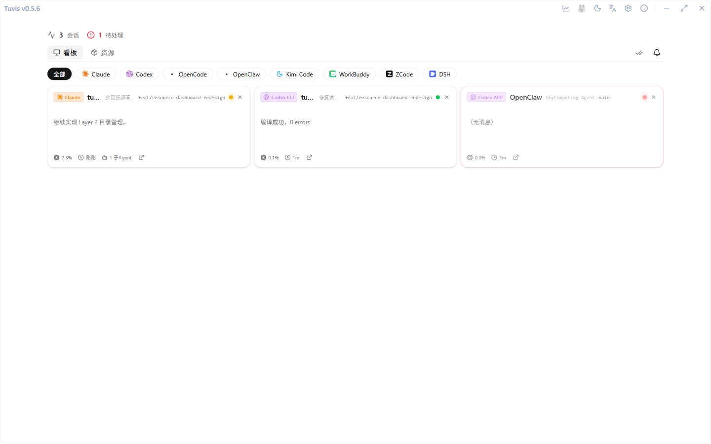

# Quick Start

Four steps to get Tuvis running: enable your tools → trust the Hook → see your first card → (optional) remote access from your phone.

## Step 1: Enable installed tools

Tuvis auto-detects installed AI coding tools at launch. Go to **Settings → Tools & Health Check** and check the tools you want to monitor and manage.

## Step 2: Trust the Hook entries

Claude Code, Codex CLI, and Kimi Code support the Hook status channel (fresher, more accurate state). After Tuvis completes Hook registration, you need to **enter `/hooks` in each tool's terminal**, find the Tuvis entry, and **trust it once**. Codex additionally has a trust gate that you must confirm inside the Codex TUI yourself. Once registration completes, Tuvis raises a **persistent in-app action card** to remind you — it stays until dismissed via "Copy command" or "Don't remind me again" (the card carries the command text as a clipboard fallback).

> 💡 The **Settings → Tools & Health Check → Signal Health** section lets you self-check whether each tool's Hook is really working: a registered tool with no events in its window is listed as a pending item with a one-click copy of the `/hooks` command; unregistered tools state the reason honestly (kimi on macOS shows "the Hook channel is not distributed on this platform; nothing to do"). Tools without Hook support (e.g. OpenCode) skip this step — Tuvis derives their state on its own.

## Step 3: See your first card

Back on the dashboard, every running tool session shows up as a card. Status lights:

- 🔴 **Red** = waiting for your input / approval;
- 🟡 **Yellow** = running / thinking;
- 🟢 **Green** = finished / idle.

Cards sort by "waiting → running → idle" priority; clicking a card focuses the matching terminal window directly.

## Step 4 (optional): Remote access from your phone

Keep an eye on progress away from the desk: turn on **Settings → Remote Access**, then open the given address (ending in `/m`) in your phone's browser to see the same dashboard, receive push alerts, reply to messages, and approve remotely. Channel choices and first-time setup are covered in [Chapter 8 · Mobile remote access](./08-mobile-remote.md).
