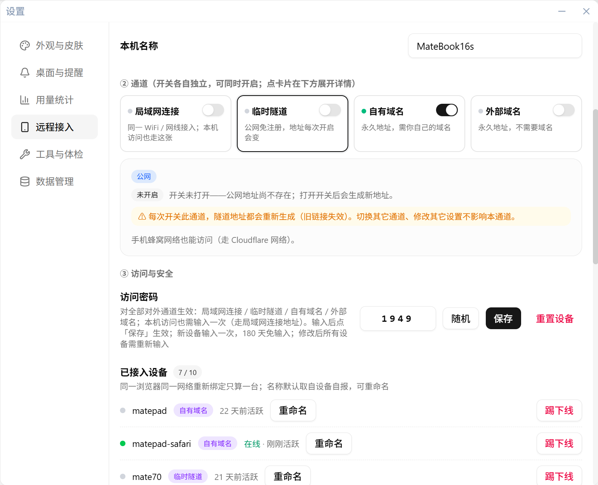
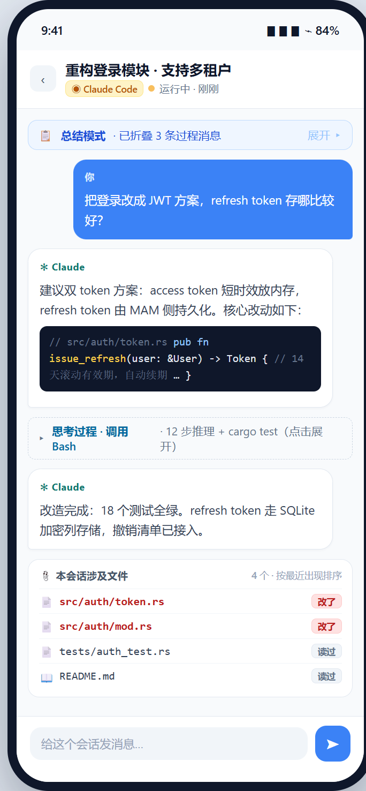
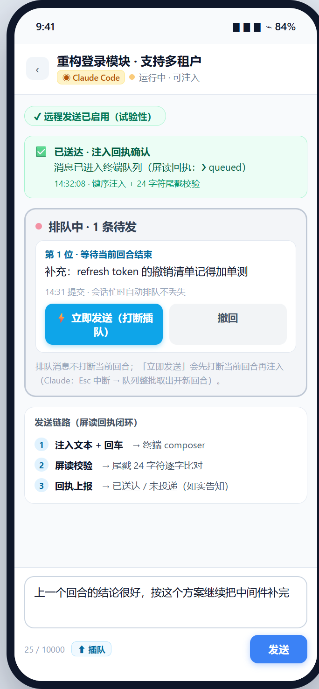
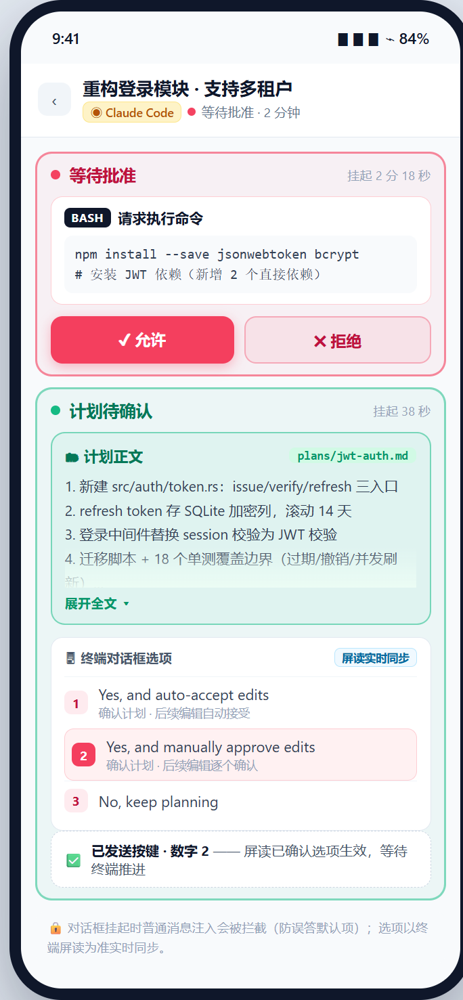
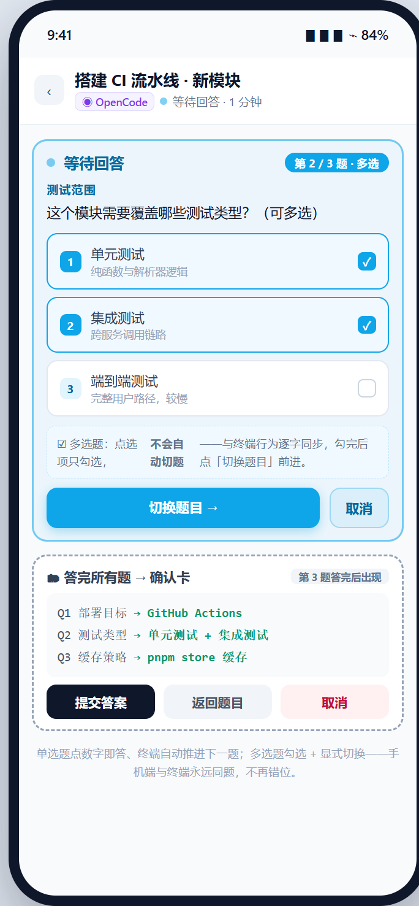

# Mobile Dashboard & Remote Injection

**Fresh-install defaults**: with no historical database (including legacy-brand data), Remote Access starts enabled, the release app attempts to register launch at login once, and remote-message device signatures are off. Enable individual channels as needed; upgrades keep their previous state. Turning a switch off is respected on later launches. Launch-at-login status reflects the operating system; a failed registration can be retried in Settings.

**Tailscale installer and manual installation**: on macOS and Windows, packages are saved in the system Downloads folder, including redirected Windows folders. The wizard follows a vertical timeline, with actions on the right and completed steps in green. The actual path and “Open downloads folder” appear only after download and verification; the pinned official “Download manually” link appears only if automatic download fails. If the installer cannot open, double-click the verified package from its downloads folder. On macOS, clicking “Install Tailscale” opens the system installer automatically; follow its instructions and authorization prompts, then return to Tuvis and click “Refresh status”. Cancelling does not mark installation complete.

**Both fixed-address wizards**: Own domain assumes your domain is already on Cloudflare and guides you through tunnel creation, Token entry and a confirmed connection, browser-side hostname binding, and board-response verification. External domain (Tailscale) follows its installation and enablement steps. Once required steps and public board verification pass, the timeline collapses and the address, copy/open actions, and QR code stay in the channel card; “View setup steps” reopens it. Later failures keep the summary with the previous address clearly marked unavailable; open and QR actions pause without restarting installation.

**Waiting for public DNS**: when the local board and Funnel are ready but public records are absent, the wizard shows elapsed time and an estimate of several minutes, potentially around ten minutes, while checking read-only about once per minute. No repeated retry is needed; overdue waits provide troubleshooting. Refresh and ordinary checks never reset Funnel; the explicit “Re-enable” repair retains configuration ownership safeguards. An enabled macOS extension needs no further action; a stopped backend first calls for checking the Tailscale client.

Step away from the desk and the dashboard comes with you — this chapter covers watching your eight-tool sessions in a phone browser and replying remotely.

## What remote access is

The mobile board is the desktop dashboard served as-is to your phone's browser: the same traffic-light cards for eight tools, session details, approvals, and Q&A. Same WiFi uses direct LAN connection; across networks use a tunnel — one-click guided setup for Tailscale (Funnel, permanent address) or a Cloudflare quick tunnel / your own domain.

The board is served directly by the desktop process (local-first): data never leaves your machine and nothing is hosted on a third-party platform — the tunnel only forwards the connection.

## Four channel cards

**Settings → Remote Access** offers **four channel cards, each with its own switch and usable simultaneously**:

| Channel card                          | When to use                                                   | Notes                                                                                                                                                                                                                                            |
| ------------------------------------- | ------------------------------------------------------------- | ------------------------------------------------------------------------------------------------------------------------------------------------------------------------------------------------------------------------------------------------ |
| 📶 LAN                                | Phone and computer on the same WiFi / cable (**recommended**) | Fastest; requires the access PIN; **your own browser on this computer uses this card's address too** (its switch must be on)                                                                                                                     |
| 🔀 Quick tunnel                       | You're away and your phone is on cellular                     | Public, no signup (Cloudflare); **address changes every time it's enabled**                                                                                                                                                                      |
| 🌐 Own domain                         | You want a stable entry point                                 | Needs a Cloudflare account (free plan works) + a Tunnel Token; the address is **permanent** once configured — Tuvis downloads and supervises cloudflared for you, with a step-by-step guide in Settings                                           |
| 🛰 External domain (no domain needed) | You don't have a domain but still want a permanent address    | **No domain required**: the card's wizard walks you through installing Tailscale and enabling Funnel to get a **permanent** address like `https://<machine>.<tailnet>.ts.net/m`; you only install and sign in to Tailscale once on this computer |

**The access PIN applies to this computer too**: loopback access is **no longer PIN-free** — opening the board from this machine's own browser is treated exactly like a remote device (enter the PIN once, then remembered for 180 days). "This machine" is **no longer a channel card**: it is just one way to connect, using the address shown on the "LAN" card.

The PIN applies to **all four channels** (**including access from this computer**): enter it once per device for **180 days**, and after a PIN change every device must re-enter it.

## Connecting a channel

How to connect: confirm "Enable Remote Access" is on → enable the channel you want → click its card to reveal the address / QR code (**the link already contains the PIN, so scanning fills it in automatically**) → open it on your phone (**the URL must end with `/m`**). **The first run of "External domain (no domain needed)" goes through the card's wizard**: click "One-click setup" and it walks through detect → download from the official source with checksum verification → install (the system installer opens on macOS; an MSI wizard opens on Windows) → sign in to Tailscale (Tuvis turns the authorization link into a button; you finish in the browser) → turn off "block incoming connections" → enable Funnel → **reachability verification** — no command line at any point; on macOS you also approve Tailscale's system extension once in System Settings, and the first Funnel enablement may additionally need one browser approval (or none at all).

**The address is only shown after it passes a real check from outside the tailnet**: while verifying or not yet effective, the card honestly reports "taking effect" and gives the expected wait for the situation (several minutes, potentially around ten minutes, for public DNS; about 1–2 minutes when recovering after boot) — it never puts a dead link in front of you. Once verified it is re-checked periodically (about once a minute, less often when idle) and continues read-only checks on failure; an explicit repair requires your confirmation. The address never changes, paired devices never need re-pairing, and **Tuvis restores the channel automatically on every boot** (it waits for the Tailscale backend to be ready before re-enabling, so it never wipes a config that is still coming back).

> **Stated honestly**: the platform notes inside the wizard match the implementation — on Windows only the second half has been tested on a real machine (detect, enable, revoke and restart recovery after "installed / signed in"), while the **install and sign-in flow has not been run end to end**; on macOS the **write paths** (enable / revoke / self-heal) are **not yet verified on a real machine** either (read-only probing has been). The wizard says so on the spot per platform and does not pretend the whole flow has been verified.

## Enabling remote access

1. Confirm Remote Access is enabled in the tray right-click menu, or open **Settings → Remote Access**;
2. Inside **Settings → Remote Access**, enable channels as needed (LAN / quick tunnel / own domain / external domain (no domain needed) — independent switches, can run together);
3. An address is shown only after it has been verified reachable from the public side; enabled channels auto-restore after a reboot;
4. The tray menu shows the address directly, like `http://192.168.x.x:9420/m`.

## Opening the board on your phone

1. Open the given address in your phone's browser (**it must end in `/m`**); scanning the QR code is recommended — the link already contains the access password and scanning fills it in;
2. Enter the access password on first visit, then password-free for 180 days; no app install needed;
3. First-time pairing, password changes, and device management (rename / kick, up to 10 devices) all live in **Settings → Remote Access**.

The screenshot above shows the site's interactive demo.

## What your phone can do

- **See the cards**: traffic-light session cards for all eight tools; state changes push in about 2 seconds (banner + sound + vibration), degrading to 3-second polling if the stream drops;
- **See the files**: the file panel aggregates session files with preview (markdown / code / images) and split-screen layouts; four sources — beyond "uploaded by me", "tool reads", and "tool reads & writes", there is "**Session artifacts**": generated files that appeared in the conversation as a link or backtick path and still exist on disk (reports, charts, data produced by scripts/commands; only previewable types like md / images / html / json make the list). Files the tool actually rewrote still show as "tool reads & writes". Artifacts with relative paths need the session working directory — **currently Codex sessions only** (sessions inside the Codex app and the other seven tools list absolute-path artifacts only); paths inside triple-backtick code blocks do not count as artifacts (`~~~` fences and indented blocks are not recognized yet);
- **Codex APP message and file links**: recognized file paths in message bodies open the preview; uploaded/referenced images, generated images, and files changed or viewed also appear as structured artifacts with accurate source labels. A file entry can jump to its latest message reference by searching the current tail and at most four earlier pages (up to 50 messages per page); it does not keep loading beyond that range. If a path is overwritten, preview reads the current file on disk and does not retain historical versions.
- **Stop the desktop turn** (Codex APP): while a turn runs, the primary composer button shows “Stop” when there is no text or attachment; with a draft it stays “Send” and a compact stop entry remains beside it. Stopping interrupts the selected turn and loses work it has not finished. The queue area no longer duplicates the stop button or running-turn explanation. Stale state, an unknown target, or an unidentified stop capability prevents execution. **Once the stopped turn is confirmed finished, the queue frozen by that stop resumes automatically in its original order** (matching Codex's own behaviour), with no extra resume step; if the turn never reaches a confirmed end (the stop did not take effect) the queue stays frozen. New messages submitted while paused join the queue without dispatching. Stop availability follows the current build’s per-operation evidence.
- **Queue actions** (Codex APP): each row shows its position, “Send first”, “Edit again”, and “Retract”. After confirmation, “Send first” stops a running target turn if needed, confirms its terminal state, then sends the selected message; other messages remain paused. Unknown results are not retried automatically. “Edit again” restores the original text to the composer only after the server confirms retraction. If a new draft already exists, choose explicitly whether to replace or append. Failed retraction or an already-dispatched message does not become a new sendable draft.
- **Combined sending when idle** (Codex APP only): after the current turn finishes naturally or you explicitly resume the queue, consecutive ordinary messages from the same device and conversation are sent together in their original order, separated by a blank line. “Send first” still sends only the selected message. Long content is split into batches; remaining messages stay queued, and drafts from different devices are not mixed. If delivery is unknown, check the entire batch instead of resending an individual member.
- **Codex APP per-operation adaptation** (F01–F08): Tuvis identifies the **running desktop
  contract** read-only and unlocks actions one by one — plain messages, blocking Q&A
  (multi-question / multi-value / free text), command and file approvals (approve / reject /
  cancel the turn), targeted interrupt, and **idle async answers**. Desktop updates normally need
  no version registration; when identification is uncertain the affected actions stay closed with
  a stated reason — no guessing, no blind writes.
  - **Async questions**: while a turn is running the draft is kept and the card says it cannot be
    submitted yet, with the reason; once idle you press "Submit answer" and it is delivered
    **once** as the official envelope (never through the plain-message queue). If the related
    history is incomplete the card shows "status unconfirmed" and will not answer for you.
  - **Approvals**: "Reject" rejects only this request (the turn continues); "Cancel the turn"
    interrupts the turn. When a file summary cannot be read there is no "Approve" entry — only
    reject or cancel.
  - **Adaptation details**: a single "Available actions" row above the composer lists what is
    usable; "N unavailable / Adaptation details" explains each reason and evidence source and lets
    you turn "Auto-adapt" off (newly adapted actions are withdrawn immediately; verified builds
    are unaffected). A one-time hint appears on first visit and stays dismissed after "Got it".
  - **Platform limits**: macOS is covered by probe evidence; Windows and some desktop builds stay
    per-evidence, and anything not closed remains honestly off.
- **Approvals**: tool-call approvals (allow / deny) and plan confirmations (body synced, number shortcuts);
- **Q&A**: single / multiple choice, free text (overwrite write-in / clear), multi-question flow and question switching;
- **Mode & permission tiers**: pick mode and permission chips directly (kimi uses the two-step, screen-read-confirmed flow);
- **Send messages & create sessions** (experimental, with queueing / jump-the-queue / raising sessions): currently covers Claude Code / Codex CLI / Kimi Code / OpenCode; the rest say so honestly.

Push uses **SSE as the primary channel** — a tap on the notification takes you straight to that session, and transition deduplication uses the same server-side logic as desktop notifications.

## Session detail page

The session detail page (ZCode-style conversation view, unified across all eight tools):

- Expand details while running (thinking / tool calls are collapsible), auto-collapse to the final summary once a turn completes
- Markdown rendering (headings / lists / tables / code highlighting); project file paths in the text become clickable links
- **File panel**: aggregates the files a session touched, newest first, with document/image filters and a **200 / 500 / 1000 message** look-back range; **modified** files are highlighted and **read-only** ones are neutral (both previewable), and tapping the secondary line reveals the full path. The four sources — including "**Session artifacts**" — are described under "What your phone can do" above
- **File preview**: markdown / syntax highlighting / inline images; three switchable layouts — side-by-side (chat left, file right), stacked, and fullscreen overlay — with a draggable splitter; readable scope is the session project directory plus your home directory (sensitive directories such as keys are always refused)
- **Transfer progress and honest bandwidth disclosure**: uploads and downloads both show a **progress bar** (bytes transferred / percentage / instantaneous rate / ETA); **when the rate or the total size is unknown it shows bytes transferred only and never invents a percentage**. On a bandwidth-limited tunnel channel the file panel and the attachment area say **in place** that this is a channel limit, not a malfunction, with time estimates based on this channel's measured rate (about 1.5 minutes to download and 3.3 minutes to upload a 20 MB attachment) and a **full-speed upgrade path** (install Tailscale on your phone and join the tailnet to connect directly, 1–2 orders of magnitude faster)
- **Message bookmarks**: mark a spot to revisit with a colored dot (up to 10, one per color), jump back by tapping it, delete individually or clear all; stored in the browser — refresh-proof, cleared when Tuvis restarts or the tab is closed
- **Font size**: 50% / 75% / 100% / 125% for message text, file content, and the question / options / free-input text of Codex async question cards; interface controls and buttons such as submit do not scale
- **Archived history**: finished or unreachable sessions stop cluttering the board — registry-based archiving (history page lazy-loads 1/3/7 days), tap a card for a read-only detail view with one-tap reactivation; board cards can be closed/archived (CLI sessions stop their process, APP sessions get a true "close")

## Remote control · send messages & approve from your phone (v0.5.0, experimental)

Not just looking — you can **act**: send messages, approve tool calls, answer questions, switch permission modes, and even **create new sessions** from your phone (currently **Claude Code / Codex CLI / Kimi Code / OpenCode**, experimental):

- **Create sessions**: start a brand-new CLI session straight from the phone — pick a known project or type a path (checked against a blocklist), optionally with an opening message injected automatically; creation progress streams back and the board jumps to the new session when it is ready. Per-tool popup shapes (trust prompts, update notices, …) are handled automatically, verified by on-machine E2E
- **Send & queue**: messages queue automatically while a session is busy, "send now" interrupts and jumps the queue (per-tool key sequences measured on real machines), and queued messages can be retracted. Every message uses **key-sequence injection with a screen-read receipt** (character-by-character tail verification) — a non-delivery is reported honestly, never faked as success
- **Remote approvals**: tool-call approval (allow/deny), plan confirmation (plan body plus terminal dialog options synced live from the screen, direct digit selection), Claude plan-approval digit shortcuts plus a **plan feedback bar** (send written feedback on an approved plan, or clear it in one tap); the approval card dismisses itself once its job is done
- **Remote Q&A**: single-choice, multi-select, and free-form answers (including **Other — overwrite & clear**: enter edit, backspace to empty, then type; an empty text is rejected honestly), per-question progression with a confirmation card; multi-select taps only toggle, "next question" advances explicitly (opencode/kimi also support ◀/▶ back and forth) — the phone and the terminal always stay on the same question. **Confirmation-card answers are sourced from the terminal's Review page via screen reading**: after a refresh or page reopen they match the terminal summary exactly; local memory is only a fallback
- **Permission modes**: kimi's three tiers (`/permission` / `/yolo` / `/auto`) use a **two-step flow** — open the menu, screen-read the highlighted row, only then press Enter — plus a **mode/permission dual read-back** in the status bar (both the switch receipt and the current tier carry screen-read evidence); codex switches via the terminal menu single-select
- **Guards**: while a dialog is pending, ordinary message injection is blocked (to avoid answering the default by accident); input-line residue is detected to prevent double sends; dangerous keys (such as Ctrl+C, which quits OpenCode) are blacklisted
- **Codex desktop APP remote control (experimental, unlocked per exact Desktop build)**: Windows `26.1013.4894.0` supports message projection / sending / status / command approval / Plan blocking Q&A; macOS `26.1013.40934` supports sending / status. `permissions` stays disabled; other builds or unsupported capabilities are refused honestly as "not unlocked / work in progress" — no fake approvals or empty sessions. Recognized file references in message bodies open the existing preview; returning from a preview searches the current tail plus at most four earlier pages for the latest reference. Preview always reads the file's current contents and does not retain historical versions. See the capability matrix below.

|                Session detail · messages                |              Send · queue & jump               |
| :-----------------------------------------------------: | :--------------------------------------------: |
|  |     |
|                  **Approvals · plan**                   |             **Q&A · multi-select**             |
|      |  |

**Mobile remote control status (v0.5.0, experimental)**: message viewing and file preview cover 7 of the 8 tools (OpenClaw's black-box build is not remotely readable yet); **sending messages to CLI sessions and creating sessions from your phone are experimental**, currently supporting Claude Code / Codex CLI / OpenCode / Kimi Code. Messages are injected as keystrokes into the terminal and verified by screen-reading receipts (no false "delivered"); queueing, interrupt-and-jump, remote approvals, question answering, permission-mode switching, and session creation are included. Illustrated walkthroughs live in the Chinese manual; per-tool statuses and limitations are listed below.

**Codex Desktop adaptive control (0.6.3, experimental)**: Tuvis reads the running Desktop contract and unlocks actions per operation — plain messages, blocking Q&A (multi-question / multi-value / free text), command and file approvals (accept / decline / cancel), targeted interrupt, and idle async answers. An unknown build attempts sends under target/state/protocol guards; destructive actions stay evidence-gated. Desktop sessions never fall back to headless.

- **Grouped async questions**: one card per source group; fill question by question, previous/next keeps drafts, and submit the whole group once from the last question. When several groups are waiting, the dock shows the current group only and a "{{count}} more group(s)" entry expands the list of the other waiting groups to switch between (answered groups are not counted). Long question stems collapse to three lines with "Show full question" / "Collapse question"; free-text input starts collapsed behind "Other answer"; the question, options and free-input text follow the session font-size setting while submit and other buttons keep their size. Answered groups close automatically and do not return after refresh.
- **Answer mode**: options and free text are mutually exclusive. Choosing an option clears old text; typing text clears the visible option. A restored old option that no longer exists is placed in the visible text field — Tuvis never submits an invisible answer.
- **Limits**: fully verified = current-package contract matches and the action has local observed success; compatible = unknown build sends under guards (destructive actions still require evidence); unsupported = Plan-mode approval, permissions switching, and interrupt without an active turn. Windows and 360/390 screenshots remain per-item acceptance; macOS `26.1021.31345` is probe-backed.

**Evidence level of Codex APP approvals**Evidence level of Codex APP approvals (reported as-is)**: **command approvals** have real-machine evidence (accept/decline closure on `26.1013.4894.0` + the pending shape on `26.1016.6573.0`); **file approvals** currently have **official method-table / call-site** evidence only — **not yet closed end-to-end on a real machine**.

### The four injectable terminals — current status and limitations (reported honestly)

- **Claude Code**: busy sessions queue messages without loss; "send now" = Esc interrupt + taking the whole queue out at once to open a new turn; retract-window protection (delivery is refused and reported honestly when the input line still has residue); **plan approval card** (approving the waiting red light + digit-key direct selection + a plan feedback bar after approval); multi-question Q&A with ←/→ two-way question switching + multi-select free-form answers (once written, they can be **edited / overwritten / cleared**); the multi-select question panel is no longer misread as an approval card (checkbox guard + approval keys disabled)
- **Codex CLI**: Tab enters the native queue (without interrupting the current turn), Esc jumps the queue with an interrupt, Ctrl+C retracts queued messages; Q&A supports a note field (Tab expands/clears it, and **the terminal's note line is screen-read back into the input box**) + multi-select free-form answers; **remote mode/permission switching** — mode Plan↔Operate chips selected directly (current tier highlighted) and four permission tiers selected directly (including a Full Access double confirmation), with the switch result verified by terminal screen reading. Limitation: the multi-question page-turn keys are not field-tested yet (multi-question navigation guides the terminal to do it)
- **Kimi Code**: busy sessions auto-send the queued message when the turn ends; three permission tiers switched via the **two-step** flow (open the menu, screen-read the highlighted row to confirm) + a bottom-bar mode/permission dual read-back; the **full 2.1.1 questionnaire chain** — Other free-form answers (edit / overwrite / clear), multi-select checkboxes, single-choice auto-advance + landing verification (after all n questions are answered it always lands on n+1), ←/→ question switching, and confirmation-card summaries taken from the terminal's Review page via screen reading. Limitations: approval digit selection is disabled (it conflicts with the menu key, so navigation is used instead); the `Ctrl+S` instant handoff is not productized yet
- **OpenCode**: Q&A with Enter / digit-key selection + single/multi-select **free-form answers** (overwrite / clear; single-choice delivery self-heals), ◀/▶ two-way question switching, Esc interrupt to jump the queue, and 2.x dual-schema session discovery. Limitation: Ctrl+C is blacklisted globally (it would quit the opencode app outright)

## Cards trust the terminal's screen-read

Remote injection is best-effort and drift is inevitable: **the card's source of truth is the terminal screen-read** — every injection receipt carries a post-action screen-read snapshot for verification, and mismatches fall back to terminal truth automatically; refreshing / reopening the page re-syncs from the snapshot; when the screen-read is unavailable (e.g. the process exited) the snapshot is empty and the card conservatively keeps the current state.

> 🔒 The address + access password is the key — do not share it; too many wrong entries locks access for about 10 minutes.

> 💡 Nine out of ten connection problems are one of these: router "AP isolation", an address missing the `/m` suffix, or a firewall blocking inbound — see the troubleshooting chapter.
