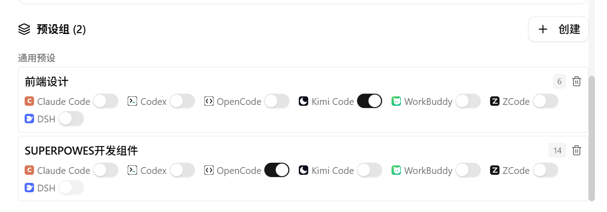
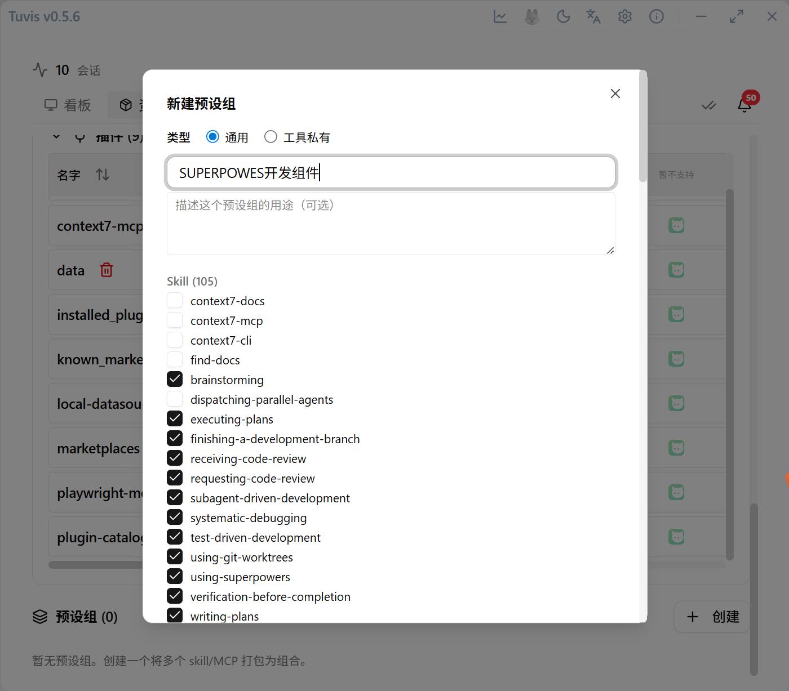

# Preset Groups

A set of resources becomes a switch — one move readies a whole coding environment, and one click restores it when you are done.

## What a preset is

A preset group is a named snapshot: pick a set of Skills, MCP servers and plugins, bundle them together, then **apply** the bundle to any tool in one click — and **restore the default** just as easily.

- **Exclusive semantics**: after a preset is applied, the tool sees only "in-preset resources + resident resources" — links to skills outside the preset are broken automatically, so switching presets is a clean swap, not an overlay;
- **Baseline snapshot**: the first apply while a tool has no active preset makes Tuvis capture its complete current state as the baseline; switches within the same session reuse that baseline; "restore default" returns exactly to where this session started (stashed items move back, extras are cleared), and the next apply takes a fresh snapshot;
- **Resident resources are never touched**: a tool's built-in native skills, its native MCP configuration section, and plugins the tool installed itself are **resident by definition** — never snapshotted, never stashed, never toggled; you can also mark any "tool × resource" pair as resident, and exclusive mode will never touch it;
- **Two kinds of presets**: universal presets (pure resource bundles, applicable to any tool) and tool-scoped presets (bound to a single tool, additionally able to include that tool's native skills).

On apply, non-resident **native skills** (real directories, not Tuvis links) are moved into the stash at `~/.tuvis/stash/<tool>/skills/` (tracked in the stash_journal ledger, recoverable after a crash); on restore each item moves back to its original spot — if the spot is now held by a same-named directory with different content, the item stays stashed and is listed honestly, waiting for manual handling.

## Create, apply & restore

1. **Create**: make a new preset in the preset section and check the Skill / MCP / plugin combination you want; when the selection includes tool-bound content, the UI automatically suggests switching to a tool-scoped preset;
2. **Apply**: one click onto the target tool — Tuvis adapts to each tool's configuration format on its own. Exclusive mode is the default; when some items fail to enable, successfully enabled items are not rolled back, and conflicts (resources already present) are skipped and reported;
3. **Restore**: click "Restore default" (or cancel the preset) to return to the pre-apply state and discard the baseline snapshot;
4. **Switch to another preset**: switch directly within a session — the baseline stays, and the state aligns to the new preset.

## Tray toggles

The system tray menu has a "Presets" submenu: one toggle item per preset — check to apply, uncheck to restore, no trip back to the main window needed.

> 💡 Want a skill to stay present under every preset? Mark it as resident instead of stuffing it into each preset.

## Health check

Applying presets depends on the three-layer links matching the ledger: when a switch or restore misbehaves, open the "Health Check" card on the resources tab to review the drift groups and fix them in one click (see the Resource Management chapter).
