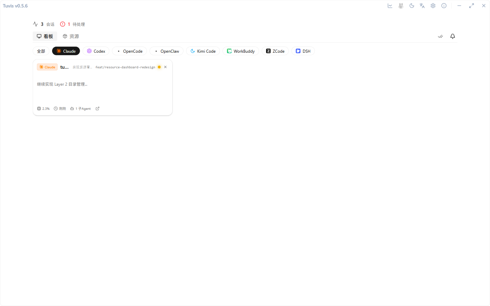

# 会话看板

看板是兔维斯的主界面：八种 AI 编程工具的会话在一屏尽收，红绿灯一望便知谁在等你。

## 看板结构

- **顶栏状态摘要**：左侧「N 会话」是当前卡片总数；有待办时右侧出现红色「N 待处理」计数，提醒你还有会话在等输入。
- **四个一级页签**：消息看板（本页）/ 工具资源 / 模型用量 / 输出速度——同一主窗口内切换，切页不重置各页状态；会话摘要、工具筛选 chips 与一键清除属于消息看板页，资源入口在工具资源页。
- **标签栏右侧**：出现已完成的卡片时亮起「一键清除已完成卡片」按钮，点一下即把绿色卡全部收走；旁边是通知铃铛（见第 6 章）。

1. 打开主窗口，默认落在消息看板页签；
2. 先看「待处理」计数，不为 0 就优先处理红色卡；
3. 卡片看完即收：点「一键清除已完成卡片」清屏。

## 会话卡：一眼四件信息

1. **工具徽章**：卡片顶部以图标 + 名称标注来源工具；
2. **项目与分支**：项目目录名（超长时截断，悬停看全名）与 Git 分支号；
3. **状态灯**：红＝待批准 / 等你输入，黄＝运行中，绿＝已完成；未读会话的状态灯带一圈光环，点右上角 X 可标记已读，或让暂离的卡先收起（状态再变化会自动重现）；
4. **最近消息预览**：最后一条消息的两行摘要；底部小字给出 **CPU 占用、运行时长**与正在运行的子 Agent 数。

> 💡 卡片按「等待 → 运行 → 空闲」优先级排序，最需要你的会话总在最上面；卡右下角的「在电脑上打开」按钮还能一键在终端里 resume 该会话。

## 按工具筛选

卡片上方一排 chips：最左是「全部」，其后是七个工具（Claude Code / Codex / OpenCode / Kimi Code / WorkBuddy / ZCode / dsh），单选，点谁筛谁，溢出自动换行。当前选择会记在本地——重启应用后仍停在上次选中的工具上。

> 💡 OpenClaw 不支持消息提醒，不在筛选 chips 里（其会话仍会出现在「全部」中）。

> 💡 chips 的图标与文案和卡片徽章同源，认脸即可对号。

> 💡 模型用量与输出速度各有独立页签——见第 11 章（用量统计）与「输出速度」一节。

## 点击卡片：直达终端

1. 点会话卡，兔维斯自动把对应终端窗口调到前台；
2. 同项目多开、命中多个候选窗口时，会弹出选择器让你点选目标；
3. 不支持跳转的形态就地提示，绝不假装跳转。

### 支持的终端

| 终端                       | 支持情况                                      |
| -------------------------- | --------------------------------------------- |
| iTerm2                     | ✅ AppleScript                                |
| Terminal.app               | ✅ AppleScript                                |
| tmux                       | ✅ pane 选择 + 终端聚焦                       |
| Windows Terminal / conhost | ✅ 进程树消歧 + 一次性标题标记锁定（Windows） |
| 浏览器标签（dsh）          | ✅ 标签页聚焦/打开（macOS）                   |
| Wayland                    | ❌ 优雅降级提示                               |

### 终端类工具如何消歧

终端类工具（Claude Code / Codex CLI / OpenCode / Kimi Code）经进程树 + 窗口内容逐层消歧聚焦；**同项目双开直达**：Kimi / OpenCode 的窗口标题与会话标题（kimi `state.json` 标题 / OpenCode DB 标题）归一化比对，唯一命中即锁定，双开终端不再弹选择器。Windows 上消歧还会对目标终端贴一次性身份标记（` — 兔维斯:xxxxxxxxxxxx`，聚焦成功后自动清除）正向锁定，且标记不会叠加残留；卡片↔终端配对存疑（同项目多开）时**宁可弹选择器也不锁错窗**，聚焦被系统拒绝时显式报错而非静默假成功。

### APP 类工具：深度链接直达

桌面 APP 类工具（Codex APP、WorkBuddy）支持深度链接直达：`codex://threads/<id>`、`workbuddy://chat/<id>`（会话级），派发前校验协议 handler、派发后验证前台化，失败自动落 APP 级前台保底（macOS AppleScript / Windows 近祖聚焦），且不误标已读。ZCode 为单窗口多标签应用，跳转直接聚焦唯一窗口（卡片携带宿主 pid，零歧义锁定）。
