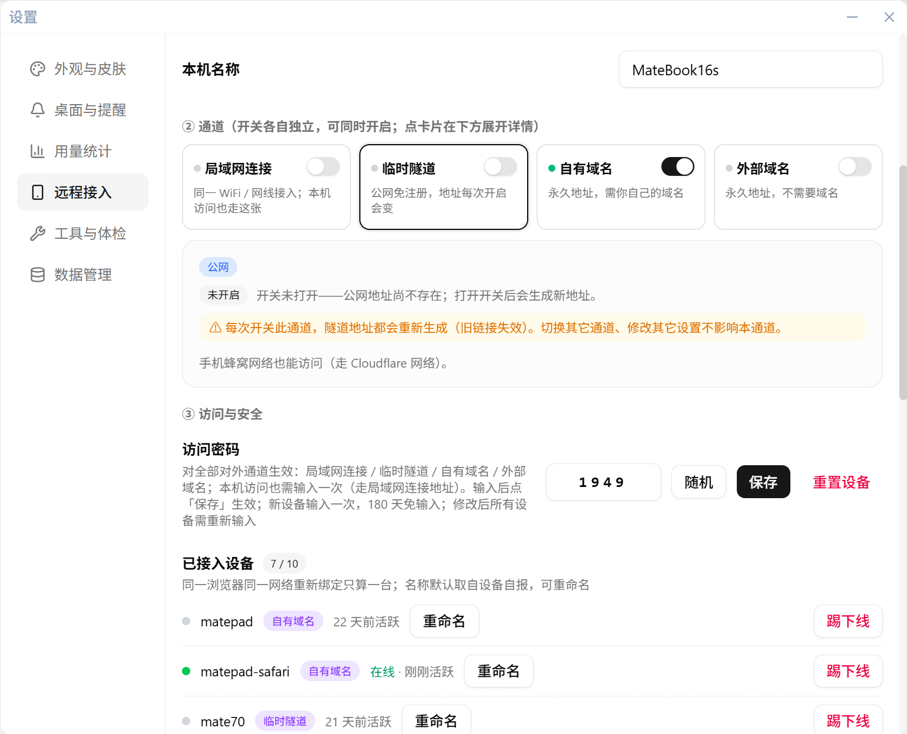
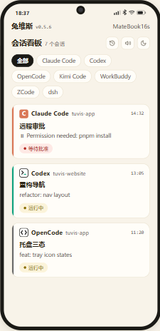
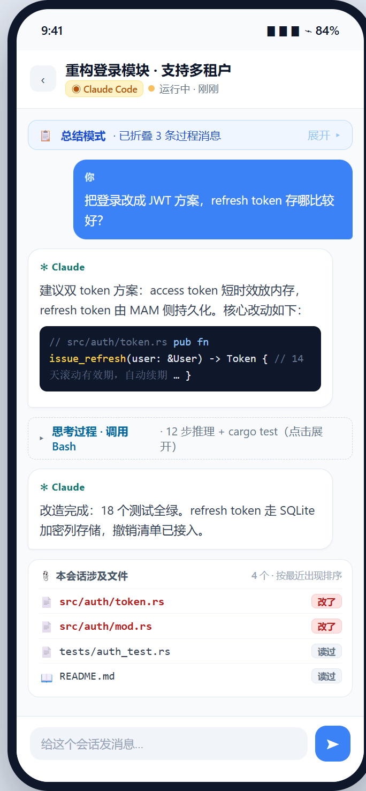
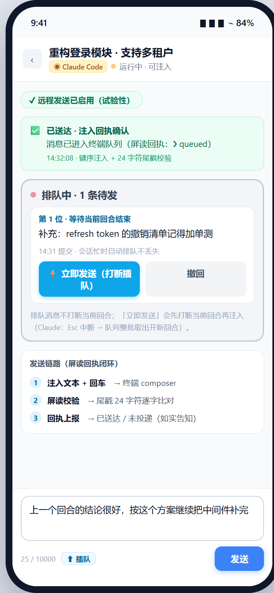
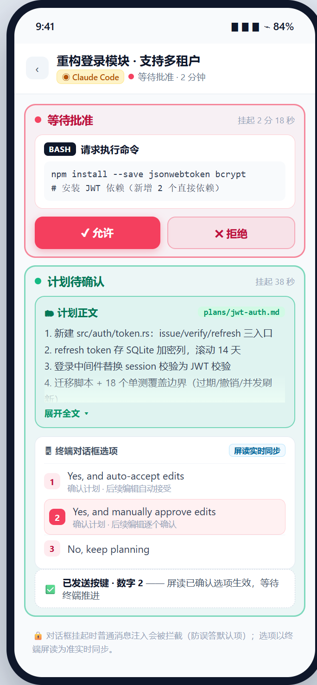
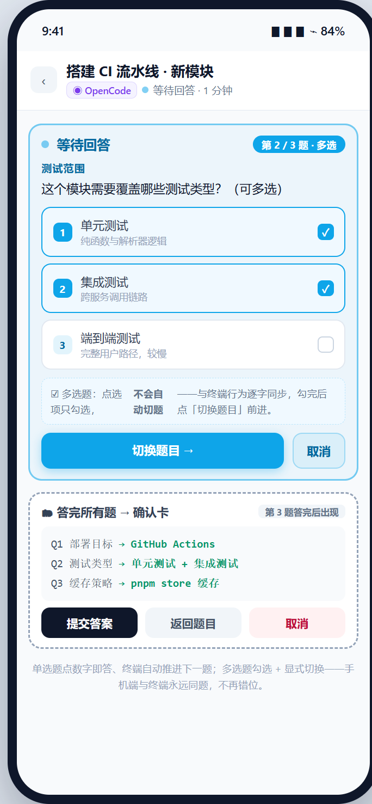

# 手机看板与远程注入

**全新安装默认值**：没有历史数据库（含旧品牌数据）时，远程接入总开关默认开启，开机启动在正式版首次启动时自动注册，远程消息设备签名默认关闭。各远程通道仍需按需手动开启；升级用户保留原状态。关闭开关后，后续启动不会重新打开；开机启动以系统实际注册结果为准，失败可在设置中重试。

**Tailscale 安装包与手动安装**：macOS 和 Windows 均保存到系统「下载」文件夹（支持 Windows 下载目录迁移），向导按时间轴从上到下操作，按钮集中在每步右侧，完成后变绿。安装包下载且校验通过后才显示实际文件位置与「打开下载文件夹」；只有自动下载失败时才显示固定版本官方「手动下载」入口。安装程序打不开时可从下载文件夹双击安装。macOS 点击「安装 Tailscale」会自动弹出系统安装界面，请按提示完成安装和授权；安装完成后返回兔维斯，点击「刷新状态」。取消安装不会被标为已完成。

**两套固定地址向导**：自有域名以「域名已接入 Cloudflare」为前提，按创建隧道 → 粘贴 Token 并确认连接 → 浏览器绑定域名 → 看板访问校验推进；外部域名（Tailscale）按安装与开通步骤推进。必需步骤完成且公网看板响应核验通过后，时间轴自动收起，地址、复制、打开与二维码留在本通道卡；也可「查看配置步骤」。后续异常保持摘要，历史地址明确标为暂不可用，暂停二维码与打开入口，不强迫重新走安装。

**等待公网 DNS**：本地看板和 Funnel 正常而公网无记录时，显示已等待时间与「可能需要几分钟，最长约 10 分钟」，后台约每分钟只读检查一次，无需反复重试。超过预计时间会给出排查入口。刷新和普通校验不会重置 Funnel；明确的「重新开通」才执行修复，并保留配置归属保护。macOS 扩展已启用时直接显示无需操作，后端停止时先检查 Tailscale 客户端。

人离开电脑，看板跟着走——本章介绍如何用手机浏览器盯着八工具会话并远程回复。

## 远程接入是什么

手机看板就是把桌面端看板原样搬进手机浏览器：同源的八工具红绿灯卡片、会话详情、审批与问答。同一 WiFi 走局域网直连；跨网可用隧道——一键引导开通 Tailscale（Funnel，永久地址）或 Cloudflare 临时隧道 / 自有域名。

看板由桌面端进程直接提供（local-first）：数据不出本机、不托管第三方平台，隧道只负责转发连接。

## 开启远程接入

1. 确认远程接入总开关已开启：可在系统托盘右键菜单查看，或打开 **设置 → 远程接入**；
2. **设置 → 远程接入** 内按需开启通道（局域网连接 / 临时隧道 / 自有域名 / 外部域名（免域名），独立开关、可同时开）；
3. 地址在公网侧实测可达后才显示；已生效通道开机自动恢复；
4. 托盘菜单会直接给出形如 `http://192.168.x.x:9420/m` 的地址。

### 四张通道卡

**设置 → 远程接入** 内是四张通道卡，各自独立开关、可同时开，按需开启：

| 通道卡               | 适用场景                               | 说明                                                                                                                                                               |
| -------------------- | -------------------------------------- | ------------------------------------------------------------------------------------------------------------------------------------------------------------------ |
| 📶 局域网连接        | 手机与电脑同一 WiFi / 网线（**推荐**） | 速度最快；需访问密码；**本机浏览器访问也走这张卡给出的地址**（前提是该开关已打开）                                                                                 |
| 🔀 临时隧道          | 人不在家、手机切蜂窝网络也要看         | 公网免注册（Cloudflare）；**地址每次开启会变**，旧链接失效                                                                                                         |
| 🌐 自有域名          | 想要一个固定入口长期使用               | 需 Cloudflare 账号（免费计划即可）+ Tunnel Token；配置一次后**地址永久不变**，兔维斯 自动下载并守护 cloudflared，设置页内附逐步图文教程                            |
| 🛰 外部域名（免域名） | 没有自己的域名，也想要一个永久地址     | **无需自备域名**：卡内向导一键引导安装 Tailscale 并开通 Funnel，拿到形如 `https://<机器名>.<尾网名>.ts.net/m` 的**永久地址**；只需一次性在本机安装并登录 Tailscale |

**访问密码对本机同样生效**：本机（回环）访问**不再免密**——从这台电脑自己的浏览器打开看板，与远程设备一视同仁（首次输入一次，之后 180 天免输入）。「本机」**不再是通道卡**：它只是「从本机访问」这一种访问方式，走「局域网连接」那张卡给出的地址。访问密码对**全部四条通道**生效；改密后所有设备需重新输入。

### 外部域名（免域名）卡内向导

外部域名（免域名）首次使用走卡内向导：点「一键配置」后依次是**检测 → 从官方源下载并校验安装包 → 安装**（macOS 自动打开系统安装界面，Windows 打开 MSI 安装向导）**→ 登录 Tailscale**（兔维斯 把授权链接做成按钮，在浏览器里完成）**→ 关闭「阻止传入连接」→ 开通 Funnel → 可达性校验**，全程不用碰命令行；macOS 另需在系统设置里批准一次 Tailscale 系统扩展，首次开通 Funnel 可能还需在浏览器里点一次批准（也可能不需要）。

> **如实申报**：向导内的平台标注与实现同源——Windows 侧的**安装与登录**流程尚未端到端实机跑过（只实测了其后半段：已安装 / 已登录之后的检测、开通、撤销与重启恢复），macOS 的**写路径**（开通 / 撤销 / 自愈）也尚未在本平台实机验证（只读探测已实测）；向导会在对应平台就地告知，不假装整条流程都验过。

### 地址显示与开机恢复

**地址只在从公网侧实测校验通过后才显示**：校验中或尚未生效时，卡片如实显示「生效中」并按场景给出预期时长（公网 DNS 发布可能需要几分钟，最长约 10 分钟；开机恢复约 1–2 分钟），不会把一个打不开的链接摆在界面上让用户干等；已生效后定期自动复验（约 1 分钟一次，空闲时更疏），异常时继续只读复验并显示原因；需要重开时由用户明确确认。地址永久不变、已配对设备免重配，**每次开机 兔维斯 会自动恢复该通道**（开机后先等 Tailscale 后端就绪再补开通，不会把正在恢复的完好配置清掉）。

## 手机端打开看板

1. 手机浏览器打开给出的地址（**必须以 `/m` 结尾**），推荐直接扫二维码——链接已含访问密码，扫码自动填入；
2. 首次访问输入访问密码，之后 180 天免输入；免装任何 App；
3. 首次配对、改密码与设备管理（重命名 / 踢下线，上限 10 台）都在 **设置 → 远程接入**。

上图为站点交互 Demo 界面示意。

## 手机能干什么

- **看卡片**：八工具红绿灯会话卡，状态变化 2 秒级推送到手机（SSE 主通道；横幅 + 提示音 + 振动三件套提醒，点横幅直接进对应会话），断流自动降级 3 秒轮询，网络恢复后刷新页面即重连；状态跃迁的去重与桌面通知同一套服务端逻辑（手机端拿到的已是去重边沿）；
- **看文件**：文件面板聚合会话文件，支持预览（markdown / 代码 / 图片）与分屏切换；来源四档：「我上传的」「工具读取」「工具读写」之外还有「**会话产物**」——对话里以链接或反引号给出过路径、且文件真实存在的生成物（脚本 / 命令产出的报告、图表、数据等，md / 图片 / html / json 等可预览类型才上列表），工具亲手改写过的文件仍显示「工具读写」。相对路径的产物需要会话工作目录，**当前仅 Codex 会话**可用（Codex App 中的会话与其余七种工具暂只上墙绝对路径的产物）；三反引号代码块里的路径示例不算产物（`~~~` 围栏与缩进代码块暂不识别）；
- **Codex APP 正文与文件关联**：正文中已识别的文件路径可点击打开预览；上传／引用图片、生成图、修改和查看文件也会作为结构化产物显示，并按实际来源标注。文件项可定位到消息中最近一次引用：最多搜索当前尾窗及四页更早消息（每页最多 50 条），范围外不继续自动加载。同一路径被覆盖后，预览始终读取磁盘上的当前文件，不保存历史版本。
- **停止桌面回合**（Codex APP）：回合运行时，输入为空且无附件，发送区主按钮显示「停止」；有文字或附件时仍显示「发送」，旁边保留紧凑停止入口。点击停止会中断目标回合，该回合未完成的工作会丢失。队列区不再重复提供停止按钮和运行长提示。状态过期、目标不明或该版本停止能力未识别时，不提供可执行停止。**该回合确认结束后，因停止而冻结的队列会自动按原顺序继续发送**（与 Codex 自身行为一致），不需要你额外点恢复；回合迟迟没有确认结束（停止未生效）时队列保持冻结。暂停期间发送的新消息会入队而不派发。停止能力按当前版本的逐项证据开放。迁移前未绑定目标回合的旧暂停仍需手动恢复，不会仅凭空闲状态自动放行。
- **队列操作**（Codex APP）：队列行显示「第 N 位　插队　重新编辑　撤回」。点「插队」并确认后，如有运行回合先定向停止，确认终态后再发送这一条正文；其余消息仍暂停。结果未知时不自动重试。点「重新编辑」先确认服务端撤回成功，再将原正文放回输入框；如果已有新稿，可明确选择替换或追加。撤回失败或消息已派发时不会把它当作可重发稿。
- **空闲后合并发送**（仅 Codex APP）：当前回合自然结束或你明确恢复队列后，同一设备、同一会话连续排队的普通消息会按原顺序合成一次发送，条目之间留一个空行；「插队」仍只发选中的一条。很长的内容会分批，未发出的消息继续留队，不与其他设备的待发稿混合。合并发送结果未知时，请核对整批结果，不按其中单条重新发送。
- **Codex APP 逐能力适配**（F01—F08）：兔维斯只读识别**当前运行的桌面版契约**，按操作
  分别放行——普通消息、阻塞问答（多题 / 多值 / 自由文本）、命令与文件审批（批准 / 拒绝 /
  终止本轮）、定向打断、**空闲异步答题**。桌面版升级后通常无需等待版本登记；识别不确定时
  对应操作保持关闭并说明原因，不猜、不盲发。
  - **异步题（0.6.3）**：同一次发出的多题只显示一张卡，逐题填写、上一题/下一题保留草稿，
    最后一题才点一次「提交全部答案」；已答组自动核销，刷新不复活。运行中先保稿，卡片显示
    「暂不可提交」及原因；历史未加载完整时显示「状态待核对」，不会替你作答。多组待答时
    停靠区只展示当前一组，题卡旁的「另有 N 组」入口可展开其余待答组列表、点选切换
    （已答组不计数）；长题干默认最多三行、可「展开全文」/「收起题干」；自由填写默认收起，
    点「其他答案」展开；题干、选项与自由输入随会话详情的字号档位缩放（提交等按钮不缩放）。
  - **答案模式**：选项与自由输入互斥——点选项会清掉旧文本，输入文本会撤销可见选项；
    恢复旧稿时，已不存在的旧选项会落到可见输入框，绝不提交看不见的答案。
  - **异步题收纳与提交**：桌面或远程正式作答后会同步撤下对应题。回合运行中可以填写，待桌面空闲后提交。桌面直接跳过或关闭未答题时，可点远程卡底部「在 Tuvis 中收纳本组」，点击「恢复显示」可恢复当前列表的已收纳组，保留当前页面草稿。
  - **能力边界**：契约匹配且本机实测通过=完美适配（发送、阻塞问答、异步提交等）；未知
    build=兼容适配（按目标/状态/协议守卫尝试发送，破坏性操作仍走证据门控）；**不支持**：
    Plan 模式审批、permissions 权限切换、无活动回合的打断。Desktop 会话永不自动转 headless。
  - **审批**：「拒绝」只拒绝本请求（回合继续），「终止本轮」才会中断回合；文件摘要读不到
    时不会出现「批准」入口，只能拒绝或终止。
  - **适配详情**：输入区上方一行「可用操作」列出当前可用项；点「N 项不可用 / 适配详情」
    可查看每项原因与证据来源，并可关闭「自动适配」（关闭后新适配动作立即撤回，已验版本不受
    影响）。首次进入会有一条轻提示，点「知道了」后不再重复。
  - **平台边界**：macOS 已按探针取证测试；Windows 与部分桌面版仍按实测证据逐项开放，
    未闭合的能力如实保持关闭。
- **审批**：工具调用批准（允许 / 拒绝）与计划确认（正文同步、数字直选）；
- **问答**：单选 / 多选、自由作答（覆盖写入 / 清空）、多题推进与切题；
- **切模式与权限档**：模式与权限档 chips 直选（kimi 为屏读确认的两段式）；
- **发消息与新建会话**（试验性，排队 / 插队 / 拉起会话）：目前覆盖 Claude Code / Codex CLI / Kimi Code / OpenCode 四家，其余如实显示不支持。

## 会话详情页

点开卡片进入会话详情（ZCode 式对话视图，八工具统一）：

- **运行明细**：运行中展开明细（思考过程 / 工具调用可点击展开），执行完成后自动折叠只显最终总结；
- **渲染与链接**：markdown 渲染（标题 / 列表 / 表格 / 代码高亮），正文中出现的项目文件路径自动变可点链接；
- **文件面板**：把会话涉及的文件聚合为一份列表（按最近出现倒序），支持「文档 / 图片」类型过滤与 **200 / 500 / 1000 条消息**三档追溯范围；**已改写**的文件名为强调色、**仅读过**的为常规色（均可点击预览），点次行目录可弹出完整路径。来源四档中的「会话产物」（v0.5.8 起）与 Codex APP 结构化产物（v0.6.0 起）的识别规则见上文「手机能干什么」；
- **文件预览**：markdown / 代码高亮 / 图片直显；三种布局随时切换——左右分屏（左对话右文件）、上下分屏、全屏浮层，分屏比例可拖动调整；可读范围为会话项目目录与用户主目录（密钥等敏感目录一律拒绝）；
- **传输进度与带宽如实告知**：文件上传 / 下载都出**进度条**（已传字节 / 百分比 / 瞬时速率 / 预计剩余）；**速率或总量不可知时只显示已传字节，不编假百分比**。走带宽受限的隧道通道时，文件面板与附件区**就地**说明「这是通道限制，不是故障」，并按本通道实测速率给出耗时量级（20 MB 附件下载约 1.5 分钟、上传约 3.3 分钟）与满速升级路径（手机上装 Tailscale 走尾网直连，带宽高 1–2 个数量级）；
- **消息书签**：长会话里拖到某处觉得「待会回来看」，点书签条上的「+ 书签」选个颜色即可打标（最多 10 个，每色一个）；点色点跳回该处，点「管理」可删单个或清空全部。书签保存在浏览器本地：刷新页面不丢、切回看板再进同一会话仍在；关掉 兔维斯（重启）或关闭浏览器标签页后清空；
- **字号档位**：对话正文字号 50% / 75% / 100% / 125% 四档可调（影响正文、文件内容与 Codex 异步题卡的题干 / 选项 / 自由输入；界面控件与提交等按钮不随档位缩放）；
- **历史会话区**：已结束或失联的会话不再霸屏——登记制归档（历史页按 1 / 3 / 7 天懒加载），点卡片进只读详情、可一键重新激活；看板卡片支持关闭 / 归档（CLI 会话停止进程入档，APP 会话真「叉」语义）；
- **翻页定位**：进入会话默认停在最新消息处；往上翻到顶有「加载更早消息」按钮，续读时视线停在原处不跳。

## 远程操控 · 手机发消息与审批（试验性 · v0.5.0 起）

不止看，还能**操作**——手机端向 CLI 会话发消息、批准、答题、切权限，甚至**直接新建会话**（支持 **Claude Code / Codex CLI / Kimi Code / OpenCode** 四家，试验性）：

- **新建会话**：手机端直接拉起一个新 CLI 会话——选候选项目或手填路径（路径黑名单校验）、可带首句自动注入；创建进度实时反馈、完成后自动跳转新会话。四家弹窗形态（信任框 / 更新框等）经实机 E2E 定案自动处置；
- **发消息与排队**：会话忙时消息自动排队不丢失；「立即发送」打断插队（各家按实测键序：claude = Esc 中断 + 队列整批取出、codex = Tab 原生队列 / Esc 插队 / Ctrl+C 撤回、kimi = 回合结束自动续发）；排队消息可撤回。每条消息走**键序注入 + 屏读回执闭环**（尾戳逐字校验），未投递如实告知，绝不谎报成功；
- **远程审批**：工具调用批准（允许 / 拒绝）、计划确认（计划正文 + 终端对话框选项屏读实时同步、数字直选）、claude 计划批准数字键直达 + **计划反馈条**（批准后可对计划发文字反馈 / 一键清除）；审批卡使命完成后自动收起；
- **远程问答**：单选 / 多选 / 自由作答（含 **Other 覆盖写入与清空**——进编辑退格到底再打新文，空文本如实拒），多题逐题推进 + 答完确认卡；多选题点选只勾选、「切换题目」显式推进（opencode / kimi 支持 ◀ / ▶ 双向）——手机与终端永远同题不错位。**确认卡摘要以终端 Review 页屏读为准**：刷新 / 重开页面后逐题答案与终端汇总页完全一致，本地记录只是兜底；
- **权限模式切换**：kimi 三档（`/permission` / `/yolo` / `/auto`）**两段式**——开菜单后屏读确认高亮才回车，且底栏**模式 / 权限双轴回读**（切档回执与当前档都有屏读证据）；codex 走终端菜单单选题；
- **守卫**：对话框挂起时拦截普通消息注入（防误答默认项）、输入行残留检测防双发、Ctrl+C 等危险键黑名单（如 opencode 会整应用退出）。

**覆盖面（如实申报）**：消息查看与文件预览覆盖 7 家（OpenClaw 为黑盒形态暂不支持远程查看）；发消息（注入）与新建会话目前覆盖上述四家。OpenClaw / WorkBuddy 为黑盒形态（无外部写通道）、ZCode 预留无头通道、dsh 写通道另评——工具差异如实呈现，不假装统一。

|                  会话详情 · 消息查看                  |                 发消息 · 排队与插队                 |
| :---------------------------------------------------: | :-------------------------------------------------: |
|  |  |
|                  **审批 · 计划确认**                  |              **问答 · 多选题与确认卡**              |
|     |    |

### Codex 桌面 APP 远程控制（实验性 · 按操作契约开放）

兔维斯只读识别当前运行的 Codex Desktop 安装包，按操作核验契约。Windows `26.1103.3517.0` 已验证空闲异步答题双向撤卡。未获得证据的操作会显示相应限制。

**Codex APP 远程控制的三态徽标（移动端）**：能力按三态如实呈现，不按「理论上支持」吹嘘——**已验证**（该 Desktop build 有真机证据：可控制 / 可发送）、**兼容发送（实验）**（未知 build：send/状态按 2026-10-22 用户裁决默认开启；打断、审批等破坏性能力仍走证据门控——兔维斯先对该 build 做一次**只读探测**（服务端 15 秒硬上限）并用随包 schema 取证，取证后解锁；探测在飞时界面只显示「探测中」骨架，**不提前下「未解锁」的定论**）、**未解锁**（服务端明确判不可用）。
**兼容发送开关已退役**：旧版设置页「⑤ 兼容发送 · 仅未验证的 Codex 桌面版本」不再提供；未验证 build 的 send/状态由运行时能力判定处理，破坏性能力仍走证据门控（该 build 的读链未取证时先完成只读探测）。**风险提示**：兼容路径的消息仍可能被投递到错误会话，风险自负。

**Codex APP 审批能力的证据等级（如实呈报）**：**命令审批**已有真机证据（`26.1013.4894.0` 的 accept/decline 闭环 + `26.1016.6573.0` 的 pending 形状）；**文件审批**目前只有**官方方法表 / 调用点**证据，**端到端尚未真机闭环**。

消息正文中已有识别能力的文件引用可点开预览；上传／引用图片、生成图、已修改和已查看文件作为结构化产物显示并标注来源，文件项可跳回最近一次正文引用（当前尾窗及最多四页、每页 50 条）；预览始终读取文件当前内容，不保存历史版本——细节见上文「手机能干什么」的「Codex APP 正文与文件关联」与「停止桌面回合」条目。

> 真实手机主路径与双平台 PRODUCT 验收仍未全部完成（过程记录见仓库 `docs/engineering/acceptance/2026-10-20-codex-app-product-acceptance.md`）。

### ZCode 统一控制（官方桥接 · 按 build 能力逐项开放）

- **桌面先就绪**：在 **设置 → 远程接入 → ③ 工具特殊配置** 的 ZCode 卡保存官方远控链接（取法见上文），点「授权」完成 **BigModel** 官方授权，再点「连接」。**保存 ≠ 已连接**：链接只用于定位，卡片状态（未配置 / 需要授权 / 正在连接 / 已配对 / 已离线 / 连接冲突）以官方一侧为准；ZAI 通道尚未实机验证，授权按钮保持禁用并说明原因。
- **手机统一界面**：连接配对且会话就绪后，ZCode 会话复用与其它工具相同的发送区、问答卡、审批卡与模型 / 思考强度控件（打断已并入发送主按钮，见下文「手机控制区」）；发送保留草稿，回执区分「已受理 / 已生效 / 结果未知」，结果未知不自动重发。**看板、正文与文件预览始终照常可用**，控制不可用也不影响阅读。
- **能力按 build 逐项开放（如实申报）**：控制能力按宿主 build 的证据**逐项**解析——已取得实机证据的已知 build（`3.16.2.8769`）按静态表开放已确认能力；官方升级后的**未知 build** 不再整板全灰：接口形状与真实目标匹配的能力先作为**候选**开放，你**第一次真实使用**该能力时兔维斯做一次确认（5 秒内有界观察：发出后等宿主状态前进，绝不重发、绝不发任何测试消息），确认成功才转正，明确失败则按 build+能力降级。队列写操作受更严格的 W0 停止门约束：真实宿主取证未闭合前，普通构建不会仅凭静态命令表开放撤回、修改、插队或恢复运行。能力状态随 build / 协议 / 证据变化自动重算，旧判决不跨 build 套用。
- **能力不可用看原因**：界面上只出现**当前可用**的操作；不可用的控件禁用并**就地给一句人话原因**（如「该操作还需终端侧确认，请在终端处理」「暂不支持该操作」等，理由由服务端冻结原因码驱动、随语言本地化）。没有任何探测页面、探测按钮或兼容徽标——build 兼容状态是内部判定，不外显也不需要你操作。
- **冲突态「断开并抢回」**：打开官方页面会把 兔维斯 踢成「连接冲突」（协议同一时刻只允许一个控制端）。此时手机端控制区出现「**断开并抢回**」按钮，操作就一步：**点它一次**——兔维斯断开当前冲突连接并立即用已保存的授权重新连接（凭据保留，不需要重新授权），成功后状态恢复「已配对」。只尝试**一次**：若官方页面还在线、抢回后仍是冲突，按钮旁会提示**先关闭官方页面**再手动重试，不会循环抢。失败时按钮旁显示冻结原因码对应的本地化原因。
- **官方页面只是辅助入口**：卡上的「打开官方页面」只在你主动核对链接时打开，外跳不改变卡上状态，也不代表统一控制已就绪；兔维斯 不做网页 DOM 自动点击，不代你登录或开关 ZCode。授权与连接只在本机进行，官方凭据只留在本机（账号 JWT 仅系统保险箱 + 受控内存，见上文「ZCode 授权、自动恢复与断开 / 忘记」），手机端不持有任何凭据或短期 token。

#### 手机控制区：一个主按钮、一行工具栏、一张卡一件事

- **主按钮只有一个**：空闲时它是「发送」（有文字或**已上传完成**的附件才可点，空输入点了也不发空消息）；官方判定正在运行且输入为空时，同一个按钮变成「**打断**」，按钮下方写明「运行中：输入为空，此按钮将打断当前回合」，点一次只停当前回合，不会顺手把草稿发出去。**手里有内容时永远是发送、绝不先打断**——想打断就先清空输入框。旧版本那条单独的「打断」行已取消。
- **上传中 / 失败的附件会锁住发送**：附件在列且尚未上传完成（或已失败）时主按钮置灰，发送区上方**常驻**一句人话原因（「附件还在上传，等上传完成再发送」/「有附件上传失败，请先移除失败的附件再发送」）。提示不随点击消失——按钮本来就点不动，原因必须一直看得见。
- **紧凑工具栏一行**：「打开官方页面」「模型」「思考强度」并排在同一行，正文区因此多出一行高度。窄屏（如 320px + 系统字号 125%）允许折到第二行，但**不横向溢出、不藏掉任何动作**；长模型名在框内省略、下拉箭头始终完整，**全名保留在控件的可访问提示与选项原文里，读屏与放大镜仍可取全**。
- **附件「＋」下面的「？」**：点开的是**既有**的附件存储说明（附件落在用户项目目录 `.tuvis-attachments/<会话>/`，已在本地 git 排除，项目收尾时可整目录清理）。它只切换说明，不弹文件选择器、不上传、也不发送。
- **待处理卡：蓝色＝问答，红色＝审批，计划批准单独标识**：一组多题时**一次只显示一题**（「第 n/N 题」），选项纵向排列；答案先在手机上按原题序暂存，翻到确认页点一次「提交」才**整体提交一次**，中途不会逐题发给终端。审批卡只给「允许一次 / 拒绝」这类**既有受限选项**，命令正文默认折叠、展开只读（不参与提交）。**计划批准（ExitPlanMode/plan_approval）会显示为「计划批准」专用卡**：卡片在宿主唯一 `approve` 选项、`single_select` 能力可用时提供「批准并开始实施」；批准是对既有 pending 的一次精确 resolve，不是普通消息。也可在文本框填写修改意见并「提交修改意见」：宿主不会批准，而是把文本作为计划反馈送回 agent，计划模式保持；不会伪造批准帧。卡形状不精确、能力未开或失败时就地说明原因并保留「打开官方页面」。MCP 表单等其他不可远程作答类型继续显示通用只读原因；命令正文被截断时卡片会说明「内容未完全展示，请在官方端核对」，并撤掉「允许一次」（「拒绝」与「打开官方页面」保留）。
- **Tuvis 待发（本机新队列）**：运行中或本地已有待发时，手机发送**先进入兔维斯自己的待发队列**，不先打给 ZCode。列表默认展开，逐行显示「第 N 条 | 前 20 个字素摘要 | 插队 / 再编辑 / 撤回」；入队成功只表示「已加入 Tuvis 待发」，**不等于 ZCode 已受理**。刷新页面或重启兔维斯后，纯待发项仍在；如果重启前已有一条被受理但无法证明终态的发送，队列会显示「待核对结果」并暂停，**先点「确认并继续队列」**：确认只清屏障、不会重发旧消息，随后只继续派发尚未发送的待发项。未核对时「继续队列/插队」会说明原因并禁用，不会出现“点了成功但没发”的假动作。待发全文与附件引用只在本机业务表，不进日志/审计/证据。
- **插队只发一条**：点某条「插队」时，若当前回合在跑，先让你确认，然后定向停止当前回合并只发送所选的这一条；其余待发项保持暂停，不会顺手全部发出。停止结果未知时**本条不发送**，界面标为待核对，绝不换 ID 重停或重发。
- **再编辑与撤回**：只对仍处于 queued 的项生效；再编辑会取回完整原文与附件引用，当前草稿非空时先询问替换/合并/取消（默认取消），不会覆盖续写。撤回/编辑与自动派发竞争时只有一个赢家，输家刷新实际状态，不假报成功。
- **官方队列仍是独立观察区**：它是 ZCode 自己已受理的队列，与上面的 Tuvis 待发是不同来源。官方撤回/修改/插队/恢复在普通构建中仍受 W0 实机取证门约束，未取证时按钮禁用并说明原因；不要把「Tuvis 待发里有 N 条」理解成「官方已排队 N 条」。
- **供应商、模型与思考强度**：工具栏先选**供应商**，再选该供应商目录里的模型，最后选该模型自己的合法档位；只选供应商不写任何东西，选定模型后一次提交完整三元组。宿主**显式不可用**的供应商禁用；目录里没有 `available` 字段的供应商标为“可用性未知”，可以选中，但提交模型/档位前会再确认一次“尝试切换可能被宿主拒绝”，确认后才发一次完整三元组，失败就地显示原因、不乐观改当前组合。换供应商不沿用上家的档位。真实双供应商切换与上下文保留仍属实机待验。
- **协作模式（R10）**：提供计划模式 / 变更前确认 / 自主模式 / 完全访问四个写入选项（`edit` 自动编辑只读兼容）。选择只更新待选项，点「应用模式」才发一帧；**完全访问**额外弹确认框，默认取消。回执 accepted 不等于配置已生效：确认标签只认新鲜配置里规范化后的 mode（`planEnabled` 优先为计划模式），未确认不乐观改标签，也不自动恢复更宽模式。

### 四个可注入终端的现状与不足（如实呈报）

- **Claude Code**：忙时消息排队不丢；「立即发送」= Esc 打断 + 队列整批取出开新回合；撤回窗口保护（输入行有残留时拒绝投递并如实回报）；**计划批准卡**（批准等待红灯 + 数字键直达 + 批准后计划反馈条）；问答多题 ←/→ 双向切题 + 多选自由作答（已写入后可**编辑 / 覆盖写入 / 清空**）；多选问题面板不再被误读为审批卡（复选框守卫 + 审批键禁用）。
- **Codex CLI**：Tab 进原生队列（不打断当前回合）、Esc 插队打断、Ctrl+C 撤回排队消息；问答支持备注栏（Tab 展开 / 清空，**终端 note 行屏读同步回输入框**）+ 多选自由作答；**模式 / 权限远程切换**——模式计划↔操作 chips 直选（当前档高亮）、权限四档直选（含 Full Access 二次确认），切换结果以终端屏读为准。不足：多题切页键未实测（多题切题引导终端完成）。
- **Kimi Code**：忙时排队回合结束自动续发；权限三档**两段式**切换（开菜单屏读确认高亮）+ 底栏模式 / 权限双轴回读；**2.1.1 问卷全链**——Other 自由作答（编辑 / 覆盖写入 / 清空）、多选勾选、单选自动推进 + 落点校验（n 题选完必落 n+1）、切题 ←/→、确认卡摘要以终端 Review 页屏读为准。不足：审批数字选择禁用（与菜单键冲突，改走导航）；`Ctrl+S` 立即引导未产品化。
- **OpenCode**：问答 enter / 数字切换选择 + 单选 / 多选**自由作答**（覆盖写入 / 清空、单选自愈送达）；◀/▶ 双向切题；Esc 打断插队；2.x 双 schema 会话发现。不足：Ctrl+C 全局禁用（会直接退出 opencode 应用）。

## 卡面以终端屏读为准

远程注入是「尽力而为」，漂移难免：**卡面权威源是终端屏读**——每次注入回执都带动作后的屏读快照核对，不符自动回退到终端真值；刷新 / 重开页面以快照纠偏；屏读不可用（如进程退出）时快照为空，保守维持现状。

> 🔒 地址 + 访问密码就是钥匙，请勿外传；连续输错达到上限会被锁定约 10 分钟。

> 💡 连不上九成出在这几点：路由器「AP 隔离」、地址漏了 `/m`、防火墙拦入站——详见「故障排查」一章。
