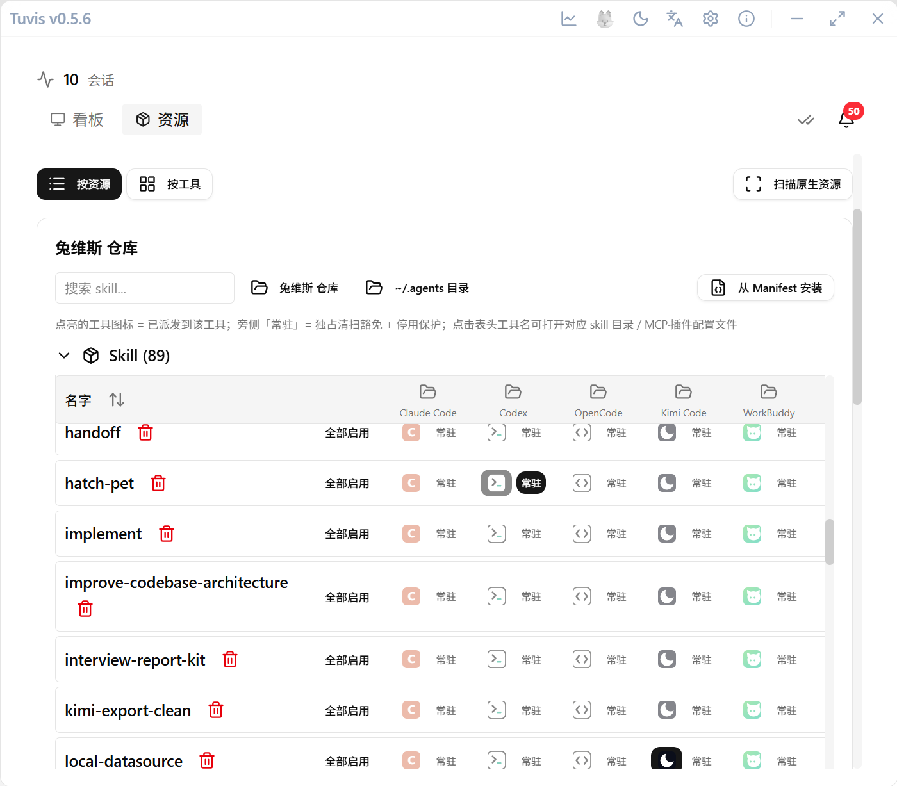

# 资源管理

Skill、MCP 服务器与插件的统一仓库——一份资源，映射到八个工具，出问题有体检兜底。

## 打开资源页

在主界面从会话看板切到 **资源** 标签。资源页有按类型（Skill / MCP / 插件）与按工具两种视图；首次启动会自动导入各工具目录里已装的技能（含只读共享源 `~/.agents/skills/`），之后新装的用「重新扫描」收录。



## Skill 库

全局仓库（SSOT）在 `~/.tuvis/skills/`，各工具读到的技能是**三层符号链接映射**：

```
~/.tuvis/skills/brainstorming/                  ← Layer 1：全局仓库
  ↓ ~/.tuvis/active/<tool>/skills/brainstorming ← Layer 2：工具级激活
      ↓ <tool>/<子 Agent>/skills/brainstorming  ← Layer 3：子 Agent 级激活
```

- **安装 / 启停**：在资源页安装新技能、对每个工具独立启用或禁用；
- **分配给子 Agent**：为支持多 Agent 的工具（如 OpenCode）的子角色单独勾选技能子集——子 Agent 分配受工具级启用范围约束，工具级禁用自动级联断开所有子 Agent 链接；
- Windows 上链接以交接点（junction）实现，Unix 上是符号链接；dsh 为只读接入（可启停，不写入其配置）。

## MCP 管理

在 MCP 区新增服务器后，兔维斯按每个工具的**原生格式**写入其配置文件：JSON（Claude Code / Kimi Code / WorkBuddy / OpenClaw）、TOML（Codex）、JSONC（OpenCode）、JSON 嵌套子树（ZCode 的 `mcp.servers`——读改写只动该子树，未知键与键序保留）。dsh 暂不支持 MCP 配置写入。

## 插件管理

插件区以「文件 + 配置」混合方式管理，支持情况按工具不同（部分工具仅为文件型或暂不支持），界面会如实展示每个工具的能力边界。

## 从 manifest 导入

资源支持通过扩展清单（manifest）批量导入：校验通过后统一入 SSOT 仓库，再按需分配到工具。

## 体检与漂移处置

你或其它工具在磁盘上手动改动（多出 / 缺少链接等）会让账本与磁盘**漂移**。资源 tab 顶部的「一致性体检」卡片按差异分组列出，可一键处置：

| 分组 | 含义 |
| --- | --- |
| L1 缺链 | 账本记为启用，磁盘无链接亦无真目录 |
| L2 占位 | 账本记为启用，磁盘是同名真目录 |
| L3 多链 | 磁盘有兔维斯链接，账本无启用记录 |
| L4 外链 | 磁盘是指向其它目标的链接（用户手动外链）|

可自动修复的项一键处置；无法安全自动处理的（如 L4、与你真目录内容不一致的 L2）转为「需人工处理」如实标出，绝不静默删除你的目录。**设置 → 工具与体检** 分区里有只读摘要与「立即体检」入口。

> 💡 出现「技能突然失效」时，先跑一次体检再排查别的——多数是链接被手动重建或覆盖导致的漂移。

## 工具勾选管理

设置页独立分区，按工具决定是否纳入兔维斯的监控与管理：

- **行式开关列表**：图标 + 名称 + 安装状态 badge，本地暂存、批量保存；保存前确认弹窗列出还原/回溯清单，未保存离开自动拦截；
- **取消勾选 = 彻底还原**：符号链接还原为真实文件、MCP 条目从工具配置移除、未读卡清空；SSOT 仓库与数据库分配关系保留，重新勾选按原分配整体重建（失败自动回滚，重新保存即幂等重试）；
- **未勾选工具彻底隐藏**：会话扫描跳过、通知静音、资源/预设界面不出现，相关写命令返回明确错误（结构化错误码 + 中英文案）。

## 各工具配置支持一览

| 工具        | Skill 目录                   | MCP 配置                           | MCP 格式                       | Hook 支持                                  |
| ----------- | ---------------------------- | ---------------------------------- | ------------------------------ | ------------------------------------------ |
| Claude Code | `~/.claude/skills/`          | `~/.claude.json`                   | JSON                           | ✅（PascalCase）                           |
| Codex CLI   | `~/.codex/skills/`           | `~/.codex/config.toml`             | TOML                           | ✅（PascalCase）                           |
| OpenCode    | `~/.config/opencode/skills/` | `~/.config/opencode/opencode.json` | JSONC                          | ❌                                         |
| OpenClaw    | `~/.openclaw/skills/`        | `~/.openclaw/openclaw.json`        | JSON                           | ❌                                         |
| Kimi Code   | `~/.kimi-code/skills/`       | `~/.kimi-code/mcp.json`            | JSON                           | ✅（PermissionRequest / PermissionResult） |
| WorkBuddy   | `~/.workbuddy/skills/`       | `~/.workbuddy/mcp.json`            | JSON                           | ❌（状态经心跳 + JSONL 推导）              |
| ZCode       | `~/.zcode/skills/`           | `~/.zcode/cli/config.json`         | JSON（`mcp.servers` 嵌套子树） | ❌（状态经 SQLite 消息流尾部推导）         |
| dsh         | ◐ 只读接入 + 启停            | N/A（探测不支持）                  | N/A                            | ❌（状态经 lock 交叉判定 + 事件流推导）    |

> 注：`~/.agents/skills/` 是 Agent Skills 开放标准的跨工具共享目录（codex / zcode 等遵循开放标准的工具直接读取）。兔维斯对 codex 的 skill 激活目录为私有 `~/.codex/skills/`；`.agents` 仅作只读共享导入源（来源标签 `agents-shared`）——兔维斯扫描入库、不归属工具、不建链；除一次性迁移兔维斯自建遗留链接外，永不写入该目录。

## Kimi Code 数据目录重定向（KIMI_CODE_HOME）

Kimi Code 支持 `KIMI_CODE_HOME` 环境变量重定向数据根（默认 `~/.kimi-code`，早期版本为 `~/.kimi`，应用会自动回退）。注意兔维斯读取的是**自身 GUI 进程**的环境变量：

- macOS 从 Dock / Spotlight 启动的应用**不继承** shell 配置（`.zshrc` 等）中的 `export KIMI_CODE_HOME=...`；
- 需要 GUI 侧生效时，可执行 `launchctl setenv KIMI_CODE_HOME <路径>` 后重启兔维斯，或直接为用户设置全局级环境变量。
