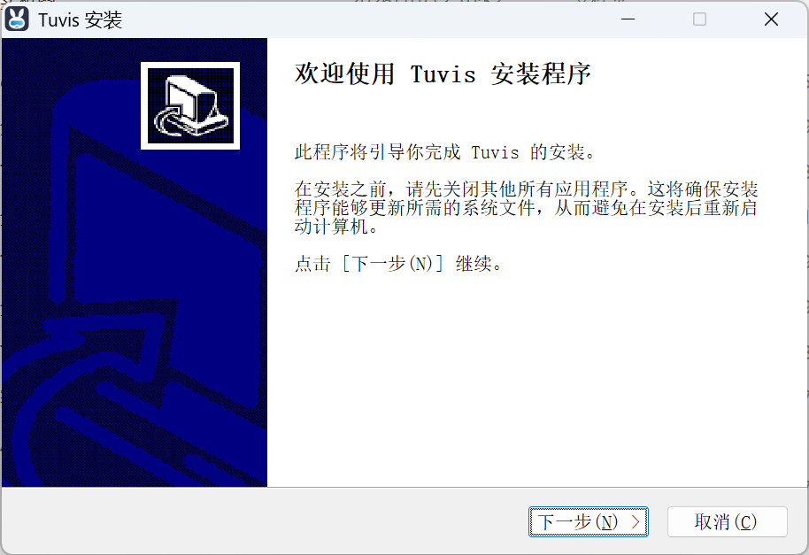

# Download and Installation

**Fresh-install defaults**: with no historical database (including legacy-brand data), Remote Access starts enabled, the release app attempts to register launch at login once, and remote-message device signatures are off. Enable individual channels as needed; upgrades keep their previous state. Turning a switch off is respected on later launches. Launch-at-login status reflects the operating system; a failed registration can be retried in Settings.

Tuvis ships installers for Windows and macOS — grab the latest release from GitHub Releases; installation takes about a minute.

## Download

1. Open the releases page: `https://github.com/jarvislee90s-dot/tuvis/releases`;
2. In the latest release's Assets list, download the installer that matches your system:
   - **Windows**: `Tuvis-*-Windows-x64-setup.exe`
   - **macOS**: `Tuvis-*-macOS.dmg`

> 💡 Trust only this repository's Releases page. Downloads offered by any other site or channel are third-party distributions — vet the risk yourself.

## System requirements

- Windows 10 or later (64-bit);
- macOS 14 or later.

## Installation steps

**Windows**: double-click the installer and click "Next" through the wizard to the end.

**macOS**: open the `.dmg`, drag Tuvis into the Applications folder, then launch it from Launchpad or Finder.

## Installation notes

- **Upgrading from 0.5.2 or earlier**: these old versions (when the app was still named MultiAgents Manager) have a broken in-app updater — download the new installer manually instead. Old and new are two separate app registrations, so **uninstall the old version before installing the new one** to avoid ending up with two tray icons. Your data migrates automatically from `~/.mam` to `~/.tuvis` on first launch of the new version — nothing to move by hand.
- **Upgrading from 0.5.5 or later**: just install over the top with the new installer; hook configuration is migrated automatically at app startup.
- **All data stays local**: everything Tuvis keeps (database, settings, logs, skill repository) lives under `~/.tuvis/` — back up that directory and you have backed up everything.
- **macOS says the app "is damaged" or "can't verify the developer"**: this is the system's standard block for unnotarized packages. In System Settings' Privacy & Security area, find the allow prompt about Tuvis and click Allow; or right-click the app (Ctrl+click) and choose "Open" once — after that double-clicking works normally.
