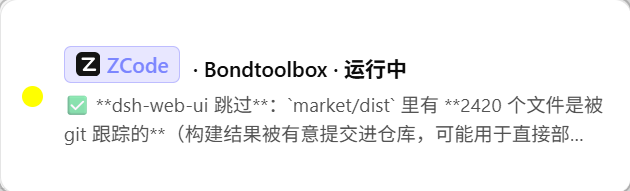

# Notifications & Reminders

When you are away from the terminal, Tuvis keeps watch for you — three layers of reminders on every state change, so nothing important sinks to the bottom.

## Three-layer reminders

When a session's state changes (after dedup and debounce), three channels relay in turn:

1. **System desktop notification**: an OS-level notification with a built-in "view session" action — one click jumps straight to that session's terminal; approval-waiting states add a "go to approval" action;
2. **Notification toast**: a small in-app card pops up from a corner of the screen; clicking the card jumps to the session's terminal, and it tucks itself away after a few seconds of being ignored;
3. **Sound**: synthesized tones — no extra audio files needed.

## Alert policy

Everything lives on the "Settings → Notifications & Pet" card:

- **Desktop notifications** master switch: sends a system notification when a session starts waiting or finishes;
- **Sub-agent report alerts**: on by default, can be silenced independently without affecting the main session's own alerts;
- **60s throttle on yellow↔green flapping**: while sub-agents run, the main session's state often flaps between yellow and green — same session, same direction, no repeated alert within 60 seconds (red waiting alerts are never throttled);
- **Silence while sub-agents are active**: flapping transitions caused by sub-agents pop nothing and sound nothing by default, controlled by the "Mute status alerts caused by sub-agent activity" switch.

> 💡 Want a preview first? Click "Preview float" on the card to pop a test toast on the spot, without disturbing any real session.

## Sounds

Sounds have two tiers: pick a **global completion sound** as the default, then set a **per-tool sound** to override it for an individual tool (follow global / mute / custom). Every picker carries a "Preview" button — one click after choosing tells you whether it sounds right.

## Notification bell & history

The bell on the main window's tab bar gathers all notification history: the unread count shows as a badge (99+ once it exceeds 99), and opening it lets you browse, jump, "clear all", or clear only the read ones. A missed banner can always be fished back out here.
