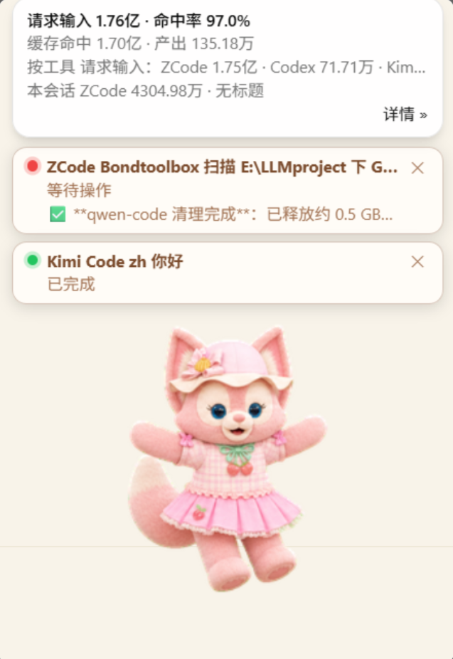
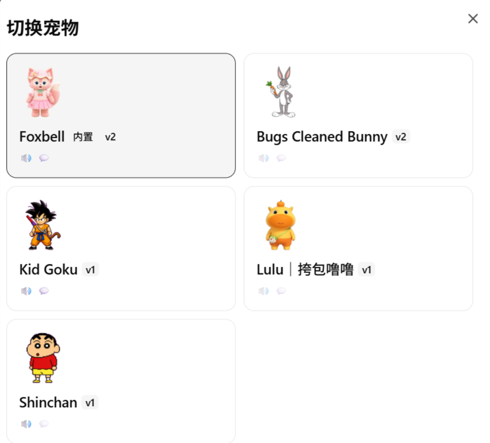
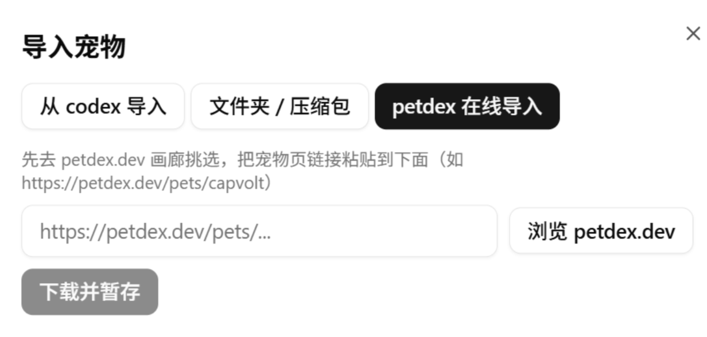

# Desktop Pet

Built-in companions live in a corner of your screen, watching sessions for you — status, usage, and voice reminders in one place. Since v0.5.8 the default is **tuvis-3D** (a 3D tech rabbit); you can switch back to **Foxbell** (the fox) any time.

## What the pet is

The default companion tuvis-3D is a 3D tech rabbit floating in a corner of your screen (Foxbell is the fox); their abilities are identical:

- **Status card overhead**: same colors, same meaning as the dashboard (red = waiting for you / yellow = running / green = finished); click the card to jump to the matching terminal;
- **Usage snippet**: hover for about half a second and a popup appears with a token-usage minibar on top of the status card (New input / Cache hit / Output / per-tool totals); after the mouse leaves there is a 2-second grace period — plenty of time to click "Details »";
- **Voice reminders**: playful nudges while waiting, cheers on completion, subtitles synced to audio length; double-click for a little chat.

## Switching built-in pets

Under "Settings → Notifications & Pet → Switch pet" the built-in list shows tuvis-3D first and Foxbell second; clicking hot-swaps the pet with no app restart. Users upgrading from earlier versions keep their previous pet choice automatically, and built-ins cannot be shadowed by an external import of the same name.

## Visibility: three switches, one state

1. The 🦊 button **next to the title-bar gear**;
2. "Show / hide pet" in the **system tray** menu;
3. The "enable pet" switch on the **Settings → Notifications & Pet** card.

All three stay in sync — any one of them turns the pet on or off.

## Launch with the app

"Settings → Notifications & Pet → Launch with the app" is **on** by default: at every launch the pet follows along — even if you hid it last time. If you would rather it stay hidden on startup, turn the switch off; for a temporary hide while running, use any of the three visibility switches above.

## Always on top

The "float above all windows" switch (in the settings page and the pet's right-click menu) decides whether the pet sits above everything; while on top it automatically suppresses notification toasts, so the two never fight.

> 💡 The right-click menu also holds sound / subtitles / gravity physics / three size tiers and more — all toggleable on the spot. Since v0.5.8 the gravity physics **defaults to off after every app restart** (re-enable per session; multi-window sync unchanged).

## Pet management

The "Notifications & Pet" card in settings holds the "current pet", "switch pet", "import pet", and "edit pet" entries. **Switch pet** is a hot swap in the pet window — no app restart; after a deletion or a switch the active pet is auto-restored.

"Import pet" opens a three-step wizard with three source tabs:

1. **Import from codex**: lists available pets under `~/.codex/pets` on this machine — check and go;
2. **Folder / archive**: pick a local pet directory or a zip package;
3. **petdex online**: browse the petdex.dev gallery first, then paste a pet page link (e.g. `https://petdex.dev/pets/capvolt`) to download and stage it.

The wizard then asks for the pet id, display name, and description, with a spritesheet preview before anything is written. Pets missing voice files degrade gracefully to animation-only; everything else keeps working.
