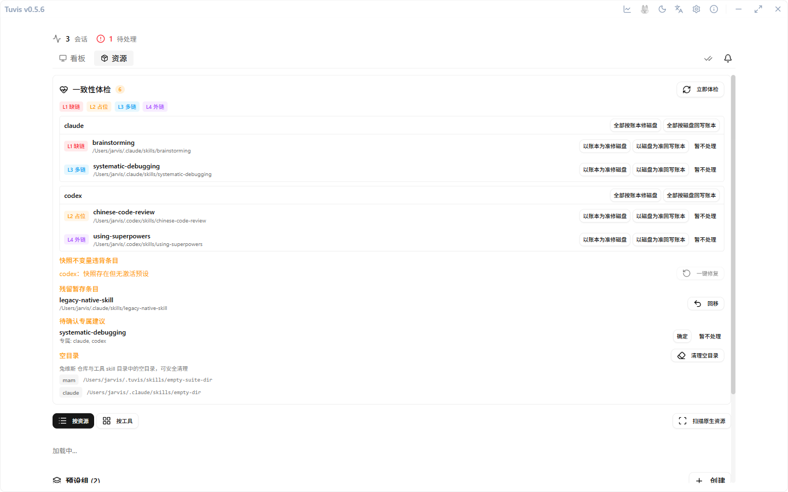

# Resource Management

One unified repository for Skills, MCP servers and plugins — one copy of a resource serves all eight tools, and a health check catches whatever goes wrong.

## Opening the resources page

On the main screen, switch from the session board to the **Resources** tab. The page offers two views — by type (Skill / MCP / plugin) and by tool; on first launch it imports skills already installed in each tool's directory (including the read-only shared source `~/.agents/skills/`), and later installs are picked up via the "Rescan" action.



## The Skill library

The global repository (SSOT) lives at `~/.tuvis/skills/`; what each tool reads is a **three-layer symlink mapping**:

```
~/.tuvis/skills/brainstorming/                  ← Layer 1: global repository
  ↓ ~/.tuvis/active/<tool>/skills/brainstorming ← Layer 2: tool-level activation
      ↓ <tool>/<sub-agent>/skills/brainstorming  ← Layer 3: sub-agent-level activation
```

- **Install / enable & disable**: install new skills on the resources page and enable or disable them per tool independently;
- **Assign to sub-agents**: tick a separate skill subset for the sub-roles of multi-agent tools (e.g. OpenCode) — sub-agent assignment is bounded by the tool-level enablement, and disabling a tool automatically cascades, breaking all of its sub-agent links;
- On Windows the links are implemented as junctions, on Unix as symlinks; dsh is read-only (it can be enabled or disabled, but nothing is ever written into its configuration).

## MCP management

After you add a server in the MCP section, Tuvis writes each tool's configuration file in its **native format**: JSON (Claude Code / Kimi Code / WorkBuddy / OpenClaw), TOML (Codex), JSONC (OpenCode), or a nested JSON subtree (ZCode's `mcp.servers` — reads and writes touch only that subtree, preserving unknown keys and key order). dsh does not support MCP configuration writes yet.

## Plugin management

The plugin section manages a mix of "files + configuration", and support varies by tool (some tools are file-only or not supported yet) — the UI states each tool's capability boundary honestly.

## Import from a manifest

Resources can be imported in bulk through an extension manifest: after validation passes they all land in the SSOT repository, then get assigned to tools as needed.

## Health check & drift handling

Manual changes on disk — by you or by other tools (extra / missing links and the like) — make the ledger and the disk **drift** apart. The "Health Check" card at the top of the Resources tab lists the differences by group, each fixable in one click:

| Group | Meaning |
| --- | --- |
| L1 missing link | The ledger says enabled, but the disk has neither link nor real directory |
| L2 placeholder | The ledger says enabled, but the disk holds a real directory of the same name |
| L3 extra link | The disk has a Tuvis link, but the ledger has no enablement record |
| L4 foreign link | The disk link points at some other target (a user-made external link) |

Items that can be repaired automatically get one-click handling; ones that cannot be handled safely (such as L4, or an L2 whose real directory content disagrees with the ledger) are honestly flagged as "needs manual handling" — your directories are never deleted silently. The **Settings → Tools & Health Check** section holds a read-only summary and a "Run health check now" entry.

> 💡 When a skill "suddenly stops working", run a health check before hunting anything else — most cases are drift caused by links being rebuilt or overwritten by hand.
