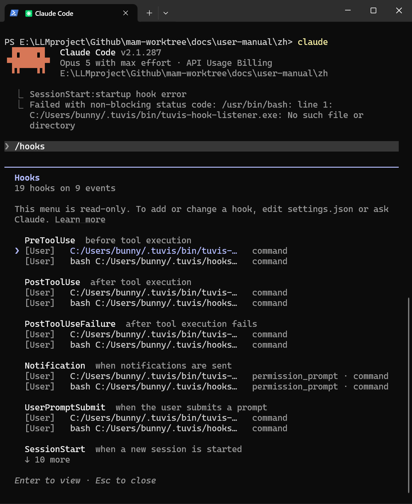

# 快速上手

四步跑通兔维斯：启用工具 → 信任 Hook → 看到第一张卡 →（可选）手机远程接入。

## 第一步：启用已安装的工具

启动兔维斯后会自动检测本机已安装的 AI 编程工具。到「设置 → 工具与体检」，把要纳入监控与管理的工具勾选启用。

## 第二步：信任 Hook 条目

Claude Code、Codex CLI、Kimi Code 支持 Hook 状态通道（状态判定更及时、更准）。兔维斯完成 Hook 注册后，需要你在**对应工具的终端里输入 `/hooks`**，找到兔维斯条目并**信任一次**；其中 Codex 另有信任门，需在 Codex 的 TUI 界面内亲自确认。

> 💡 「设置 → 信号健康度」分区可以自查每个工具的 Hook 是否真正在工作：已注册但事件窗口内无事件时，会列出待办并附一键复制的 `/hooks` 命令。OpenCode 等不支持 Hook 的工具无需此步，状态由兔维斯自行推导。

## 第三步：看到第一张卡

回到首页看板，凡是处于运行中的工具会话都会出现在卡片上。状态灯含义：

- 🔴 **红** = 等待你输入 / 待批准；
- 🟡 **黄** = 运行中 / 思考中；
- 🟢 **绿** = 已完成 / 空闲。

卡片按「等待 → 运行 → 空闲」优先级排序，点击卡片即可直接聚焦对应终端窗口。

## 第四步（可选）：手机远程接入

人离开电脑也能盯进度：开启「设置 → 远程接入」后，手机浏览器打开对应地址（以 `/m` 结尾）即可看到同源看板、收推送、回消息、远程批准。通道选择与首次配置见[第 08 章 · 手机远程接入](./08-mobile-remote.md)。