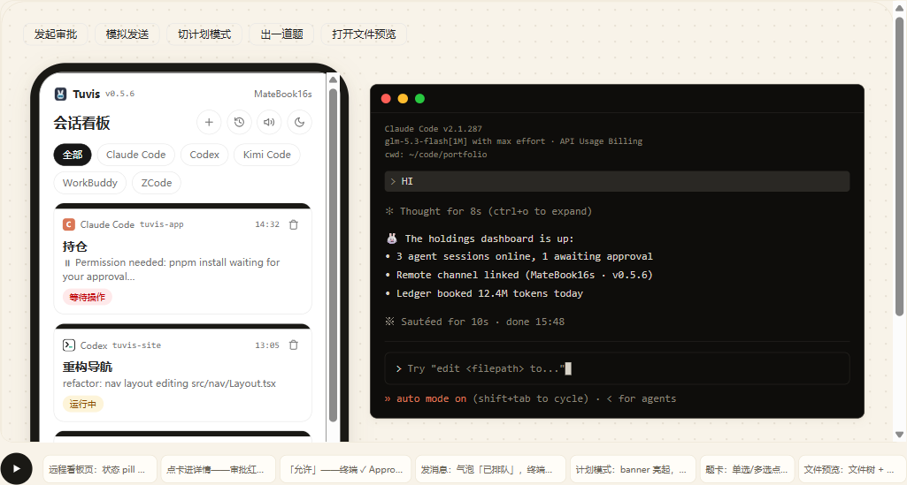

# 手机看板与远程注入

人离开电脑，看板跟着走——本章介绍如何用手机浏览器盯着八工具会话并远程回复。

## 远程接入是什么

手机看板就是把桌面端看板原样搬进手机浏览器：同源的八工具红绿灯卡片、会话详情、审批与问答。同一 WiFi 走局域网直连；跨网可用隧道——一键引导开通 Tailscale（Funnel，永久地址）或 Cloudflare 临时隧道 / 自有域名。

看板由桌面端进程直接提供（local-first）：数据不出本机、不托管第三方平台，隧道只负责转发连接。

## 开启远程接入

1. 系统托盘右键菜单勾选「远程接入」，或打开 **设置 → 远程接入**；
2. **设置 → 远程接入** 内按需开启通道（局域网连接 / 临时隧道 / 自有域名 / 外部域名（免域名），独立开关、可同时开）；
3. 地址在公网侧实测可达后才显示；已生效通道开机自动恢复；
4. 托盘菜单会直接给出形如 `http://192.168.x.x:9420/m` 的地址。

## 手机端打开看板

1. 手机浏览器打开给出的地址（**必须以 `/m` 结尾**），推荐直接扫二维码——链接已含访问密码，扫码自动填入；
2. 首次访问输入访问密码，之后 180 天免输入；免装任何 App；
3. 首次配对、改密码与设备管理（重命名 / 踢下线，上限 10 台）都在 **设置 → 远程接入**。

上图为站点交互 Demo 界面示意。

## 手机能干什么

- **看卡片**：八工具红绿灯会话卡，状态变化 2 秒级推送（横幅 + 提示音 + 振动），断流自动降级 3 秒轮询；
- **看文件**：文件面板聚合会话文件，支持预览（markdown / 代码 / 图片）与分屏切换；来源四档：「我上传的」「工具读取」「工具读写」之外还有「**会话产物**」——对话里以链接或反引号给出过路径、且文件真实存在的生成物（脚本 / 命令产出的报告、图表、数据等，md / 图片 / html / json 等可预览类型才上列表），工具亲手改写过的文件仍显示「工具读写」。相对路径的产物需要会话工作目录，**当前仅 Codex 会话**可用（Codex App 中的会话与其余七种工具暂只上墙绝对路径的产物）；三反引号代码块里的路径示例不算产物（`~~~` 围栏与缩进代码块暂不识别）；
- **审批**：工具调用批准（允许 / 拒绝）与计划确认（正文同步、数字直选）；
- **问答**：单选 / 多选、自由作答（覆盖写入 / 清空）、多题推进与切题；
- **切模式与权限档**：模式与权限档 chips 直选（kimi 为屏读确认的两段式）；
- **发消息与新建会话**（试验性，排队 / 插队 / 拉起会话）：目前覆盖 Claude Code / Codex CLI / Kimi Code / OpenCode 四家，其余如实显示不支持。

## 卡面以终端屏读为准

远程注入是「尽力而为」，漂移难免：**卡面权威源是终端屏读**——每次注入回执都带动作后的屏读快照核对，不符自动回退到终端真值；刷新 / 重开页面以快照纠偏；屏读不可用（如进程退出）时快照为空，保守维持现状。

> 🔒 地址 + 访问密码就是钥匙，请勿外传；连续输错达到上限会被锁定约 10 分钟。

> 💡 连不上九成出在这几点：路由器「AP 隔离」、地址漏了 `/m`、防火墙拦入站——详见「故障排查」一章。