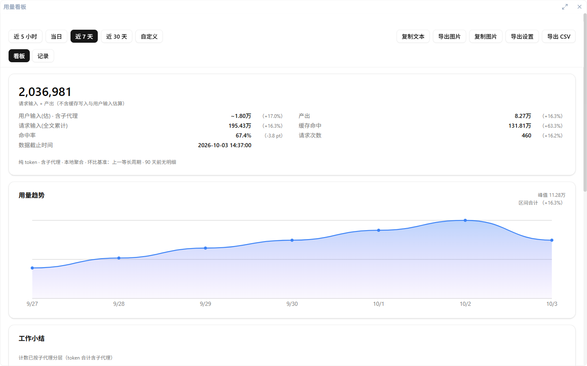

# 用量统计

每个工具各烧掉多少 token——一条账本看得清，自动采集、只读本机、无遥测。

## 用量账本

兔维斯为 Claude Code / Codex / Kimi Code / OpenCode / ZCode / WorkBuddy / dsh 七个工具统一记账（OpenClaw 暂不采集）。**只在本机读取各工具自己的会话记录汇总**，不上报任何遥测；账本存 `~/.tuvis/tuvis.db`，明细按小时桶默认保留 90 天、上限 90 天（可配），到期只留日聚合。

采集节奏：应用启动后延迟自动采一次，之后按设置间隔进行（单飞互斥 + 最小间隔兜底，不占 3 秒会话轮询）；**设置 → 用量统计** 里可随时「立即采集」，也有总开关——关闭后不采集、不落库（设置与导出仍可用，导出的是既有账本）。数字设置（迷你条工具行数 / 明细保留期 / 采集间隔）在输入过程中保留草稿，**失焦或按 Enter 后才夹取并保存**，不会边打字边改值。

## 打开大看板

主窗口**标题栏的用量按钮**打开独立的用量大看板窗口；桌宠迷你条的「详情 »」也可直达。

大看板包含：

- **Token 总览**（固定展开）：总处理 Token、新增输入、缓存命中、未缓存命中输入、输出、命中率、请求次数，带与上一等长周期的环比；原「缓存写入（解释）」块已移除，计量维度统一为「新增输入 / 缓存命中 / 输出 / 合计」；
- **用量趋势**（固定展开）：折线 + 渐变面积图，x 轴粒度随时间范围切换，右上角标峰值、悬停看精确值；卡内可按「全部 / 按工具 / 按渠道」局部筛选，峰值与环比跟随同一筛选口径，但**不影响全局总览与分布**；其中「渠道」= 供应商别名（provider 显示名，未编辑 = 原名；显式计费绑定优先；工具不参与渠道分类；未配置别名时非空 provider 按原始串聚合；「未指定渠道」与「渠道可能混合」不作为筛选选项）；
- **用量分布**（默认展开、可折叠）：按 **渠道 / 工具 / 项目 / 模型** 四维切换的占比条排行，默认 Top 5，可「显示更多」；每行 = 名称 · Token · 缓存命中率 · 相对条，不显示美元金额；同显示名跨工具合并，同名模型不再出现无法区分的重复行；空 provider 未指派时渠道维度合并为「未指定渠道」一行、模型维度按工具拆行；渠道维度另有「渠道可能混合」行（同一日志身份可能混合多个账户、无法拆分）；空模型显示「未知模型」；
- **API 等效费用**（默认展开、可折叠）：每条模型一张卡片，主行五列（渠道 / 模型 | 估价 | 总 Token | 缓存命中率 | 计费详情），默认按渠道分组、可切按模型平铺；没有全局费用总额或渠道小计（费用不是实际支出）；同一归一化模型同币种同价，不同显示渠道分行展示；卡片内展开「新增输入 / 缓存命中 / 输出 / 合计」四行 ×「项目 / Token 用量 / 金额 / 单价」四列的计费明细（合计行单价留空，缓存写仅有数据时出现），主表头与明细列头均为实体字，小字只留归一化模型与快照获取时间；卡头「同步价格」可手动强制刷新 models.dev + 人民币来源 + 当日汇率（loading / 行内状态）；表头可 USD / CNY 快捷切换（只换显示，账本与费用 CSV 仍为 USD）。**CNY 优先原生人民币价，缺失时按当日汇率换算；原生价正常显示，换算价加虚线下划线（卡头有图例）**；
- **工作活动**（默认折叠）：卡头显示会话数与工具调用次数；展开后看 turn、错误三层、用户打断、最常调用工具，p50 / 最长 turn / 工具耗时收在展开后的高级统计里；
- **导出**：复制文本 / 导出图片（分享图，含桌宠立绘）/ 导出 CSV（UTF-8 BOM，Excel 兼容，只含结构化账本列）/ **费用 CSV**（当前时间窗全部渠道 / 模型费用行，不含总计，前端不加 BOM；在既有 17 列后追加渠道键 / 渠道类型 / 显示名 / 归一化模型 / 目录发布日期 / 覆盖价标记 / 价格规则形态 7 列；`observed_provider` 单值列在合并多个原始 provider 或含未标注来源时留空，完整证据见 UI tooltip）。分享摘要已删除「用户输入(估)」，并新增「未缓存命中输入」。

时间范围五档可切，自定义起止跨度 ≤31 天。同窗口的「用量记录」页签：每工具一卡，每行 = 「供应商 / 模型」的消耗，可按工具 / 项目分组，带 实测 / 推断 / 未知 标记；**行名优先显示供应商别名**（「别名 / 原始模型」；无别名回退原始「供应商 / 模型」，原始身份保留在 title 与行数据中）；**「用量分布」的渠道 / 模型维度与「API 等效费用」行 tooltip** 展示原始 provider 证据——合并多个原始 provider 时列出完整列表，组内有非空 provider 且含未标注来源时追加「含未标注来源」提示（工具 / 项目维度不展示 provider 证据）；普通行不再出现「指定渠道 / 修改关联」，只有含糊行显示「绑定计费归属」；旧版计费归属与参考价规则收在页脚「高级」入口；行仍带「用户指定 / 日志实测 / 含糊」轻量标记；每行另有「供应商显示名」入口（已有别名时显示「编辑」），浮窗保存前可预览该规则近 30 天的命中工具、模型与 Token 合计。**设置 → 用量统计 → 显示与计价配置** 与「自定义价格规则」放在**同一个弹窗**（费用卡「管理配置」直接打开同一弹窗）：设置页与 D 卡共用，弹窗上半是供应商/模型条目，下半是可折叠的自定义价格规则（默认收起）；设置页与 D 卡是两个 WebView，设置页修改后已打开的用量看板不保证立即刷新，看板内配置是主路径。条目默认按最近 7 天 Token 用量显示前 10，可按用量 / 原始供应商名 / 原始模型名排序（同键切换升降序），底部可展开全部并搜索；每条三行——原始身份（只读）、供应商名 + 模型名（都可编辑：供应商名对同一原始 provider 全局生效，空 provider 条目写 toolModel 别名；模型名按（显示供应商, 原始模型）批量生效）、计价身份（仅下拉 / 搜索选择）。高级区「自定义价格规则」支持固定价或分时价（可选 USD/CNY 计价币种）；计费归属绑定 / 参考价规则是旧版能力，入口已移至「用量看板 → 记录」页页脚的「高级」入口。每个高级选项旁有 Info 图标，hover/focus 显示说明；每条模型有「设置自定义价格 / 编辑自定义价格」快捷入口，自动预填原始模型名（保存时后端归一化），已有规则显示「已应用自定义价格」徽标。**定价目录状态** 仍在设置页，可启用 / 刷新 models.dev 公开价目，失败沿用最后有效快照。

## 供应商显示名（别名）与自动定价

- **渠道显示名**：渠道 = 供应商别名。非空 provider 按原始串精确映射到别名，未编辑 = 原名；不同原始串可映射到同一显示名并跨工具合并；显式计费绑定优先级最高；别名只影响展示与分组，不回写账本，也不改变 Token 口径。**未配置别名时，非空 provider 按原始串聚合**。记录页行名优先显示供应商别名（原始「供应商 / 模型」保留在 title 与行数据中）；别名同时体现在「用量趋势」筛选项、「用量分布」「API 等效费用」、配置弹窗与别名浮窗中；「用量分布」的渠道 / 模型维度与「API 等效费用」行 tooltip 展示原始 provider 证据——合并多个原始 provider 时列出完整列表，组内有非空 provider 且含未标注来源时追加「含未标注来源」提示（工具 / 项目维度不展示 provider 证据）。
- **空 provider**：不设自动规则，按「工具 + 原始模型」逐条设置别名，保存后回溯生效；未指派时渠道维度显示「未指定渠道」（合成一行）、模型维度按工具拆行；空模型显示「未知模型」。
- **供应商名与自定义模型名**：配置弹窗的供应商/模型条目段可同时编辑供应商名与模型名。供应商名对同一原始 provider 全局生效（空 provider 条目写 toolModel 别名，未命名 = 未指定渠道）；模型名可一键复制原名、可清除回原名，显示名键 =（显示供应商, 原始模型），同一展示键的多个原始来源一起改名；自定义模型名只应用在 D 卡行名上（C 分布与记录页仍显示原始模型名；记录页的供应商部分会显示别名）。
- **计价身份**：可为模型条目显式指定目录 provider / model——仅下拉 / 搜索选择，无自由输入，避免非法键；默认显示精选自动匹配结果，可覆盖、可清除；优先级低于自定义价格规则与参考价规则、高于自动匹配。
- **已知限制**：两个订阅在日志中的原始 provider 串完全相同时，别名无法把它们拆开，渠道会合并；只能靠含糊行的「绑定计费归属」或页脚「高级」入口（显式计费绑定），不按 Token 比例拆账。
- **自动匹配（精选来源）**：仅使用 models.dev 公开价目（不内置种子价），精选来源按「直营官方（含中国站变体）> OpenRouter」取价，四价全 0 的条目跳过；模型 ID 机械归一化后精确匹配，层内按 `release_date` 最新去重后同币种同价；精确未命中时前缀回退仅在唯一，或命中多个候选但价格完全一致时采用；跨模型族替代须显式指定参考模型。多模态 / 上下文阶梯等条件价按基础文本价估算，并在不准确原因里标注；缺价仍显示 `—`，不显示 0。精选未命中的模型默认未估价，可在计价身份里显式选择目录条目（目录搜索默认精选，可开「显示全部 N 个来源」查看全部来源）。
- **费用计算粒度**：近 7 天 / 近 30 天 / 自定义（≤31 天）的费用按小时明细按日聚合计算，dsh 也能按输入 / 缓存命中 / 输出全量计价；存在分时规则时按小时判定峰谷后再汇总，分时行单价为加权平均。明细保留期调低或清理导致范围内缺明细时，该时间段**整体回退日聚合**（dsh 仅按输出计价；分时规则按低谷价估算并标注）；近 5 小时 / 当日与计费渠道预览不变。
- **刷新与核对**：默认每日刷新、可手动刷新（D 卡「同步价格」可强制刷新 models.dev + 人民币来源 + 当日汇率）；失败沿用最后有效快照，并显示数据源与快照日期；D 卡行展开的小字可核对归一化模型与快照获取时间。**模型发布日不是价格日期**——目录条目的发布日只用于同名去重，估价始终采用快照获取时刻的价格。
- **自定义价格规则（固定价 / 分时价）**：在配置弹窗「自定义价格规则」里按**归一化模型名**设置价格。固定价直接覆盖输入 / 缓存读 / 缓存写 / 输出四价（USD / CNY，按所选币种存储；显示另一币种时按当日汇率换算并加虚线下划线）。开启分时价后，周一至周五的高峰窗口（可多个、可跨午夜、只支持整点）使用高峰四价，其余时间（含周末）使用低谷四价；低谷留空的分量回退目录报价；时区可选上海 / UTC / 系统本地，只影响 API 计费峰谷计算；可用「按高峰 × %」快捷填充低谷价。**不需要写供应商**；自定义显示名不参与匹配；保存后所有渠道的同名模型共用；它不在计价身份或参考价规则里选择。列表展示目录来源、发布日期与快照日期；后续价目同步不会覆盖用户值；日聚合回退时整段按低谷价估算并在不准确原因里标注。

## 迷你条

悬停桌宠约半秒出现的浮窗即迷你条（宠物右键「今日用量」可唤回）：5 行指标行序钉死（新增输入 + 命中率 / 缓存命中 + 输出 / 四桶明细 / 报错 / 最长单 turn），时间档（当日 / 近 5 小时 / 近 7 天）与工具行数（1–7）随设置联动，尾部「详情 »」直达大看板；**设置 → 用量统计** 的「今日口径」与之同源。

## 采集口径速览

- **四桶** = 未缓存输入 / 缓存读 / 缓存写 / 输出；命中率由缓存语义（互斥 / 包含 / 仅总量）派生，拿不准时按互斥——宁可命中率偏低，不静默多算；
- **总处理 Token = 新增输入 + 输出**；**未缓存命中输入 = 新增输入 − 缓存命中**（本期与上期同公式；「新增输入」即账本 requestTotal，口径不变、仅界面措辞统一）；
- **含子代理**：token 总量包含子代理用量；turn 数不跨工具合计；
- **不可得显示 `—` 而非 0**：部分指标仅部分工具可得；V2 已从看板与分享摘要删除「用户输入(估)」（它不是 API Token），账本字段与 Token CSV 原始列保留兼容；
- **隐私**：界面与 CSV 只出现结构化数字与工具 / 模型 / 项目 / 会话标题，无 prompt 原文，无代码内容。

> 💡 某列显示 `—` 不是故障，是该口径下真值不可得；命中率超过常识时多半是缓存语义误判，反馈时请附工具版本号。